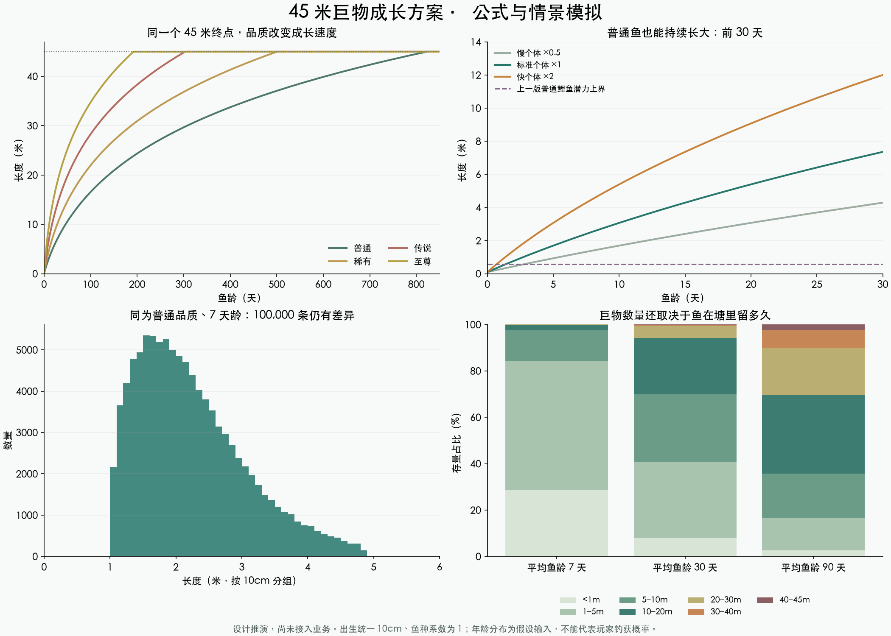

# 45 米巨物成长重设计

日期：2026-11-01。状态：候选设计与可复现模拟已完成，未替换业务算法、未部署。此前“鱼种限制最终体型”的代码仍在；本方案改变设计方向。

## 希望玩家感受到什么

上班时放着不管，偶尔收到一条鱼。普通鱼能带来小收获；尺寸明显刷新纪录时有惊喜；任何鱼种都可能成为 45 米的传说。成长、等待、收杆和再次抛竿全部自动完成。

**所有鱼的长度上限统一为 45 米。鱼种影响出生体型与少量速度差异；品质影响成长效率；个体影响成长速度。三者都不再降低最终上限。** 普通泥鳅可以长成巨物，品质也不会因为长大自动升级。

## 一、成长怎么计算

### 先确定出生长度和固定速度

- 出生长度：`clamp(鱼种参考体型 × U(0.08, 0.18), 0.02m, 0.25m)`，出生后保存，不重复抽取。
- 鱼种速度系数：`clamp((鱼种参考体型 / 0.9m)^0.12, 0.85, 1.15)`。物种差异有限，小鱼种仍能追上大鱼种。
- 品质速度系数：普通 0.70、优良 0.90、稀有 1.15、史诗 1.50、传说 1.90、神话 2.40、至尊 3.00。
- 个体速度：对数正态分布，`ln(v) ~ N(-0.125, 0.5²)`，拒绝重抽区间外值，限制在 0.4–2.5；用实体 ID 派生并固定。多数接近正常速度，少量明显快或慢，不能每个 tick 重抽。
- 第一版不增加随机觉醒、喂养或每日操作任务，差异来自鱼自身的属性和存活时间。

### 长大需要越来越多时间

设 `x = 当前长度 - 出生长度`，单位为米：

```
成长消耗 G(x) = 2x + 0.12x² + 0.00006x⁴
累计进度 P = 鱼龄（天）× 品质系数 × 鱼种系数 × 个体速度
求出 G(x) = P 对应的 x
长度 = min(45m, 出生长度 + x)
```

`G(x)` 始终递增，可用二分求解。其导数 `2 + 0.24x + 0.00024x³` 越来越大，所以同样过一天，体长增加越来越少。45 米是有限时间可达到的硬上限，不再设置 0.2、0.35、0.8 米等品质终点。

按出生 10cm、鱼种系数与个体速度均为 1，得到下表。它是**单条鱼持续留在塘中的成长时间**，不是玩家游玩这么久就能钓到的承诺：

| 长度 | 普通鱼 | 至尊鱼 |
| --- | ---: | ---: |
| 1m | 2.7 天 | 0.6 天 |
| 5m | 18.2 天 | 4.2 天 |
| 10m | 45.9 天 | 10.7 天 |
| 20m | 138.2 天 | 32.2 天 |
| 30m | 307.2 天 | 71.7 天 |
| 40m | 604.2 天 | 141.0 天 |
| 45m | 822.3 天 | 191.9 天 |

同样条件下，速度为 2.5 的至尊鱼约 76.7 天到达 45m；普通鱼也能到达，只是通常需要更久。45m 定位为长期世界纪录，1m、5m、10m、20m 都是独立的惊喜阶段。全局节奏以后可统一调整速度，而不修改上限或破坏个体排序。

时间按现实经过计算，不要求玩家在线。正常自然成长以出生状态和绝对鱼龄重算，重复 tick 不叠加奖励。当前长度取已保存长度与自然目标的较大值，避免已有额外成长倒退。达到 45m 后保持 45m。

## 二、如何避免所有鱼最后又一样大

同一个终点无法单独保证多样性。如果所有鱼都永远存活，足够久后一定会全部到 45m。因此成长曲线要与鱼塘更新一起设计。

1. **个体速度连续分布。** 同种、同品质、同龄也有不同长度，不再只按品质分成几个桶。
2. **初始鱼塘有不同年龄。** 建塘时大部分鱼为 0–7 天，少量为 7–60 天；每塘额外保留 1 条 180–360 天的原生老鱼，计入总容量，品质按塘配置抽取。世界在玩家进入前已存在，开服无需等几个月才能出现大鱼；老鱼也不保证是 45m。
3. **补鱼通常从幼鱼开始。** 不在每次补鱼时直接塞入 45m 奖励鱼。
4. **无人鱼塘也有自然更替。** 候选参数为每鱼每天 1% 迁出、以幼鱼等量补位，独立于玩家数量；被锁定的咬钩鱼暂不参与。不能将“迁出”只实现为同塘换钓点，否则无法改变年龄结构。此为新增生态机制，当前模拟没有实现它。
5. **脱钩不再按体长复利。** 现行每次 +2% 会让巨物在多次脱钩后绕过漫长成长。候选替代为每次增加 30 分钟等效鱼龄，每鱼每日最多 2 小时；实现时需要持久化奖励与日预算，离线重放不能重复发放。

自然更替只保持水体更新，不针对大鱼强制删除，也不修改玩家已经钓到的鱼。迁出的老鱼可写入塘史；未来若扩展跨塘迁移，再保留其实体身份。

## 三、模拟看到了什么



可复现设置：每组 100,000 条鱼，随机种子 451101；统一从 10cm 出生、鱼种系数为 1；个体速度按上述分布生成。混合品质场景使用参考权重 38/28/18/9/4/2/1，不代表每个现有鱼塘的实际品质结构。

同为普通品质的鱼：

| 鱼龄 | 中位长度 | 中间 80% 的长度范围 |
| --- | ---: | ---: |
| 1 天 | 41.2cm | 28.2–65.1cm |
| 7 天 | 2.09m | 1.30–3.42m |
| 30 天 | 6.84m | 4.46–10.43m |
| 90 天 | 14.6m | 10.2–20.6m |

7 天样本有 3,814 个不同的保存长度，按当前单位与小数位规则显示后为 383 种。不能把保存精度对应的种类数直接当作玩家可见种类数。

另假设塘内鱼龄分别服从平均值 7、30、90 天的指数分布，观察存量尺寸。**这些平均鱼龄是输入假设，不是从当前捕捞/补鱼代码推算的结果，更不是玩家钓获概率。**

| 假设平均鱼龄 | ≥10m | ≥20m | ≥40m | 恰好达到 45m |
| --- | ---: | ---: | ---: | ---: |
| 7 天 | 2.492% | 0.071% | 本次未观察到 | 本次未观察到 |
| 30 天 | 30.075% | 5.693% | 0.067% | 0.020% |
| 90 天 | 64.255% | 30.223% | 2.386% | 1.013% |

可以看到，鱼留得越久，巨物越多；曲线本身不能承诺巨物出率。未观察到不等于概率为零。每次调参都应分别看出生分布、塘内存量、咬钩对象和最终钓获，不能混用四种口径。

## 四、要让巨物带来喜悦，还要配套什么

以下是配套候选参数，**未做完整会话/生态/经济验证，不能当作现行表现**。

### 等待漫长，咬钩后有收获

建议把主要等待放在浮漂阶段。进入咬钩阶段后自动收杆、自动结算、自动再抛，不要求点击确认。不因未查看结果阻塞下一轮；离线结果入账，回来看一次汇总。

- 普通收获：初步体验目标为成功钓获间隔平均 40–80 分钟；这是长时间平均目标，不是每隔固定分钟发一条鱼，也不是已测结果。
- 品质稀有度：尽量只在选鱼时体现一次，避免稀有品质先抽不到、再被极低咬钩率重复压低。当前按品质抽候选后又按品质设置咬钩率，此路径应在会话模拟中一起校准。
- 长度咬钩系数候选：`0.65 + 0.35 × (1 - exp(-L/2))`，使小鱼也有机会咬钩；不再用 `L/45` 让所有常见小鱼长期处于最低档。它是乘数，不是完整概率。
- 基础脱钩率候选：`5% + 25% × (L/45)^0.7`，45m 基础脱钩率为 30%，之后再应用有边界的渔具与个体修正。
- 自动收杆时长候选：`30秒 + 870秒 × (L/45)^0.65`，最大约 15 分钟。当前 40m 附近的基础脱钩率约 98.5%、收杆约 2 小时，直接沿用会削弱巨物收获感。
- 基础钓组提供持续挂机兜底，缺耗材或损坏不应让用户不知情地永久停钓。

### 巨物值钱，但避免破坏经济

当前展示体重默认按 `12 × L³` 计算，45m 会显示为 1,093,500kg。候选处理是保留幻想体重用于图鉴和纪录，并检查大重量单位；出售与回鱼奖励不要直接按吨数线性给钱。

售价尺寸加成可先试验 `1 + 2×ln(1 + L/0.5)`，再乘品质基础价，45m 加成约 10.02 倍。该式仅为受控的候选经济曲线，完整收入、回鱼收益及装备耐久仍须闭环模拟后确定。背包、分享、图鉴和排行榜继续记录真实长度，不把它压缩成几个“大中小”档。

## 五、显示与存量

- 不足 1m：厘米，保留 1 位小数，如 28.2cm；1–<10m：米，保留 2 位，如 2.09m；≥10m：米，保留 1 位，如 14.6m。
- 体长仍按米保存、精度 0.001m。44.95m 可能显示为 45.0m；“达到 45m”成就按保存值是否真的等于 45 判定，不按显示字符串判定。
- 上线时所有活塘鱼保留品质、出生时间和当前尺寸，推导固定速度；切换当天不缩短已获得的尺寸。已有超过 45m 的历史记录保留，不通过迁移删除纪录；新自然成长不再新增超过 45m 的鱼。
- 新迁移需使用新版本键，不能复用上一版 `INDIVIDUAL_FISH_GROWTH_V1`；还需停用旧的按尺寸升品路径。背包和历史记录不跟随塘鱼自然成长。

## 六、实施与验证顺序

1. 将 45m 成长、出生尺寸和固定速度接入 shared；将原“个体潜力上限”接口改为共同上限，逐个检查咬钩归一化、回鱼、调试生成及旧脚本。
2. 增加高龄原生鱼初始化、自然迁出与幼鱼补位，验证离线补算、重启、重复 tick 不重抽、不重复奖励。
3. 把咬钩频率、脱钩率和自动收杆接入完整会话模拟；验证活跃/低活跃/无人塘，以及不同装备，不能只看成长公式。
4. 验证玩家 8 小时挂机的成功数分布、最长无收获时间、巨物成功捕获占比和金币收入；不以塘内大鱼占比代替捕获占比。
5. 验证数月无人塘的最终分布和 45m 聚集程度；再确认经济、耐久与回鱼奖励，完成一次性迁移与客户端回归。

本次已验证模拟长度不下降、不越过 45m、出生值准确、各长度里程碑可反求；完整业务未切换。自然更替、配套会话概率和经济仍为实施项，不声称已经通过线上验证。

桌面与手机浏览器预览均已检查：图表加载正常，无页面脚本错误或横向溢出；旧的预览选择记录能打开新方案。截图与浏览器检查汇总在 `/Users/red/Desktop/fish/output/growth-45m-design/`。

复现：`fish-growth-45m-2026-11-01/simulate.py`（需 numpy、matplotlib）。原始汇总：同目录 `simulation.json`。总预览稳定路由仍为 `现行预览.html#fish-growth`。
