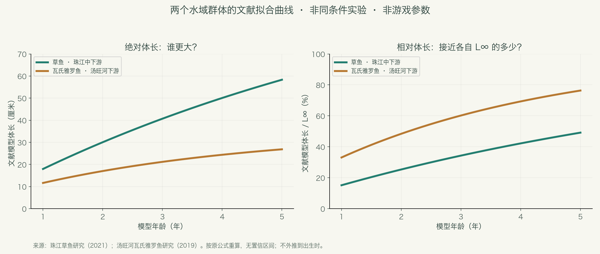
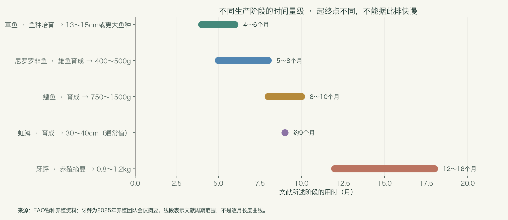

# 鱼类百科：先认识真实的鱼，再决定游戏的成长

2026年11月3日 · 面向非专业读者的资料手册 · 第一版

这份手册围绕项目已有的50个鱼类条目展开，补充鱼类分类、生活习性、出生与幼鱼尺寸、成长、成熟、寿命和鱼塘生态知识。它是生物学参考资料，不是新的游戏数值方案。

**先记住三个结论：鱼种决定基本体型和生活方式；同种鱼的成长也会不同；鱼长大、鱼性成熟、鱼到达最大尺寸，是三件不同的事。**

阅读顺序建议：先看第1～4章建立概念，再看第5～7章的数据与鱼种，最后看第8～10章，联系你的鱼塘设计。全文的数字均区分研究观测、文献模型、养殖实例和数据库记录，不把它们混成统一成长表。

## 1. 鱼到底如何分类？

### 1.1 先分清“亲缘关系”和“生活方式”

“鲤形目”“鲇形目”“鲑科”讲的是亲缘关系；“淡水鱼”“冷水鱼”“肉食鱼”“底层鱼”讲的是生活方式。这几种标签可以同时出现在一条鱼身上。

入门时，可以把现生鱼类理解为下面几大支。这里是便于阅读的简化谱系，不把传统的“鱼类”当作现代分类中严格的单一分支。

| 大类 | 常见例子 | 认识重点 |
| --- | --- | --- |
| 无颌类 | 七鳃鳗、盲鳗 | 与鲤鱼、鲈鱼的亲缘关系相距很远 |
| 软骨鱼类 | 鲨、鳐、银鲛 | 不能因为都叫“鱼”，就套用池塘鲤鱼的生活史 |
| 辐鳍鱼类 | 鲤、鲫、鳜、鲑、鲟、鳗等 | 项目中的鱼主要属于这一大支 |
| 肉鳍鱼类中的现生鱼 | 肺鱼、腔棘鱼 | 不是项目当前主要涉及的鱼类 |

鲟鱼的骨骼以软骨为主，但它属于辐鳍鱼，不能据此归入鲨鱼所在的软骨鱼类。名称和单一外形特征都不能代替分类。[分类入门：佛罗里达自然历史博物馆](https://www.floridamuseum.ufl.edu/discover-fish/fish/fish-groups/)；[鲟类骨骼的例外：OpenStax](https://openstax.org/books/biology-2e/pages/29-2-fishes)。

### 1.2 对理解鱼塘最有帮助的六种分类

| 分类维度 | 可以怎样分 | 为什么有用 |
| --- | --- | --- |
| 水域 | 淡水、海水、河口，以及跨水域生活 | 中华鲟和鳗鲡不能只用一个封闭淡水塘来解释完整生活史 |
| 温度 | 偏冷水、温水、偏暖水 | 虹鳟和罗非鱼不会在同一水温下都表现最好 |
| 食性 | 植物、浮游生物、底栖动物、鱼虾、杂食 | 同一份窝料不应被理解为所有鱼同等吃到的营养 |
| 活动位置 | 表层、中上层、中下层、近底层 | 影响在哪里遇见鱼，也影响鱼能吃到什么 |
| 体形 | 纺锤形、侧扁高体形、鳗形、带形、平扁形 | 同样长50厘米，重量与视觉体量可能差很多 |
| 生活史 | 较早成熟、较晚成熟；定居、季节移动、洄游 | 决定“老鱼”“大鱼”“稀少”分别意味着什么 |

这些是阅读工具，不是互斥的抽屉。鱼的活动层、食物和栖息地可能随着年龄、季节与昼夜变化。

## 2. 一条鱼从出生到变老，会经历什么？

| 阶段 | 用简单的话解释 | 对尺寸的意义 |
| --- | --- | --- |
| 受精卵 | 尚未孵出 | 卵径不是鱼长 |
| 初孵仔鱼 | 刚孵化，可能仍依靠卵黄囊 | 很多鱼只有毫米级；物种间差异很大 |
| 开口与仔鱼发育 | 开始从外界摄食，器官持续发育 | 食物颗粒必须小到能够吞下 |
| 稚鱼、幼鱼与鱼种培育 | 越来越像成鱼，但通常尚未性成熟 | 养殖中“鱼苗”“夏花”“鱼种”不是同一个规格 |
| 性成熟 | 具备繁殖能力 | 不表示已经达到最大体型 |
| 较大、较老的个体 | 可能继续缓慢增长，也可能因环境而停滞 | 年龄不能单独决定尺寸；更不保证长成纪录鱼 |

这些阶段没有一套适用于所有鱼的统一厘米分界。“幼鱼”也不是一个可以直接换算为固定鱼龄的词。

### 2.1 4厘米通常是“投放时的幼鱼”，不是真正的出生尺寸

以鳜鱼为例，FAO资料记录：初孵约**4毫米**；培育到约1.5厘米需要一个育苗阶段，随后再经池塘育苗达到**3～5厘米**。因此，把一条4厘米的鳜鱼称为“刚孵化”，会把已经发生的一段成长抹掉。真实育苗有阶段衔接，不能把不同阶段的日数随意当成同一个起点。[FAO鳜鱼资料](https://www.fao.org/fishery/docs/DOCUMENT/aquaculture/CulturedSpecies/file/en/en_mandarinfish.htm)。

草鱼也有不同规格：FAO实例中，育苗2～3周可到约3厘米，之后还会继续培育较大的鱼种。4厘米对草鱼只是很早的一段，对泥鳅等较小的鱼则已占更大比例。[FAO草鱼资料](https://www.fao.org/fishery/docs/DOCUMENT/aquaculture/CulturedSpecies/file/en/en_grasscarp.htm)。

**联系项目：统一4厘米可以作为简化的“初始投放规格”。若保留“出生体长”字段，需明确它是游戏出生设定，还是现实孵化体长。**两者都能做，但含义应一致。这是概念说明，暂不改变已讨论的4厘米设定。

## 3. 看鱼的数字，先问清楚口径

### 3.1 “常见”“最大”“成熟”是不同的数字

| 名称 | 它回答的问题 | 不能怎样用 |
| --- | --- | --- |
| 某次调查的平均体长 | 这批被采到的鱼平均多长？ | 不能直接当作所有成鱼的平均长度 |
| 数据库的常见长度 | 资料中常被提及的一种代表长度 | 未必是严格统计的均值，也未必仅包含成鱼 |
| 养殖上市规格 | 养殖者通常在什么规格收获？ | 不等于生物学上限 |
| 初次成熟体长、成熟年龄 | 何时开始具备繁殖能力？ | 不等于停止成长 |
| 最大记录 | 曾有资料报告到多大？ | 不等于每条鱼都能达到，更不能作为鱼塘常态 |
| 渐近体长 L∞ | 模型拟合时趋近的长度参数 | 不等于绝对硬上限，也不是已经观测到的纪录 |

例如，赤点石斑鱼数据库的常见长度约30厘米、最大记录58厘米。不能据此说“正常鱼都在30～58厘米之间”，更不能用58厘米代表全部石斑鱼。[FishBase赤点石斑鱼](https://www.fishbase.se/summary/Epinephelus_akaara.html)。

### 3.2 全长、体长、叉长不能直接混用

| 标记 | 常用含义 | 测到哪里 |
| --- | --- | --- |
| TL | 全长 | 吻端到尾鳍最末端，具体尾鳍摆放方式还需看测量规范 |
| SL | 标准体长 | 吻端到尾鳍基部附近，不包括尾鳍长度 |
| FL | 叉长 | 吻端到分叉尾鳍的凹口 |
| 中文“体长” | 要看论文方法 | 不能仅凭中文词就自动等同于TL或SL |

本文保留资料原有标记。没有可靠换算关系时，不把SL、FL硬转成TL；没有说明的口径就明确保留不确定性。

### 3.3 时间也有不同起点

“出生后8个月”“投放鱼种后8个月”“一个生长季”“1+龄”，并不是同一件事。养殖资料常从投苗或转入育成阶段起算。冬龄、周年龄和按世代划分的年龄组也需要看研究方法。下文的养殖周期不用于直接倒推出生日期。

## 4. 真实的鱼为什么会长得不一样？

### 4.1 不同鱼种：体型潜力和成长节奏是两条轴

一条鱼可以最终很大，但需要较长时间；另一条鱼可以很早成熟，却始终保持较小体型。“一天增加几厘米”“一年增加几公斤”“达到自身最终体型的百分比”，得到的快慢排名可能不同。

很多鱼的体长成长可以用逐渐趋缓的曲线近似；但初孵仔鱼的发育、季节性变化和体重成长不一定都符合“从出生第一秒开始速度就递减”。模型要匹配生活阶段。加拿大渔业与海洋部的研究方法资料同时讨论了多种成长模型，并强调食物、温度会显著改变成长。[DFO生长模型说明](https://www.dfo-mpo.gc.ca/science/species-especes/otoliths/methods/analysis-eng.html)。

### 4.2 同一鱼种：同一天出生，也不会整齐地长大

| 差异来源 | 会出现什么现象 |
| --- | --- |
| 遗传与品系 | 某些个体或选育群体成长较快，但不能直接换算成固定品质等级 |
| 性别 | 可能有成长与成熟时间差异；差异方向和大小依鱼种而异 |
| 实际吃到的食物 | 强势个体可能吃得更多，弱势个体即使身边有饵也未必摄入 |
| 水温与溶氧经历 | 同龄鱼在不同水域可能得到不同的有效生长时间 |
| 密度与竞争 | 数量过多可能使平均摄食量下降，成长停滞或差异扩大 |
| 疾病、损伤与应激 | 活着不等于持续良好生长 |

现实实例：FAO日本鳗鲡养殖资料明确提到个体成长差异明显，需要定期分级；真鲷的长期选育研究也发现选择能够改变群体成长表现。因此，现实没有一个通用结论说“同种同龄个体只能相差±15%”。这个范围需要具体群体数据，或由游戏自行定义。[FAO日本鳗鲡](https://www.fao.org/fishery/docs/DOCUMENT/aquaculture/CulturedSpecies/file/en/en_japaneseeel.htm)；[真鲷选育原始研究，1996](https://www.jstage.jst.go.jp/article/fishsci1994/62/6/62_6_845/_article/-char/en)。

### 4.3 食性也会随年龄改变

草鱼成鱼偏植物性，不代表初孵阶段就能吃草叶；青鱼成鱼善于摄食软体动物，也不是出生就能咬开大螺。鲤鱼是杂食性，不能因为吃谷物饵就归为严格草食。鳜鱼很早就会捕食其他鱼苗，和温和吃草的形象完全不同。[FAO草鱼](https://www.fao.org/fishery/docs/DOCUMENT/aquaculture/CulturedSpecies/file/en/en_grasscarp.htm)、[FAO鲤鱼](https://www.fao.org/fishery/docs/CDrom/aquaculture/I1129m/file/en/en_commoncarp.htm)、[加拿大DFO青鱼](https://www.dfo-mpo.gc.ca/species-especes/profiles-profils/blackcarp-carpenoire-eng.html)。

## 5. 用真实研究看成长：大不等于“相对长得快”

这里选择两项中国水域研究，按论文提供的公式重新计算曲线。**它们是特定群体的拟合模型，不是每条鱼的实测轨迹，也不是项目的新参数。**

| 对象 | 调查范围 | 论文的体长模型，单位毫米 |
| --- | --- | --- |
| 草鱼 | 珠江中下游，2019～2020年 | L(t)=1187×[1−exp(−0.128×(t+0.282))] |
| 瓦氏雅罗鱼 | 汤旺河下游，2017～2018年 | L(t)=351.75×[1−exp(−0.26×(t+0.5448))] |

草鱼研究样本涉及0+～5+龄。图只展示1～5年的模型计算窗口，不向出生时外推；雅罗鱼使用相同窗口只是便于阅读，不声称各年龄点都有等量实测样本。两篇论文的采样、拟合方法及体长口径应分别理解，不能把这两条线当作控制了环境的鱼种实验。

{{GROWTH_TABLE}}

左图回答“同样一个模型年龄，体长是多少”；右图回答“达到各自模型渐近长度的多少”。草鱼在这两个群体模型中绝对长度更大；雅罗鱼则更早接近自己的较小渐近长度。**所以，不能只给鱼种一个“快/慢”标签，还应区分最终体型与接近最终体型的节奏。**图中没有置信区间；小数只是公式计算精度，不表示测量精度。

来源：[《珠江中下游草鱼渔业生物学特征研究》，2021](https://www.schinafish.cn/cn/article/Y2021/I5/110)；[《汤旺河下游瓦氏雅罗鱼的生长特征与资源合理利用》，2019](https://xuebao.dlou.edu.cn/article/2019/2095-1388/201906010.html)。

## 6. 养殖资料里的时间尺度：通常是月和年

下面是不同资料的实例，起点、终点、温度和养殖条件均不同，**用于建立时间尺度，不能用来给鱼种排成长速度名次**。

| 对象 | 文献中的周期 | 达到的规格 | 适用口径 |
| --- | --- | --- | --- |
| 尼罗罗非鱼 | 5～8个月 | 400～500克 | 雄鱼育成实例；随水温而变，从养殖投放阶段起算 |
| 鳙鱼 | 8～10个月 | 750～1500克 | 中国育成实例，非出生至生理上限 |
| 虹鳟 | 通常约9个月 | 30～40厘米 | 育成到一种上市规格；不同市场与环境可更久 |
| 草鱼 | 4～6个月 | 约13～15厘米或更大的鱼种 | 鱼种培育阶段，不是长成大型成鱼 |
| 鳜鱼 | 第一年；第二年 | 约400～600克；1～1.5公斤 | FAO描述的年级成长量级，并非所有野生个体必达 |

鲤鱼更能说明环境差异：FAO给出的实例是，热带、亚热带混养塘一个养殖季可达0.6～1.0公斤；温带达到1～2公斤可能需要2～4个养殖季。“同一物种，一年必须长到多少厘米”并不是普遍规律。

来源：[罗非鱼](https://www.fao.org/fishery/docs/DOCUMENT/aquaculture/CulturedSpecies/file/en/en_niletilapia.htm)、[鳙鱼](https://www.fao.org/fishery/docs/DOCUMENT/aquaculture/CulturedSpecies/file/en/en_bigheadcarp.htm)、[虹鳟](https://www.fao.org/fishery/docs/DOCUMENT/aquaculture/CulturedSpecies/file/en/en_rainbowtrout.htm)、[草鱼](https://www.fao.org/fishery/docs/DOCUMENT/aquaculture/CulturedSpecies/file/en/en_grasscarp.htm)、[鳜鱼](https://www.fao.org/fishery/docs/DOCUMENT/aquaculture/CulturedSpecies/file/en/en_mandarinfish.htm)、[鲤鱼](https://www.fao.org/fishery/docs/CDrom/aquaculture/I1129m/file/en/en_commoncarp.htm)。这些FAO资料是历史养殖实例，本文不把其中旧产业统计或旧繁育技术进展当作今天的现状。

## 7. 项目50个条目的鱼类索引与重点物种档案

每个条目保留项目的中文名称和ID。**“重点档案”有本次核对的物种资料；“分类索引”用于确认对象与查阅方向，不伪造缺少依据的逐龄长度、寿命或出生尺寸。**泛称和别名会单独说明。项目自身的典型长度配置只作为项目字段显示，绝不作为现实数据。

先辨认三组容易重复或混淆的名字：

- **团头鲂与武昌鱼**：通常是同一物种的两个名字。可以在游戏中保留不同条目，但不能据此声称是两个生物学物种。[NCBI物种条目](https://www.ncbi.nlm.nih.gov/Taxonomy/Browser/wwwtax.cgi?id=75352)。
- **鳊鱼与长春鳊**：长春鳊可指鳊属的Parabramis pekinensis，项目“鳊鱼”若也指该物种，就可能再次重复；地方俗名又会扩大“鳊鱼”的范围，需明确。[长春鳊群体比较原始研究，2025](https://xuebao.dlou.edu.cn/article/2025/2095-1388/202501015.html)。
- **锦鲤与鲤鱼、巨青与青鱼**：前者是观赏品种条目，后者是大型个体称呼，不应仅凭名字各自发明一套新物种的生物学极限。[FAO鲤鱼与观赏选育说明](https://www.fao.org/fishery/docs/CDrom/aquaculture/I1129m/file/en/en_commoncarp.htm)。

{{SPECIES_CARDS}}

## 8. 成熟、寿命和“越老越大”的常见误解

### 8.1 性成熟很早，不等于很快长到上限

尼罗罗非鱼在适宜池塘条件下可于约5～6个月性成熟；中华鲟则有明显更长的成熟时间，NOAA资料约为雄8年、雌14年。它们在生活史上本就不同，不能共享一条真实年龄曲线。[FAO尼罗罗非鱼](https://www.fao.org/fishery/docs/DOCUMENT/aquaculture/CulturedSpecies/file/en/en_niletilapia.htm)；[NOAA中华鲟](https://www.fisheries.noaa.gov/species/chinese-sturgeon/resources)。

### 8.2 寿命不能拿一个最大纪录代表全部个体

NOAA记载中华鲟寿命至少可达35年；贝加尔湖流域的哲罗鲑研究记载可达29年。这表示它们有长期生活史，不表示鱼塘中每一条都能活到这个年龄。天敌、疾病、环境波动和捕捞都会让存活个体减少。本文没有为缺少合适资料的鱼种补写“平均寿命”。[哲罗鲑原始研究，1998](https://pubs.usgs.gov/publication/1000685)。

### 8.3 很久没人钓，不代表全塘鱼都会变成巨物

没人钓主要减少捕捞损失。最后可能有更多大个体留下，也可能因繁殖、食物竞争、缺氧等原因出现大量小鱼，或鱼群结构改变。罗非鱼池塘过度繁殖、幼鱼过多与成长受抑制，就是一个具体例子。[FAO罗非鱼池塘问题](https://www.fao.org/fishery/docs/DOCUMENT/aquaculture/CulturedSpecies/file/en/en_niletilapia.htm)。

因此，“年龄一直增加，所有鱼迟早达到同一个上限”是游戏模型的结果，不是自然鱼塘的必然结局。

## 9. 一个真实鱼塘为何会有大鱼和小鱼？

### 9.1 鱼塘不是一个平均分配食物的容器

鱼塘有植物、藻类、浮游动物、底栖动物及不同活动区域。混养利用的正是食物和空间差异。例如鲢、鳙偏滤食，草鱼成鱼偏植物性，青鱼成鱼偏软体动物；它们并不是围着同一块鱼饵平均吃饭。[FAO中国池塘混养资料](https://www.fao.org/4/t0555E/T0555E07.htm)。

对打窝的生物学理解应是：**局部出现一份有限的食物资源，部分鱼遇到并实际摄入；营养随后影响成长。**不能理解为塘内所有鱼立即增加相同长度。你已选择的“附近实际摄食、每鱼每次限量、剩余到期失效”，在这种资源分配的方向上更接近现实；具体份量和加速分钟数仍是游戏设计。

### 9.2 体长分布由“进入、成长、离开”共同决定

| 过程 | 可能如何改变分布 |
| --- | --- |
| 不同季节出生或分批投放 | 形成不同出生批次，而不是每天完全相同的年龄组成 |
| 大小不一的投放鱼种 | 刚进入鱼塘的鱼不一定都是刚出生鱼苗 |
| 食物、水温、竞争变化 | 同一批鱼也会逐渐拉开差异 |
| 捕捞选择 | 钓走哪些尺寸、哪些食性的鱼，会改变剩余结构 |
| 自然死亡、迁入迁出 | 长期决定大龄鱼能保留多少，以及新个体从哪里来 |

这是一套生态过程的概念框架，并不是已经证明你游戏鱼塘会发生某一种固定波动。没有死亡、迁出、繁殖与环境限制的简化模型，长期结构尤其取决于补鱼与捕捞规则。

### 9.3 钓到的分布，不一定等于塘里的分布

假设塘里有100条鱼，其中20条大鱼，这不能推出鱼获中一定20%是大鱼。接近钓位、愿意吃对应饵料、吞得下鱼钩，以及成功上岸，都属于额外筛选。这里的100与20只是解释用的假设数字。

对纯挂机体验，值得分别观察“塘内尺寸分布”和“实际鱼获尺寸分布”。玩家最终感受到的是后者。

## 10. 哪些真实规律值得借鉴到当前项目？

以下只是从生物学资料得到的设计启发，**尚未替代你的既定方案**：

| 现实规律 | 对项目的启发 |
| --- | --- |
| 不同鱼种体型潜力不同 | 若希望保留物种辨识度，应让鱼种至少影响一个可见特征；长度也可以是一种选择 |
| 同种鱼也有不同成长经历 | 个体差异可以来自潜力、速度、出生批次、摄食经历，而不必全部放在随机上限上 |
| 4厘米通常已是幼鱼 | “出生”“投放”“来到这个鱼塘”可以分开记录，鱼龄叙事才清楚 |
| 体长趋缓不等于同日硬触顶 | 可以保留后期慢长，让大鱼有差异和历史，但仍需为游戏指定可控边界 |
| 同样长度不等于同样体量 | 鱼体轮廓、重量、体态和稀有特征，也能创造收获区别 |
| 大龄鱼来自长期存活与资源条件 | 不能只靠把普通鱼成长调快，解决满塘捕捞与补鱼问题 |
| 现实没有“神话品质”生物学等级 | 品质决定上限是游戏规则；±15%、1～14天成长也是体验参数，不必伪装成科学结论 |

你仍然可以选择“品质决定主要上限”。需要想清楚的是：**鱼种在长度、成长节奏、体态、食性和故事中分别占多少分量。**现实资料帮助我们理解这些维度，而不会自动要求游戏变成复杂养殖模拟。

## 11. 如何继续查一条鱼，避免查到似是而非的参数？

1. 先确定学名与别名，避免用“石斑鱼”“裂腹鱼”这种类群名称查单一上限。
2. 查野生水域还是养殖群体；记录地区、年份、水温及投放规格。
3. 分开保存常见长度、成熟长度、最大记录、渐近体长；保留TL、SL、FL口径。
4. 找年龄—长度原始研究，查看样本量、覆盖年龄、拟合方法和不确定性。
5. 缺少资料就标记缺失；不把数据库中的估算值、世代时间或种群翻倍时间当作单条鱼的成长周期。

科学家常用耳石、鳞片或其他硬组织的生长标志估龄，不是只量长度就知道准确生日。不同鱼种需要不同验证方法。[NOAA年龄与生长](https://www.fisheries.noaa.gov/national/science-data/age-and-growth)。

对游戏，一条鱼的“出生日期”“出生体长”“入塘日期”“入塘体长”“累计成长与遭遇”都可以来自真实记录；不必假装这是从钓上来的尺寸科学推断出来的。

## 12. 资料范围与可信程度

- **原始研究**：特定研究对象的观测与模型，例如珠江草鱼、汤旺河雅罗鱼、真鲷选育。最适合解释条件明确的成长现象，不能直接推广到全国。
- **官方物种与养殖资料**：FAO、NOAA、DFO、科研院所等。适合建立生活史与养殖阶段认知，注意资料年代和对象。
- **物种数据库**：FishBase、NCBI等。适合查学名、分布与带文献的数值；常见长度不是普遍统计均值，最大记录需要谨慎解释。
- **项目数据**：读取当前`shared/generated/game-data/fish_species.json`。只说明项目条目与字段，不构成生物学证据。
- **本手册的计算图**：由文献公式重新计算；没有生成不存在的逐龄实测数据，也没有给缺少依据的条目编造成长曲线。

这份第一版覆盖项目50条目的分类入口，并对资料足够的对象提供成长或体型重点档案；它不是覆盖全球所有物种的完整动物志。来源链接位于对应段落与每张重点档案内，便于逐项追溯。
