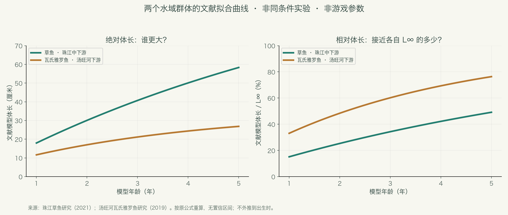
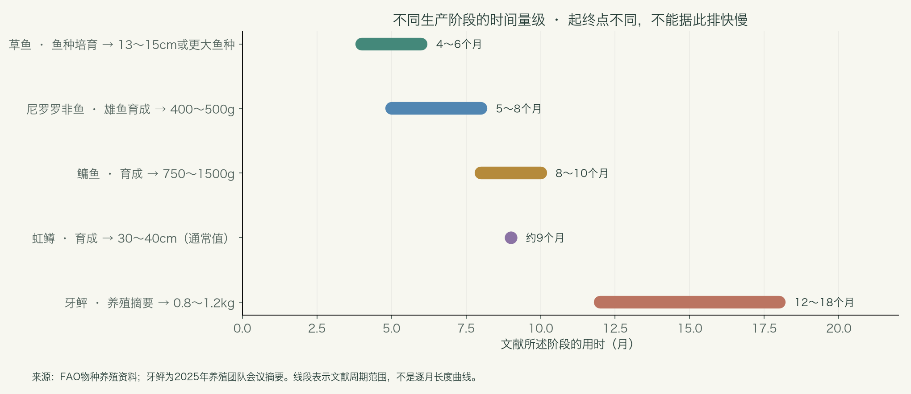

# 鱼类百科：先认识真实的鱼，再决定游戏的成长

2026年11月3日 · 面向非专业读者的资料手册 · 第一版

这份手册围绕项目已有的50个鱼类条目展开，补充鱼类分类、生活习性、出生与幼鱼尺寸、成长、成熟、寿命和鱼塘生态知识。它是生物学参考资料，不是新的游戏数值方案。

**先记住三个结论：鱼种决定基本体型和生活方式；同种鱼的成长也会不同；鱼长大、鱼性成熟、鱼到达最大尺寸，是三件不同的事。**

阅读顺序建议：先看第1～4章建立概念，再看第5～7章的数据与鱼种，最后看第8～10章，联系你的鱼塘设计。全文的数字均区分研究观测、文献模型、养殖实例和数据库记录，不把它们混成统一成长表。

## 1. 鱼到底如何分类？

### 1.1 先分清“亲缘关系”和“生活方式”

“鲤形目”“鲇形目”“鲑科”讲的是亲缘关系；“淡水鱼”“冷水鱼”“肉食鱼”“底层鱼”讲的是生活方式。这几种标签可以同时出现在一条鱼身上。

入门时，可以把现生鱼类理解为下面几大支。这里是便于阅读的简化谱系，不把传统的“鱼类”当作现代分类中严格的单一分支。

| 大类 | 常见例子 | 认识重点 |
| --- | --- | --- |
| 无颌类 | 七鳃鳗、盲鳗 | 与鲤鱼、鲈鱼的亲缘关系相距很远 |
| 软骨鱼类 | 鲨、鳐、银鲛 | 不能因为都叫“鱼”，就套用池塘鲤鱼的生活史 |
| 辐鳍鱼类 | 鲤、鲫、鳜、鲑、鲟、鳗等 | 项目中的鱼主要属于这一大支 |
| 肉鳍鱼类中的现生鱼 | 肺鱼、腔棘鱼 | 不是项目当前主要涉及的鱼类 |

鲟鱼的骨骼以软骨为主，但它属于辐鳍鱼，不能据此归入鲨鱼所在的软骨鱼类。名称和单一外形特征都不能代替分类。[分类入门：佛罗里达自然历史博物馆](https://www.floridamuseum.ufl.edu/discover-fish/fish/fish-groups/)；[鲟类骨骼的例外：OpenStax](https://openstax.org/books/biology-2e/pages/29-2-fishes)。

### 1.2 对理解鱼塘最有帮助的六种分类

| 分类维度 | 可以怎样分 | 为什么有用 |
| --- | --- | --- |
| 水域 | 淡水、海水、河口，以及跨水域生活 | 中华鲟和鳗鲡不能只用一个封闭淡水塘来解释完整生活史 |
| 温度 | 偏冷水、温水、偏暖水 | 虹鳟和罗非鱼不会在同一水温下都表现最好 |
| 食性 | 植物、浮游生物、底栖动物、鱼虾、杂食 | 同一份窝料不应被理解为所有鱼同等吃到的营养 |
| 活动位置 | 表层、中上层、中下层、近底层 | 影响在哪里遇见鱼，也影响鱼能吃到什么 |
| 体形 | 纺锤形、侧扁高体形、鳗形、带形、平扁形 | 同样长50厘米，重量与视觉体量可能差很多 |
| 生活史 | 较早成熟、较晚成熟；定居、季节移动、洄游 | 决定“老鱼”“大鱼”“稀少”分别意味着什么 |

这些是阅读工具，不是互斥的抽屉。鱼的活动层、食物和栖息地可能随着年龄、季节与昼夜变化。

## 2. 一条鱼从出生到变老，会经历什么？

| 阶段 | 用简单的话解释 | 对尺寸的意义 |
| --- | --- | --- |
| 受精卵 | 尚未孵出 | 卵径不是鱼长 |
| 初孵仔鱼 | 刚孵化，可能仍依靠卵黄囊 | 很多鱼只有毫米级；物种间差异很大 |
| 开口与仔鱼发育 | 开始从外界摄食，器官持续发育 | 食物颗粒必须小到能够吞下 |
| 稚鱼、幼鱼与鱼种培育 | 越来越像成鱼，但通常尚未性成熟 | 养殖中“鱼苗”“夏花”“鱼种”不是同一个规格 |
| 性成熟 | 具备繁殖能力 | 不表示已经达到最大体型 |
| 较大、较老的个体 | 可能继续缓慢增长，也可能因环境而停滞 | 年龄不能单独决定尺寸；更不保证长成纪录鱼 |

这些阶段没有一套适用于所有鱼的统一厘米分界。“幼鱼”也不是一个可以直接换算为固定鱼龄的词。

### 2.1 4厘米通常是“投放时的幼鱼”，不是真正的出生尺寸

以鳜鱼为例，FAO资料记录：初孵约**4毫米**；培育到约1.5厘米需要一个育苗阶段，随后再经池塘育苗达到**3～5厘米**。因此，把一条4厘米的鳜鱼称为“刚孵化”，会把已经发生的一段成长抹掉。真实育苗有阶段衔接，不能把不同阶段的日数随意当成同一个起点。[FAO鳜鱼资料](https://www.fao.org/fishery/docs/DOCUMENT/aquaculture/CulturedSpecies/file/en/en_mandarinfish.htm)。

草鱼也有不同规格：FAO实例中，育苗2～3周可到约3厘米，之后还会继续培育较大的鱼种。4厘米对草鱼只是很早的一段，对泥鳅等较小的鱼则已占更大比例。[FAO草鱼资料](https://www.fao.org/fishery/docs/DOCUMENT/aquaculture/CulturedSpecies/file/en/en_grasscarp.htm)。

**联系项目：统一4厘米可以作为简化的“初始投放规格”。若保留“出生体长”字段，需明确它是游戏出生设定，还是现实孵化体长。**两者都能做，但含义应一致。这是概念说明，暂不改变已讨论的4厘米设定。

## 3. 看鱼的数字，先问清楚口径

### 3.1 “常见”“最大”“成熟”是不同的数字

| 名称 | 它回答的问题 | 不能怎样用 |
| --- | --- | --- |
| 某次调查的平均体长 | 这批被采到的鱼平均多长？ | 不能直接当作所有成鱼的平均长度 |
| 数据库的常见长度 | 资料中常被提及的一种代表长度 | 未必是严格统计的均值，也未必仅包含成鱼 |
| 养殖上市规格 | 养殖者通常在什么规格收获？ | 不等于生物学上限 |
| 初次成熟体长、成熟年龄 | 何时开始具备繁殖能力？ | 不等于停止成长 |
| 最大记录 | 曾有资料报告到多大？ | 不等于每条鱼都能达到，更不能作为鱼塘常态 |
| 渐近体长 L∞ | 模型拟合时趋近的长度参数 | 不等于绝对硬上限，也不是已经观测到的纪录 |

例如，赤点石斑鱼数据库的常见长度约30厘米、最大记录58厘米。不能据此说“正常鱼都在30～58厘米之间”，更不能用58厘米代表全部石斑鱼。[FishBase赤点石斑鱼](https://www.fishbase.se/summary/Epinephelus_akaara.html)。

### 3.2 全长、体长、叉长不能直接混用

| 标记 | 常用含义 | 测到哪里 |
| --- | --- | --- |
| TL | 全长 | 吻端到尾鳍最末端，具体尾鳍摆放方式还需看测量规范 |
| SL | 标准体长 | 吻端到尾鳍基部附近，不包括尾鳍长度 |
| FL | 叉长 | 吻端到分叉尾鳍的凹口 |
| 中文“体长” | 要看论文方法 | 不能仅凭中文词就自动等同于TL或SL |

本文保留资料原有标记。没有可靠换算关系时，不把SL、FL硬转成TL；没有说明的口径就明确保留不确定性。

### 3.3 时间也有不同起点

“出生后8个月”“投放鱼种后8个月”“一个生长季”“1+龄”，并不是同一件事。养殖资料常从投苗或转入育成阶段起算。冬龄、周年龄和按世代划分的年龄组也需要看研究方法。下文的养殖周期不用于直接倒推出生日期。

## 4. 真实的鱼为什么会长得不一样？

### 4.1 不同鱼种：体型潜力和成长节奏是两条轴

一条鱼可以最终很大，但需要较长时间；另一条鱼可以很早成熟，却始终保持较小体型。“一天增加几厘米”“一年增加几公斤”“达到自身最终体型的百分比”，得到的快慢排名可能不同。

很多鱼的体长成长可以用逐渐趋缓的曲线近似；但初孵仔鱼的发育、季节性变化和体重成长不一定都符合“从出生第一秒开始速度就递减”。模型要匹配生活阶段。加拿大渔业与海洋部的研究方法资料同时讨论了多种成长模型，并强调食物、温度会显著改变成长。[DFO生长模型说明](https://www.dfo-mpo.gc.ca/science/species-especes/otoliths/methods/analysis-eng.html)。

### 4.2 同一鱼种：同一天出生，也不会整齐地长大

| 差异来源 | 会出现什么现象 |
| --- | --- |
| 遗传与品系 | 某些个体或选育群体成长较快，但不能直接换算成固定品质等级 |
| 性别 | 可能有成长与成熟时间差异；差异方向和大小依鱼种而异 |
| 实际吃到的食物 | 强势个体可能吃得更多，弱势个体即使身边有饵也未必摄入 |
| 水温与溶氧经历 | 同龄鱼在不同水域可能得到不同的有效生长时间 |
| 密度与竞争 | 数量过多可能使平均摄食量下降，成长停滞或差异扩大 |
| 疾病、损伤与应激 | 活着不等于持续良好生长 |

现实实例：FAO日本鳗鲡养殖资料明确提到个体成长差异明显，需要定期分级；真鲷的长期选育研究也发现选择能够改变群体成长表现。因此，现实没有一个通用结论说“同种同龄个体只能相差±15%”。这个范围需要具体群体数据，或由游戏自行定义。[FAO日本鳗鲡](https://www.fao.org/fishery/docs/DOCUMENT/aquaculture/CulturedSpecies/file/en/en_japaneseeel.htm)；[真鲷选育原始研究，1996](https://www.jstage.jst.go.jp/article/fishsci1994/62/6/62_6_845/_article/-char/en)。

### 4.3 食性也会随年龄改变

草鱼成鱼偏植物性，不代表初孵阶段就能吃草叶；青鱼成鱼善于摄食软体动物，也不是出生就能咬开大螺。鲤鱼是杂食性，不能因为吃谷物饵就归为严格草食。鳜鱼很早就会捕食其他鱼苗，和温和吃草的形象完全不同。[FAO草鱼](https://www.fao.org/fishery/docs/DOCUMENT/aquaculture/CulturedSpecies/file/en/en_grasscarp.htm)、[FAO鲤鱼](https://www.fao.org/fishery/docs/CDrom/aquaculture/I1129m/file/en/en_commoncarp.htm)、[加拿大DFO青鱼](https://www.dfo-mpo.gc.ca/species-especes/profiles-profils/blackcarp-carpenoire-eng.html)。

## 5. 用真实研究看成长：大不等于“相对长得快”

这里选择两项中国水域研究，按论文提供的公式重新计算曲线。**它们是特定群体的拟合模型，不是每条鱼的实测轨迹，也不是项目的新参数。**

| 对象 | 调查范围 | 论文的体长模型，单位毫米 |
| --- | --- | --- |
| 草鱼 | 珠江中下游，2019～2020年 | L(t)=1187×[1−exp(−0.128×(t+0.282))] |
| 瓦氏雅罗鱼 | 汤旺河下游，2017～2018年 | L(t)=351.75×[1−exp(−0.26×(t+0.5448))] |

草鱼研究样本涉及0+～5+龄。图只展示1～5年的模型计算窗口，不向出生时外推；雅罗鱼使用相同窗口只是便于阅读，不声称各年龄点都有等量实测样本。两篇论文的采样、拟合方法及体长口径应分别理解，不能把这两条线当作控制了环境的鱼种实验。

| 模型年龄 | 草鱼体长（厘米） | 瓦氏雅罗鱼体长（厘米） |
| --- | --- | --- |
| 1年 | 18.0 | 11.6 |
| 2年 | 30.1 | 17.0 |
| 3年 | 40.7 | 21.2 |
| 4年 | 50.1 | 24.4 |
| 5年 | 58.3 | 26.9 |

左图回答“同样一个模型年龄，体长是多少”；右图回答“达到各自模型渐近长度的多少”。草鱼在这两个群体模型中绝对长度更大；雅罗鱼则更早接近自己的较小渐近长度。**所以，不能只给鱼种一个“快/慢”标签，还应区分最终体型与接近最终体型的节奏。**图中没有置信区间；小数只是公式计算精度，不表示测量精度。

来源：[《珠江中下游草鱼渔业生物学特征研究》，2021](https://www.schinafish.cn/cn/article/Y2021/I5/110)；[《汤旺河下游瓦氏雅罗鱼的生长特征与资源合理利用》，2019](https://xuebao.dlou.edu.cn/article/2019/2095-1388/201906010.html)。

## 6. 养殖资料里的时间尺度：通常是月和年

下面是不同资料的实例，起点、终点、温度和养殖条件均不同，**用于建立时间尺度，不能用来给鱼种排成长速度名次**。

| 对象 | 文献中的周期 | 达到的规格 | 适用口径 |
| --- | --- | --- | --- |
| 尼罗罗非鱼 | 5～8个月 | 400～500克 | 雄鱼育成实例；随水温而变，从养殖投放阶段起算 |
| 鳙鱼 | 8～10个月 | 750～1500克 | 中国育成实例，非出生至生理上限 |
| 虹鳟 | 通常约9个月 | 30～40厘米 | 育成到一种上市规格；不同市场与环境可更久 |
| 草鱼 | 4～6个月 | 约13～15厘米或更大的鱼种 | 鱼种培育阶段，不是长成大型成鱼 |
| 鳜鱼 | 第一年；第二年 | 约400～600克；1～1.5公斤 | FAO描述的年级成长量级，并非所有野生个体必达 |

鲤鱼更能说明环境差异：FAO给出的实例是，热带、亚热带混养塘一个养殖季可达0.6～1.0公斤；温带达到1～2公斤可能需要2～4个养殖季。“同一物种，一年必须长到多少厘米”并不是普遍规律。

来源：[罗非鱼](https://www.fao.org/fishery/docs/DOCUMENT/aquaculture/CulturedSpecies/file/en/en_niletilapia.htm)、[鳙鱼](https://www.fao.org/fishery/docs/DOCUMENT/aquaculture/CulturedSpecies/file/en/en_bigheadcarp.htm)、[虹鳟](https://www.fao.org/fishery/docs/DOCUMENT/aquaculture/CulturedSpecies/file/en/en_rainbowtrout.htm)、[草鱼](https://www.fao.org/fishery/docs/DOCUMENT/aquaculture/CulturedSpecies/file/en/en_grasscarp.htm)、[鳜鱼](https://www.fao.org/fishery/docs/DOCUMENT/aquaculture/CulturedSpecies/file/en/en_mandarinfish.htm)、[鲤鱼](https://www.fao.org/fishery/docs/CDrom/aquaculture/I1129m/file/en/en_commoncarp.htm)。这些FAO资料是历史养殖实例，本文不把其中旧产业统计或旧繁育技术进展当作今天的现状。

## 7. 项目50个条目的鱼类索引与重点物种档案

每个条目保留项目的中文名称和ID。**“重点档案”有本次核对的物种资料；“分类索引”用于确认对象与查阅方向，不伪造缺少依据的逐龄长度、寿命或出生尺寸。**泛称和别名会单独说明。项目自身的典型长度配置只作为项目字段显示，绝不作为现实数据。

先辨认三组容易重复或混淆的名字：

- **团头鲂与武昌鱼**：通常是同一物种的两个名字。可以在游戏中保留不同条目，但不能据此声称是两个生物学物种。[NCBI物种条目](https://www.ncbi.nlm.nih.gov/Taxonomy/Browser/wwwtax.cgi?id=75352)。
- **鳊鱼与长春鳊**：长春鳊可指鳊属的Parabramis pekinensis，项目“鳊鱼”若也指该物种，就可能再次重复；地方俗名又会扩大“鳊鱼”的范围，需明确。[长春鳊群体比较原始研究，2025](https://xuebao.dlou.edu.cn/article/2025/2095-1388/202501015.html)。
- **锦鲤与鲤鱼、巨青与青鱼**：前者是观赏品种条目，后者是大型个体称呼，不应仅凭名字各自发明一套新物种的生物学极限。[FAO鲤鱼与观赏选育说明](https://www.fao.org/fishery/docs/CDrom/aquaculture/I1129m/file/en/en_commoncarp.htm)。

### 鲫鱼 · 重点档案

- 分类定位：鲫属 Carassius；以 C. auratus 资料作例；生态阅读组：淡水常见鱼。
- 认识重点：常与鲤鱼一起出现，但不是小号鲤鱼。辨认时可留意口部、须及体形。
- 已核对资料 / 数值范围：体型例子：C. auratus 数据库常见长度10厘米TL，最大记录48厘米TL。
- 如何理解：这不等于中国所有鲫鱼的成年分布；本版不据此设定平均寿命或逐龄成长。
- 命名注意：中文鲫鱼涉及不同种、群体和养殖品系；不能将欧洲鲫 C. carassius 的资料直接照搬。
- 来源：[FishBase · Carassius auratus，不能代表全部鲫属鱼](https://www.fishbase.org/summary/Carassius_auratus.html)

### 鲤鱼 · 重点档案

- 分类定位：Cyprinus carpio；生态阅读组：淡水常见鱼。
- 认识重点：底栖觅食为主的杂食鱼，也会利用水体其他层的食物；吃谷物不表示严格草食。
- 已核对资料 / 数值范围：温暖地区混养实例：一个养殖季可达0.6～1.0公斤；温带到1～2公斤可需2～4个养殖季。
- 如何理解：温度与养殖条件能明显改变时间尺度；这些是体重，不是长度。
- 命名注意：不同品系和温度下成长明显不同；锦鲤条目需与此区分品系和物种层级。
- 来源：[FAO · 鲤鱼](https://www.fao.org/fishery/docs/CDrom/aquaculture/I1129m/file/en/en_commoncarp.htm)

### 草鱼 · 重点档案

- 分类定位：Ctenopharyngodon idella；旧资料常作 idellus；生态阅读组：淡水常见鱼。
- 认识重点：成年偏植物食性，幼早期食物不同；大型成鱼不能仅靠“多活几天”来解释。
- 已核对资料 / 数值范围：珠江群体研究样本体长103～665毫米，涉及0+～5+龄；文献拟合见第5章。
- 如何理解：同一物种的一个水域群体模型，并非每条草鱼的保证长度；4厘米应理解为幼鱼规格。
- 命名注意：温暖地区的养殖周期不能直接用于寒冷地区；不要把鱼种培育时间当作成鱼上限时间。
- 来源：[2021年原始研究 · 珠江中下游草鱼](https://www.schinafish.cn/cn/article/Y2021/I5/110)；[FAO · 草鱼](https://www.fao.org/fishery/docs/DOCUMENT/aquaculture/CulturedSpecies/file/en/en_grasscarp.htm)

### 鲢鱼 · 重点档案

- 分类定位：Hypophthalmichthys molitrix；生态阅读组：滤食与植物食性。
- 认识重点：典型滤食型鱼，利用细小悬浮食物；不能与直接吞下一团饵的鱼等同。
- 已核对资料 / 数值范围：滤食型鱼；FAO繁育实例选择4～6岁、体重超过2.5公斤的亲鱼。
- 如何理解：这是繁育选用规格，不是首次成熟年龄，也不是所有成鱼的常见体重。
- 命名注意：藻类、颗粒大小和水体食物条件，比“人投了多少块饵”更能解释营养获得。
- 来源：[FAO · 鲢鱼](https://www.fao.org/fishery/docs/CDrom/aquaculture/I1129m/file/en/en_silvercarp.htm)

### 鳙鱼 · 重点档案

- 分类定位：Hypophthalmichthys nobilis；生态阅读组：滤食与植物食性。
- 认识重点：鳙鱼俗称胖头鱼，偏利用浮游动物等悬浮食物，与鲢有食物生态位差异。
- 已核对资料 / 数值范围：中国育成实例：8～10个月达到约750～1500克的上市规格。
- 如何理解：起点是育成投放阶段，不能解读成从孵化到最大尺寸；自然繁殖还涉及流水条件。
- 命名注意：滤食偏好不是绝对单一食谱；养殖育成周期不等于寿命或最大体型周期。
- 来源：[FAO · 鳙鱼](https://www.fao.org/fishery/docs/DOCUMENT/aquaculture/CulturedSpecies/file/en/en_bigheadcarp.htm)

### 青鱼 · 重点档案

- 分类定位：Mylopharyngodon piceus；生态阅读组：淡水大型鱼。
- 认识重点：成鱼偏食软体动物，咽齿适于处理带壳食物；食物限制有物种特点。
- 已核对资料 / 数值范围：加拿大DFO概述记载体长可达约1.8米。
- 如何理解：这是资料所列可达长度，不是该塘每条青鱼的成长目标；大型个体需要合适食物与存活机会。
- 命名注意：“巨青”通常仍是青鱼的大个体，不是另一生物学物种。
- 来源：[加拿大DFO · 青鱼](https://www.dfo-mpo.gc.ca/species-especes/profiles-profils/blackcarp-carpenoire-eng.html)

### 罗非鱼 · 重点档案

- 分类定位：罗非鱼类群；本手册数值例为 Oreochromis niloticus；生态阅读组：暖水鱼。
- 认识重点：可利用多类食物，部分罗非鱼有口孵育幼行为；高繁殖补充不保证每条都长大。
- 已核对资料 / 数值范围：尼罗罗非鱼实例：雄鱼育成5～8个月可达400～500克；池塘成熟年龄可约5～6个月。
- 如何理解：成长、成熟是不同终点；过度繁殖与竞争可能造成小型化。
- 命名注意：养殖罗非鱼可能是不同种或杂交群体，尼罗罗非鱼数字不能自动覆盖全部条目。
- 来源：[FAO · 尼罗罗非鱼](https://www.fao.org/fishery/docs/DOCUMENT/aquaculture/CulturedSpecies/file/en/en_niletilapia.htm)

### 泥鳅 · 重点档案

- 分类定位：泥鳅 Misgurnus anguillicaudatus 作为定位；生态阅读组：底栖与鳗形鱼。
- 认识重点：小型、细长、近底层生活的代表；不能因为细长就与鳗鲡归为一类。
- 已核对资料 / 数值范围：USGS物种资料概述的常见体型约10～20厘米，最大长度记录28厘米SL。
- 如何理解：常见范围与最大记录采用的口径需分别理解，不应把28厘米当作每条泥鳅最终都会到的值。
- 命名注意：泥鳅与大鳞副泥鳅等相似鱼要先确认；资料中TL与SL须保留原标记。
- 来源：[USGS · 泥鳅物种资料](https://nas.er.usgs.gov/queries/greatLakes/FactSheet.aspx?H=&Potential=N&Species_ID=498&Type=0)

### 鳊鱼 · 重点档案

- 分类定位：鳊 Parabramis pekinensis，或地方泛称；生态阅读组：鳊鲂与鲴类。
- 认识重点：较高、侧扁的体形与细长鱼差别很大，同长度的视觉体量也不同。
- 已核对资料 / 数值范围：若定位为P. pekinensis，FishBase列最大记录55厘米TL。
- 如何理解：单一最大记录不能生成完整年龄曲线；中文俗名范围仍要先确定。
- 命名注意：若此处指P. pekinensis，就可能与长春鳊条目重复；先确认美术与命名。
- 来源：[FishBase · 鳊](https://www.fishbase.se/summary/282)

### 团头鲂 · 重点档案

- 分类定位：Megalobrama amblycephala；生态阅读组：鳊鲂与鲴类。
- 认识重点：团头鲂也是通常所称的武昌鱼，名称不同不代表成长史不同。
- 已核对资料 / 数值范围：NCBI中M. amblycephala同时关联Wuchang bream与Bluntsnout bream名称。
- 如何理解：已核对名称关系；不提供未经核对的极端长度和寿命。
- 命名注意：不采用缺乏核对的网络极端尺寸；本次未提供可靠统一逐龄体长表。
- 来源：[NCBI · 团头鲂/武昌鱼名称](https://www.ncbi.nlm.nih.gov/Taxonomy/Browser/wwwtax.cgi?id=75352)

### 长春鳊 · 重点档案

- 分类定位：长春鳊：Parabramis pekinensis；生态阅读组：鳊鲂与鲴类。
- 认识重点：2025年的群体比较研究明确使用这一学名；英文White amur bream也对应这一对象。
- 已核对资料 / 数值范围：2025年长江与黑龙江养殖群体比较研究使用Parabramis pekinensis。
- 如何理解：这是物种定位与不同群体研究的入口，本版不将体成分实验当作成长曲线。
- 命名注意：注意和鲂属的三角鲂区分；不要依据中文俗名另设一个无依据的物种。
- 来源：[2025年原始研究 · 长春鳊群体比较](https://xuebao.dlou.edu.cn/article/2025/2095-1388/202501015.html)

### 鳜鱼 · 重点档案

- 分类定位：鳜 Siniperca chuatsi；生态阅读组：淡水捕食鱼。
- 认识重点：躲藏、伏击，幼早期便能捕食其他鱼苗；同类相食也可能使个体差异扩大。
- 已核对资料 / 数值范围：初孵约4毫米；FAO年级描述为一年约400～600克、二年约1～1.5公斤。
- 如何理解：毫米级出生、厘米级鱼种、公斤级成鱼是不同阶段；避免把4厘米写成现实孵化体长。
- 命名注意：资料中的克、公斤是体重，不能缺少长重关系就擅自换成厘米。
- 来源：[FAO · 鳜鱼](https://www.fao.org/fishery/docs/DOCUMENT/aquaculture/CulturedSpecies/file/en/en_mandarinfish.htm)

### 翘嘴鲌 · 分类索引

- 分类定位：翘嘴鲌；候选定位 Culter alburnus；生态阅读组：淡水捕食鱼。
- 认识重点：可先从鲌类的侧扁体形和捕食生活方式认识，辨认时留意口位和轮廓。
- 已核对资料 / 数值范围：本版未提供经逐条核对的成长或寿命数值。
- 如何理解：此项用于分类检索；具体到种、地区和群体后再补充生物学参数。
- 命名注意：分类索引：尚未逐条核验该项目形象对应的物种及逐龄成长数据。
- 来源：分类检索待补：本版不以候选学名宣称数值已核验。

### 大口黑鲈 · 重点档案

- 分类定位：大口黑鲈类；传统资料作 Micropterus salmoides；生态阅读组：淡水捕食鱼。
- 认识重点：伏击捕食者；幼鱼和较大个体利用的猎物会有变化。
- 已核对资料 / 数值范围：USFWS传统物种资料给出常见长度16英寸，约40.6厘米。
- 如何理解：这里只用于认识体型量级；因分类调整，不把旧资料中的极端纪录直接绑定项目的养殖群体。
- 命名注意：近年大口黑鲈与佛罗里达相关类群的命名有调整；项目需注明所采用的分类版本。
- 来源：[USFWS · 大口黑鲈资料，注意分类版本](https://www.fws.gov/species/largemouth-bass-micropterus-salmoides)

### 乌鳢 · 重点档案

- 分类定位：Channa argus；生态阅读组：淡水捕食鱼。
- 认识重点：乌鳢俗称黑鱼，属于鳢类，不是黑鲈，也不是鲶鱼。
- 已核对资料 / 数值范围：FishBase列最大记录100厘米TL，成熟描述约2岁、30厘米。
- 如何理解：这些是文献记录或概述，不能推导全部群体到2岁都恰好30厘米。
- 命名注意：成熟时间和体型取决于群体；这里只使用数据库明确列出的指标。
- 来源：[FishBase · 乌鳢](https://www.fishbase.se/summary/Channa_argus.html)

### 鲶鱼 · 重点档案

- 分类定位：以鲶 Silurus asotus 为例；生态阅读组：底栖捕食鱼。
- 认识重点：有须、少鳞或无鳞的外观很醒目；“鲶鱼”俗称也常被用于多种不同的鲇形目鱼。
- 已核对资料 / 数值范围：以S. asotus为例：FishBase常见长度37厘米SL，最大记录130厘米TL。
- 如何理解：这两个数字测量终点不同，不能直接算“常见到最大”的倍数。
- 命名注意：不能把南方大口鲇、胡子鲶或其他巨型鲶鱼的纪录归到同一个条目。
- 来源：[FishBase · 鲶 Silurus asotus](https://www.fishbase.se/summary/silurus-asotus.html)

### 黄颡鱼 · 重点档案

- 分类定位：Tachysurus fulvidraco；可见 Pelteobagrus 等旧属名；生态阅读组：底栖捕食鱼。
- 认识重点：黄颡鱼的须和鳍棘有辨识度；偏底部摄食，雄鱼有守护卵与幼体行为。
- 已核对资料 / 数值范围：FishBase列最大记录34.5厘米TL，并描述雄性护卵及护幼行为。
- 如何理解：本版不将数据库的模型估算世代时间转换成“几天长满”。
- 命名注意：查旧资料须检查异名；旧属名不同不代表存在多套不同生长上限。
- 来源：[FishBase · 黄颡鱼](https://www.fishbase.se/summary/Tachysurus-fulvidraco.html)

### 银鲴 · 分类索引

- 分类定位：银鲴 Xenocypris argentea；生态阅读组：鳊鲂与鲴类。
- 认识重点：辨认时应把鲴类与鲂、鲌分开；项目英文ID中的bream不是可靠分类依据。
- 已核对资料 / 数值范围：本版未提供经逐条核对的成长或寿命数值。
- 如何理解：此项用于分类检索；具体到种、地区和群体后再补充生物学参数。
- 命名注意：本次核对到学名入口，未核验统一体长—年龄或寿命数值。
- 来源：[原始调查 · 海南鹦哥岭鱼类，含银鲴学名](https://www.biodiversity-science.net/EN/10.3724/SP.J.1003.2008.07021)

### 红鳍鲌 · 分类索引

- 分类定位：红鳍鲌；Culter / Chanodichthys 等属名需核对；生态阅读组：淡水捕食鱼。
- 认识重点：红色鱼鳍是外观线索，不能据此与所有“红鳍”的鱼合并。
- 已核对资料 / 数值范围：本版未提供经逐条核对的成长或寿命数值。
- 如何理解：此项用于分类检索；具体到种、地区和群体后再补充生物学参数。
- 命名注意：项目中文名需要结合图像与当前分类资料定位；本版不强行给出唯一学名。
- 来源：分类检索待补：本版不以候选学名宣称数值已核验。

### 马口鱼 · 分类索引

- 分类定位：马口鱼；候选定位 Opsariichthys bidens；生态阅读组：溪流与特殊鱼。
- 认识重点：可作为溪流鱼的认识入口；不能只按river_chub这个英文ID套入欧美同名鱼资料。
- 已核对资料 / 数值范围：本版未提供经逐条核对的成长或寿命数值。
- 如何理解：此项用于分类检索；具体到种、地区和群体后再补充生物学参数。
- 命名注意：分类索引：体长、成熟及寿命尚无本次逐条核对数据。
- 来源：分类检索待补：本版不以候选学名宣称数值已核验。

### 鳡鱼 · 分类索引

- 分类定位：鳡；候选定位 Elopichthys bambusa；生态阅读组：淡水大型鱼。
- 认识重点：与同属鲤形目但偏植物或滤食的鱼相比，生活方式可能非常不同。
- 已核对资料 / 数值范围：本版未提供经逐条核对的成长或寿命数值。
- 如何理解：此项用于分类检索；具体到种、地区和群体后再补充生物学参数。
- 命名注意：分类索引：不要用“都是鲤形目”推导相同食性或成长速度。
- 来源：分类检索待补：本版不以候选学名宣称数值已核验。

### 赤眼鳟 · 分类索引

- 分类定位：赤眼鳟；候选定位 Squaliobarbus curriculus；生态阅读组：淡水常见鱼。
- 认识重点：中文带“鳟”字，不表示它就是虹鳟、哲罗鲑那样的鲑科鱼。
- 已核对资料 / 数值范围：本版未提供经逐条核对的成长或寿命数值。
- 如何理解：此项用于分类检索；具体到种、地区和群体后再补充生物学参数。
- 命名注意：分类索引：名称后缀不能决定温度需求与成长参数。
- 来源：分类检索待补：本版不以候选学名宣称数值已核验。

### 长吻鮠 · 重点档案

- 分类定位：Leiocassis longirostris；生态阅读组：底栖捕食鱼。
- 认识重点：俗称江团、鮰鱼；中科院水生所研究将其作为典型肉食鱼讨论营养适应。
- 已核对资料 / 数值范围：中科院水生所研究将长吻鮠描述为高蛋白需求、糖利用能力较低的肉食鱼。
- 如何理解：食物适配有种间差异；本次资料未提供可通用的逐龄长度表。
- 命名注意：与黄颡鱼同样有须，也不能共享逐龄长度；本版不填未经核对的成长年表。
- 来源：[中科院水生所 · 长吻鮠食性研究](https://www.ihb.cas.cn/xwdt/kydt/202408/t20240823_7309953.html)

### 武昌鱼 · 重点档案

- 分类定位：Megalobrama amblycephala；生态阅读组：鳊鲂与鲴类。
- 认识重点：常见名称武昌鱼对应团头鲂；在生物学档案里应与团头鲂互相关联。
- 已核对资料 / 数值范围：与团头鲂通常指同一物种，见对应档案。
- 如何理解：可以保留内容条目，但现实生物学档案应共用物种身份。
- 命名注意：项目中保留两个ID是内容设计选择，不应据此重复计为两个现实物种。
- 来源：[NCBI · 团头鲂/武昌鱼名称](https://www.ncbi.nlm.nih.gov/Taxonomy/Browser/wwwtax.cgi?id=75352)

### 光唇鱼 · 分类索引

- 分类定位：光唇鱼类；Acrossocheilus 等需具体化；生态阅读组：溪流与特殊鱼。
- 认识重点：光唇鱼这个简称可能不足以确定具体种；不能因英文ID含mahseer就套用大型南亚鱼。
- 已核对资料 / 数值范围：本版未提供经逐条核对的成长或寿命数值。
- 如何理解：此项用于分类检索；具体到种、地区和群体后再补充生物学参数。
- 命名注意：类群索引：先明确中文全名、产地及学名，才有可用的尺寸和成长资料。
- 来源：分类检索待补：本版不以候选学名宣称数值已核验。

### 岩原鲤 · 分类索引

- 分类定位：岩原鲤；候选定位 Procypris rabaudi；生态阅读组：溪流与特殊鱼。
- 认识重点：中文含“鲤”并不意味着只是普通鲤鱼换一种颜色。
- 已核对资料 / 数值范围：本版未提供经逐条核对的成长或寿命数值。
- 如何理解：此项用于分类检索；具体到种、地区和群体后再补充生物学参数。
- 命名注意：分类索引：本版未核验当地群体成长曲线与寿命；不挪用普通鲤鱼数字。
- 来源：分类检索待补：本版不以候选学名宣称数值已核验。

### 花鲴 · 分类索引

- 分类定位：项目写“花鲴”；可能拟指花䱻 Hemibarbus maculatus；生态阅读组：溪流与特殊鱼。
- 认识重点：鲴与䱻是不同的字；英文barbel也无法唯一锁定物种。
- 已核对资料 / 数值范围：本版未提供经逐条核对的成长或寿命数值。
- 如何理解：此项用于分类检索；具体到种、地区和群体后再补充生物学参数。
- 命名注意：身份待确认：这是需要核对的命名问题，未确认前不建立貌似精确的物种档案。
- 来源：分类检索待补：本版不以候选学名宣称数值已核验。

### 裂腹鱼 · 分类索引

- 分类定位：裂腹鱼类；Schizothorax 等；生态阅读组：溪流与特殊鱼。
- 认识重点：裂腹鱼是包含多个对象的类群名称，常与高原水域鱼类研究一起出现。
- 已核对资料 / 数值范围：本版未提供经逐条核对的成长或寿命数值。
- 如何理解：此项用于分类检索；具体到种、地区和群体后再补充生物学参数。
- 命名注意：类群索引：不能给所有裂腹鱼设一个统一的现实最大体长、鱼龄和温度范围。
- 来源：分类检索待补：本版不以候选学名宣称数值已核验。

### 金线鲃 · 分类索引

- 分类定位：金线鲃属 Sinocyclocheilus 等待具体到种；生态阅读组：溪流与特殊鱼。
- 认识重点：属内有不同栖息与形态类型，不能把一种洞穴鱼的特点赋给全部金线鲃。
- 已核对资料 / 数值范围：本版未提供经逐条核对的成长或寿命数值。
- 如何理解：此项用于分类检索；具体到种、地区和群体后再补充生物学参数。
- 命名注意：类群索引：需要具体种名；本版不以属级最大值当作每种鱼的上限。
- 来源：[FishBase · 金线鲃属物种索引](https://www.fishbase.se/identification/SpeciesList.php?genus=Sinocyclocheilus)

### 铜鱼 · 分类索引

- 分类定位：铜鱼；候选定位 Coreius heterodon；生态阅读组：溪流与特殊鱼。
- 认识重点：属于需要结合河流生态认识的鱼种；不应仅因名字含carp就复制鲤鱼设定。
- 已核对资料 / 数值范围：本版未提供经逐条核对的成长或寿命数值。
- 如何理解：此项用于分类检索；具体到种、地区和群体后再补充生物学参数。
- 命名注意：分类索引：铜鱼与近似名称、近缘种需区分；未填未经核验的数值。
- 来源：分类检索待补：本版不以候选学名宣称数值已核验。

### 黑鲷 · 分类索引

- 分类定位：黑鲷；候选定位 Acanthopagrus schlegelii；生态阅读组：海水与河口鱼。
- 认识重点：与真鲷同属鲷类认识范围，但不是同种鱼换一个颜色。
- 已核对资料 / 数值范围：本版未提供经逐条核对的成长或寿命数值。
- 如何理解：此项用于分类检索；具体到种、地区和群体后再补充生物学参数。
- 命名注意：分类索引：性别、成长和繁殖资料要匹配具体物种；本版未填逐龄数字。
- 来源：分类检索待补：本版不以候选学名宣称数值已核验。

### 真鲷 · 重点档案

- 分类定位：Pagrus major；生态阅读组：海水与河口鱼。
- 认识重点：真鲷是侧扁而较高体的海鱼；食物包括底栖无脊椎动物等。
- 已核对资料 / 数值范围：FishBase常见长度30厘米TL，最大记录100厘米SL；最大报告年龄26年。
- 如何理解：口径不同、记录含义不同；26年不是野生个体的平均预期寿命。
- 命名注意：常见长度与最大记录口径不同，不能直接作为同一分布的两端。
- 来源：[FishBase · 真鲷](https://www.fishbase.se/summary/PAGRUS-MAJOR.html)

### 大黄鱼 · 分类索引

- 分类定位：大黄鱼；候选定位 Larimichthys crocea；生态阅读组：海水与河口鱼。
- 认识重点：不能与小黄鱼仅凭市场俗名混为同一个物种档案。
- 已核对资料 / 数值范围：本版未提供经逐条核对的成长或寿命数值。
- 如何理解：此项用于分类检索；具体到种、地区和群体后再补充生物学参数。
- 命名注意：分类索引：自然种群与养殖群体应分别查证；未填成长与寿命年表。
- 来源：分类检索待补：本版不以候选学名宣称数值已核验。

### 带鱼 · 重点档案

- 分类定位：带鱼类；以下例子仅为 Trichiurus lepturus；生态阅读组：海水与河口鱼。
- 认识重点：带状细长体形使它很长却不一定很重；长度不等于体量。
- 已核对资料 / 数值范围：T. lepturus数据库常见长度100厘米TL，最大记录234厘米TL。
- 如何理解：只代表该具体物种；带状外形说明“长”不一定意味着同等重量的大块头。
- 命名注意：带鱼涉及多个种与分类问题，例子的记录不能覆盖全部中国带鱼。
- 来源：[FishBase · Trichiurus lepturus，仅代表该物种](https://www.fishbase.se/summary/Trichiurus-lepturus)

### 鲐鱼 · 重点档案

- 分类定位：日本鲐 Scomber japonicus 作为候选定位；生态阅读组：海水与河口鱼。
- 认识重点：鲐、鲅等相似俗名应分开；游泳型体形与伏底鱼不同。
- 已核对资料 / 数值范围：以S. japonicus为例：常见长度30厘米FL，最大记录64厘米TL。
- 如何理解：保留叉长与全长标记；不要把不同鲐种或旧分布资料混为一谈。
- 命名注意：数据库的常见长度为叉长FL，不能与全长TL无标记混用。
- 来源：[FishBase · 日本鲐](https://www.fishbase.se/summary/Scomber-japonicus.html)

### 牙鲆 · 重点档案

- 分类定位：Paralichthys olivaceus；生态阅读组：海水与河口鱼。
- 认识重点：牙鲆是平扁体形的底栖鱼，左右不对称的成鱼外观来自发育变化。
- 已核对资料 / 数值范围：2025年养殖团队会议摘要概述：可在12～18个月达到0.8～1.2公斤上市规格。
- 如何理解：这是会议摘要中的生产量级说明，证据细节少于完整生长论文，不作为野生成长曲线。
- 命名注意：养殖上市时间只说明特定条件下的生产周期，不是寿命或生理极限。
- 来源：[2025年研究团队会议摘要 · 牙鲆养殖](https://www.was.org/Meeting/Program/PaperDetail/166172)

### 花鲈 · 分类索引

- 分类定位：花鲈；优先核对 Lateolabrax maculatus；生态阅读组：海水与河口鱼。
- 认识重点：花鲈不是大口黑鲈；都被俗称鲈鱼，不表示共享同一生活史。
- 已核对资料 / 数值范围：本版未提供经逐条核对的成长或寿命数值。
- 如何理解：此项用于分类检索；具体到种、地区和群体后再补充生物学参数。
- 命名注意：部分旧数据库链接跳向L. japonicus；本版不把该页数字直接当作花鲈数据。
- 来源：分类检索待补：本版不以候选学名宣称数值已核验。

### 银鲳 · 分类索引

- 分类定位：银鲳；Pampus 类群需明确具体种；生态阅读组：海水与河口鱼。
- 认识重点：银色、高而侧扁的体形有辨识度，但市场名可能混入相似对象。
- 已核对资料 / 数值范围：本版未提供经逐条核对的成长或寿命数值。
- 如何理解：此项用于分类检索；具体到种、地区和群体后再补充生物学参数。
- 命名注意：分类索引：应核实学名与地区，不能用某个银鲳旧名下的数字覆盖全部。
- 来源：分类检索待补：本版不以候选学名宣称数值已核验。

### 石斑鱼 · 重点档案

- 分类定位：石斑鱼类群；具体示例 Epinephelus akaara；生态阅读组：海水与河口鱼。
- 认识重点：石斑鱼不是一个单一物种，不同种之间的体型和生活史差异很大。
- 已核对资料 / 数值范围：仅以赤点石斑鱼E. akaara为例：常见长度30厘米TL，最大记录58厘米TL。
- 如何理解：不同石斑鱼种可能相差很大；不能把这一示例套给项目尚未明确的整个石斑条目。
- 命名注意：本版赤点石斑鱼的30/58厘米仅属于示例种，不是整个类群的常见值与上限。
- 来源：[FishBase · 赤点石斑鱼，仅作具体物种示例](https://www.fishbase.se/summary/Epinephelus_akaara.html)

### 鲻鱼 · 重点档案

- 分类定位：Mugil cephalus 作为定位；生态阅读组：海水与河口鱼。
- 认识重点：可见于海岸、河口等多类盐度环境；完整生活史不能只按静水淡水塘解释。
- 已核对资料 / 数值范围：M. cephalus数据库常见长度50厘米SL，最大记录100厘米SL，最大报告年龄16年。
- 如何理解：最大年龄不是平均寿命；SL也不是含完整尾鳍的全长。
- 命名注意：数据库记录保留SL；类群与区域鉴定仍应留意。
- 来源：[FishBase · 鲻鱼](https://www.fishbase.se/summary/Mugil-cephalus)

### 虹鳟 · 重点档案

- 分类定位：Oncorhynchus mykiss；生态阅读组：冷水与长寿鱼。
- 认识重点：有淡水定居和降海生活型；同一物种也可能有不同成长经历。
- 已核对资料 / 数值范围：FAO育成实例：到30～40厘米上市规格通常约9个月；更大规格可更久。
- 如何理解：这是人工条件下的育成阶段；淡水与降海生活型的成长也可能不同。
- 命名注意：“冷水鱼”不等于任何低温都长得好，也不代表温度越低越好。
- 来源：[FAO · 虹鳟](https://www.fao.org/fishery/docs/DOCUMENT/aquaculture/CulturedSpecies/file/en/en_rainbowtrout.htm)

### 细鳞鲑 · 分类索引

- 分类定位：细鳞鲑；Brachymystax 类群需确认；生态阅读组：冷水与长寿鱼。
- 认识重点：可先按冷水鲑类理解，与热带罗非鱼的环境需求明显不同。
- 已核对资料 / 数值范围：本版未提供经逐条核对的成长或寿命数值。
- 如何理解：此项用于分类检索；具体到种、地区和群体后再补充生物学参数。
- 命名注意：类群索引：分类与不同种群需核实，不能用哲罗鲑或虹鳟的曲线代替。
- 来源：分类检索待补：本版不以候选学名宣称数值已核验。

### 哲罗鲑 · 重点档案

- 分类定位：Hucho taimen；生态阅读组：冷水与长寿鱼。
- 认识重点：大型鲑科鱼，有较长生活史；能够形成跨多年的个体经历。
- 已核对资料 / 数值范围：贝加尔湖流域研究记载可达29岁、60公斤。
- 如何理解：年龄与体重是该研究汇总的可达量级，不是同一条29岁个体必然重60公斤，也不是平均值。
- 命名注意：本版研究来自贝加尔湖流域，不能自动当成所有地区群体的平均寿命。
- 来源：[1998年原始研究 · 贝加尔湖流域哲罗鲑](https://pubs.usgs.gov/publication/1000685)

### 雅罗鱼 · 重点档案

- 分类定位：雅罗鱼；例为瓦氏雅罗鱼 Leuciscus waleckii；生态阅读组：冷水与长寿鱼。
- 认识重点：项目英文ID为whitefish，但雅罗鱼不能直接套用鲑科白鲑资料。
- 已核对资料 / 数值范围：以汤旺河瓦氏雅罗鱼为例：L∞约35.175厘米、k=0.26/年；第5章有重算曲线。
- 如何理解：L∞是拟合参数，不是这类鱼的绝对硬上限；雅罗鱼条目仍需确认具体种。
- 命名注意：中文雅罗鱼需具体化；本版成长研究只针对瓦氏雅罗鱼的一个水域群体。
- 来源：[2019年原始研究 · 汤旺河瓦氏雅罗鱼](https://xuebao.dlou.edu.cn/article/2019/2095-1388/201906010.html)

### 中华鲟 · 重点档案

- 分类定位：Acipenser sinensis；生态阅读组：鲟类与洄游鱼。
- 认识重点：长寿、大型、溯河繁殖的代表；现实成长与成熟按多年尺度理解。
- 已核对资料 / 数值范围：NOAA概述：可达16英尺，约4.88米；寿命至少35年，雄雌成熟约8/14年。
- 如何理解：可达长度不代表常态；它是溯河繁殖鱼，不是终生静水塘鱼。
- 命名注意：不要把海洋育肥与江河繁殖阶段压成静水鱼塘里的单一生活方式。
- 来源：[NOAA · 中华鲟](https://www.fisheries.noaa.gov/species/chinese-sturgeon/resources)

### 达氏鲟 · 分类索引

- 分类定位：达氏鲟；候选定位 Acipenser dabryanus；生态阅读组：鲟类与洄游鱼。
- 认识重点：与中华鲟是不同物种；不能因为都叫鲟就复制中华鲟的全部生活史。
- 已核对资料 / 数值范围：本版未提供经逐条核对的成长或寿命数值。
- 如何理解：此项用于分类检索；具体到种、地区和群体后再补充生物学参数。
- 命名注意：分类索引：本次未核验该物种专属的逐龄成长、最大体长和寿命数字。
- 来源：分类检索待补：本版不以候选学名宣称数值已核验。

### 鳗鲡 · 重点档案

- 分类定位：鳗鲡属 Anguilla；例为日本鳗鲡 A. japonica；生态阅读组：底栖与鳗形鱼。
- 认识重点：鳗鲡的海洋繁殖和幼体发育有独特阶段，与黄鳝不同。
- 已核对资料 / 数值范围：FAO日本鳗鲡资料明确描述个体成长差异显著，需定期分级。
- 如何理解：这支持“同种鱼有成长差异”，但不能据此推导统一±15%的现实区间。
- 命名注意：项目需确定是日本鳗鲡还是其他鳗鲡；不能把黄鳝资料混入。
- 来源：[FAO · 日本鳗鲡](https://www.fao.org/fishery/docs/DOCUMENT/aquaculture/CulturedSpecies/file/en/en_japaneseeel.htm)

### 黄鳝 · 重点档案

- 分类定位：Monopterus albus 类群；生态阅读组：底栖与鳗形鱼。
- 认识重点：黄鳝虽像鳗鲡，但不是鳗鲡属；研究记录有先雌后雄的自然性反转。
- 已核对资料 / 数值范围：中科院水生所研究介绍黄鳝具有先雌后雄的自然性反转特性。
- 如何理解：不是所有鳗形鱼都如此；本版不混用鳗鲡寿命与成长参数。
- 命名注意：不能用“鳝”和“鳗”俗称相近推导同一种生活史；群体和分类也需注意。
- 来源：[中科院水生所 · 黄鳝及性反转](https://www.ihb.cas.cn/xwdt/kydt/202510/t20251027_7997821.html)

### 锦鲤 · 分类索引

- 分类定位：鲤的观赏选育品种，Cyprinus carpio 相关；生态阅读组：观赏与特殊条目。
- 认识重点：色彩与花纹是主要辨识维度；观赏价值不是独立的生物学体型等级。
- 已核对资料 / 数值范围：本版未提供经逐条核对的成长或寿命数值。
- 如何理解：此项用于分类检索；具体到种、地区和群体后再补充生物学参数。
- 命名注意：与鲤鱼建立品种关联；本版不为“锦鲤”虚构一条独立物种成长曲线。
- 来源：[FAO · 鲤鱼](https://www.fao.org/fishery/docs/CDrom/aquaculture/I1129m/file/en/en_commoncarp.htm)

### 巨青 · 分类索引

- 分类定位：大型青鱼个体，Mylopharyngodon piceus；生态阅读组：观赏与特殊条目。
- 认识重点：巨青适合表达“大个体”的收获，但名字本身不产生一个新物种。
- 已核对资料 / 数值范围：本版未提供经逐条核对的成长或寿命数值。
- 如何理解：此项用于分类检索；具体到种、地区和群体后再补充生物学参数。
- 命名注意：与青鱼关联；个体大可以来自年龄、遗传、营养和存活经历。
- 来源：[加拿大DFO · 青鱼](https://www.dfo-mpo.gc.ca/species-especes/profiles-profils/blackcarp-carpenoire-eng.html)

## 8. 成熟、寿命和“越老越大”的常见误解

### 8.1 性成熟很早，不等于很快长到上限

尼罗罗非鱼在适宜池塘条件下可于约5～6个月性成熟；中华鲟则有明显更长的成熟时间，NOAA资料约为雄8年、雌14年。它们在生活史上本就不同，不能共享一条真实年龄曲线。[FAO尼罗罗非鱼](https://www.fao.org/fishery/docs/DOCUMENT/aquaculture/CulturedSpecies/file/en/en_niletilapia.htm)；[NOAA中华鲟](https://www.fisheries.noaa.gov/species/chinese-sturgeon/resources)。

### 8.2 寿命不能拿一个最大纪录代表全部个体

NOAA记载中华鲟寿命至少可达35年；贝加尔湖流域的哲罗鲑研究记载可达29年。这表示它们有长期生活史，不表示鱼塘中每一条都能活到这个年龄。天敌、疾病、环境波动和捕捞都会让存活个体减少。本文没有为缺少合适资料的鱼种补写“平均寿命”。[哲罗鲑原始研究，1998](https://pubs.usgs.gov/publication/1000685)。

### 8.3 很久没人钓，不代表全塘鱼都会变成巨物

没人钓主要减少捕捞损失。最后可能有更多大个体留下，也可能因繁殖、食物竞争、缺氧等原因出现大量小鱼，或鱼群结构改变。罗非鱼池塘过度繁殖、幼鱼过多与成长受抑制，就是一个具体例子。[FAO罗非鱼池塘问题](https://www.fao.org/fishery/docs/DOCUMENT/aquaculture/CulturedSpecies/file/en/en_niletilapia.htm)。

因此，“年龄一直增加，所有鱼迟早达到同一个上限”是游戏模型的结果，不是自然鱼塘的必然结局。

## 9. 一个真实鱼塘为何会有大鱼和小鱼？

### 9.1 鱼塘不是一个平均分配食物的容器

鱼塘有植物、藻类、浮游动物、底栖动物及不同活动区域。混养利用的正是食物和空间差异。例如鲢、鳙偏滤食，草鱼成鱼偏植物性，青鱼成鱼偏软体动物；它们并不是围着同一块鱼饵平均吃饭。[FAO中国池塘混养资料](https://www.fao.org/4/t0555E/T0555E07.htm)。

对打窝的生物学理解应是：**局部出现一份有限的食物资源，部分鱼遇到并实际摄入；营养随后影响成长。**不能理解为塘内所有鱼立即增加相同长度。你已选择的“附近实际摄食、每鱼每次限量、剩余到期失效”，在这种资源分配的方向上更接近现实；具体份量和加速分钟数仍是游戏设计。

### 9.2 体长分布由“进入、成长、离开”共同决定

| 过程 | 可能如何改变分布 |
| --- | --- |
| 不同季节出生或分批投放 | 形成不同出生批次，而不是每天完全相同的年龄组成 |
| 大小不一的投放鱼种 | 刚进入鱼塘的鱼不一定都是刚出生鱼苗 |
| 食物、水温、竞争变化 | 同一批鱼也会逐渐拉开差异 |
| 捕捞选择 | 钓走哪些尺寸、哪些食性的鱼，会改变剩余结构 |
| 自然死亡、迁入迁出 | 长期决定大龄鱼能保留多少，以及新个体从哪里来 |

这是一套生态过程的概念框架，并不是已经证明你游戏鱼塘会发生某一种固定波动。没有死亡、迁出、繁殖与环境限制的简化模型，长期结构尤其取决于补鱼与捕捞规则。

### 9.3 钓到的分布，不一定等于塘里的分布

假设塘里有100条鱼，其中20条大鱼，这不能推出鱼获中一定20%是大鱼。接近钓位、愿意吃对应饵料、吞得下鱼钩，以及成功上岸，都属于额外筛选。这里的100与20只是解释用的假设数字。

对纯挂机体验，值得分别观察“塘内尺寸分布”和“实际鱼获尺寸分布”。玩家最终感受到的是后者。

## 10. 哪些真实规律值得借鉴到当前项目？

以下只是从生物学资料得到的设计启发，**尚未替代你的既定方案**：

| 现实规律 | 对项目的启发 |
| --- | --- |
| 不同鱼种体型潜力不同 | 若希望保留物种辨识度，应让鱼种至少影响一个可见特征；长度也可以是一种选择 |
| 同种鱼也有不同成长经历 | 个体差异可以来自潜力、速度、出生批次、摄食经历，而不必全部放在随机上限上 |
| 4厘米通常已是幼鱼 | “出生”“投放”“来到这个鱼塘”可以分开记录，鱼龄叙事才清楚 |
| 体长趋缓不等于同日硬触顶 | 可以保留后期慢长，让大鱼有差异和历史，但仍需为游戏指定可控边界 |
| 同样长度不等于同样体量 | 鱼体轮廓、重量、体态和稀有特征，也能创造收获区别 |
| 大龄鱼来自长期存活与资源条件 | 不能只靠把普通鱼成长调快，解决满塘捕捞与补鱼问题 |
| 现实没有“神话品质”生物学等级 | 品质决定上限是游戏规则；±15%、1～14天成长也是体验参数，不必伪装成科学结论 |

你仍然可以选择“品质决定主要上限”。需要想清楚的是：**鱼种在长度、成长节奏、体态、食性和故事中分别占多少分量。**现实资料帮助我们理解这些维度，而不会自动要求游戏变成复杂养殖模拟。

## 11. 如何继续查一条鱼，避免查到似是而非的参数？

1. 先确定学名与别名，避免用“石斑鱼”“裂腹鱼”这种类群名称查单一上限。
2. 查野生水域还是养殖群体；记录地区、年份、水温及投放规格。
3. 分开保存常见长度、成熟长度、最大记录、渐近体长；保留TL、SL、FL口径。
4. 找年龄—长度原始研究，查看样本量、覆盖年龄、拟合方法和不确定性。
5. 缺少资料就标记缺失；不把数据库中的估算值、世代时间或种群翻倍时间当作单条鱼的成长周期。

科学家常用耳石、鳞片或其他硬组织的生长标志估龄，不是只量长度就知道准确生日。不同鱼种需要不同验证方法。[NOAA年龄与生长](https://www.fisheries.noaa.gov/national/science-data/age-and-growth)。

对游戏，一条鱼的“出生日期”“出生体长”“入塘日期”“入塘体长”“累计成长与遭遇”都可以来自真实记录；不必假装这是从钓上来的尺寸科学推断出来的。

## 12. 资料范围与可信程度

- **原始研究**：特定研究对象的观测与模型，例如珠江草鱼、汤旺河雅罗鱼、真鲷选育。最适合解释条件明确的成长现象，不能直接推广到全国。
- **官方物种与养殖资料**：FAO、NOAA、DFO、科研院所等。适合建立生活史与养殖阶段认知，注意资料年代和对象。
- **物种数据库**：FishBase、NCBI等。适合查学名、分布与带文献的数值；常见长度不是普遍统计均值，最大记录需要谨慎解释。
- **项目数据**：读取当前`shared/generated/game-data/fish_species.json`。只说明项目条目与字段，不构成生物学证据。
- **本手册的计算图**：由文献公式重新计算；没有生成不存在的逐龄实测数据，也没有给缺少依据的条目编造成长曲线。

这份第一版覆盖项目50条目的分类入口，并对资料足够的对象提供成长或体型重点档案；它不是覆盖全球所有物种的完整动物志。来源链接位于对应段落与每张重点档案内，便于逐项追溯。
