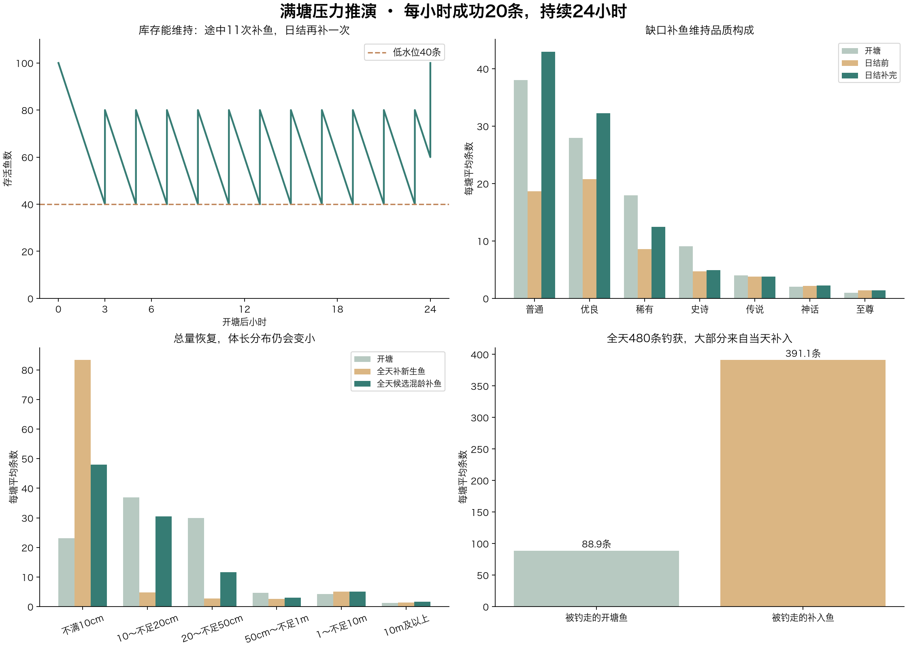

<!-- fishing-rule-status: historical-analysis; reviewed: 2026-11-04 -->
> **历史方案／实验，非现行要求。** 本文保留当时参数与结论供追溯，不能用于验收当前成长或预测现行鱼获；正文旧复现命令已停用。请先看[现行规则](../../策划/规格/玩法/钓鱼系统现行规则.md)，现行成长T80为1／2／3／5／7／10／14天，以入塘口径和实际共享实现为准。

# 满塘全天捕捞：每小时20条，一天480条

2026-11-03 · 4000个独立参考塘的离线条件推演，未修改业务算法。

## 场景与口径

接受每小时已经成功带走20条这一前提，共480条，保持上一报告的相对捕获倾向，不据基础概率判断是否能达到该产量。采用七品质参考高级塘，开塘100条；成长、个体上限波动和开塘初始化沿用上一报告。默认补入鱼都是出生4cm的新生鱼；这是对照假设，补鱼鱼龄尚未最终确定。另列此前候选70%幼鱼、25%成长鱼、5%较成熟鱼的混龄方案。

捕获对象按“品质抽取权重×品质咬钩基数×尺寸咬钩系数×竹竿品质适配×成功不脱钩概率”选择；每次捕获后重新计算存量。按新方案以个体上限归一化尺寸，不含鱼种适配差异。没有模拟钓位隔离、收杆占用、迁徙、睡眠、耐久、吃饵打窝及脱钩的额外生长。结果是这个简化模型的平均值，不能直接当作线上预测或其他类别塘的结果。

## 数量与补鱼节奏

第1小时100→80，第2小时80→60，第3小时60→40，触发补40条到80。以后每两小时重复80→60→40→80。第3、5、7、9、11、13、15、17、19、21、23小时各补40条，共11次、440条。第24小时80→60，日结再补40条回到100。

全天总计：开塘100＋途中补440＋日结补40−捕获480＝日结100条。沿用现有按品质缺口补鱼，理想品质数按容量100计算，逐条重算权重；低水位只决定补到80，不把品质理想数另改成80。

## 品质变化

| 品质 | 开塘100条 | 全天钓走480条 | 日结前60条 | 日结补完100条 |
| --- | --- | --- | --- | --- |
| 普通 | 38.06 | 297.56 | 18.66 | 42.96 |
| 优良 | 27.94 | 147.68 | 20.76 | 32.28 |
| 稀有 | 17.97 | 29.52 | 8.56 | 12.43 |
| 史诗 | 9.05 | 4.84 | 4.69 | 4.91 |
| 传说 | 3.98 | 0.37 | 3.77 | 3.82 |
| 神话 | 2.01 | 0.03 | 2.19 | 2.22 |
| 至尊 | 0.99 | 0.00 | 1.37 | 1.38 |

补鱼优先恢复缺少的普通、优良，因而能维持总量并大致拉回品质结构，但这不等于恢复鱼龄结构。表格小数是多塘平均；极小值经四舍五入可显示0，不代表绝无可能。

## 体长变化

| 体长 | 全天钓走480条 | 日结前60条 | 补幼鱼后100条 | 候选混龄补完100条 |
| --- | --- | --- | --- | --- |
| 不满10cm | 395.97 | 43.33 | 83.33 | 48.03 |
| 10～不足20cm | 50.20 | 4.85 | 4.85 | 30.55 |
| 20～不足50cm | 30.53 | 2.74 | 2.74 | 11.65 |
| 50cm～不足1m | 2.97 | 2.55 | 2.55 | 3.03 |
| 1～不足10m | 0.32 | 5.11 | 5.11 | 5.08 |
| 10m及以上 | 0.01 | 1.42 | 1.42 | 1.66 |

上表前三个结果来自“全补新生鱼”；最后一列来自独立运行的候选混龄方案，全天过程都会受混龄补入影响，并非只在最后一刻换40条鱼。

新生补鱼场景，全天钓获体长P10／中位数／P90为4.3／5.5／16.2厘米；日结后中位体长为4.9厘米。

## 原有鱼与新鱼去了哪里

初始100条中，约88.9条首日被钓走，约11.1条留到日结；留下的原有鱼偏向不易钓获的品质。480条钓获中约391.1条来自当天补入，占81.5%。

被钓走的补入鱼，入塘到钓走的时长P10／中位数／P90为0.27／1.37／4.08小时，其中95.8%不到6小时就被带走。新生补鱼时，这也是真实鱼龄；混龄方案的入塘时长不能等同真实鱼龄。

日结后100条中，约81.5条真实鱼龄不足6小时，约88.9条不足1天。即使普通1天可自然长到上限80%，也不代表它能在满负荷捕捞下活够1天。数量补足与年龄平衡是两件事。

## 设计含义

该规则能防止总量持续下降，但全天480条的持续捕捞会使低品质鱼快速周转，出现“新生鱼反复补入、几小时内被钓走，较难钓的鱼长期留下”的分层。仅加快普通鱼到80%的速度不能消除这一问题；如果希望满塘仍能钓到有成长经历的鱼，后续需要确定补鱼来源和入塘鱼龄，或调整成功捕获对象的相对选择方式。本报告不替你改动这些规则。

原始数据full-pond-results.json；复现脚本simulate_full_pond.py，固定随机种子2026110303，numpy与matplotlib。校验总库存、分品质守恒、每日480条捕获和480条补入，以及开塘100条的去留守恒。
