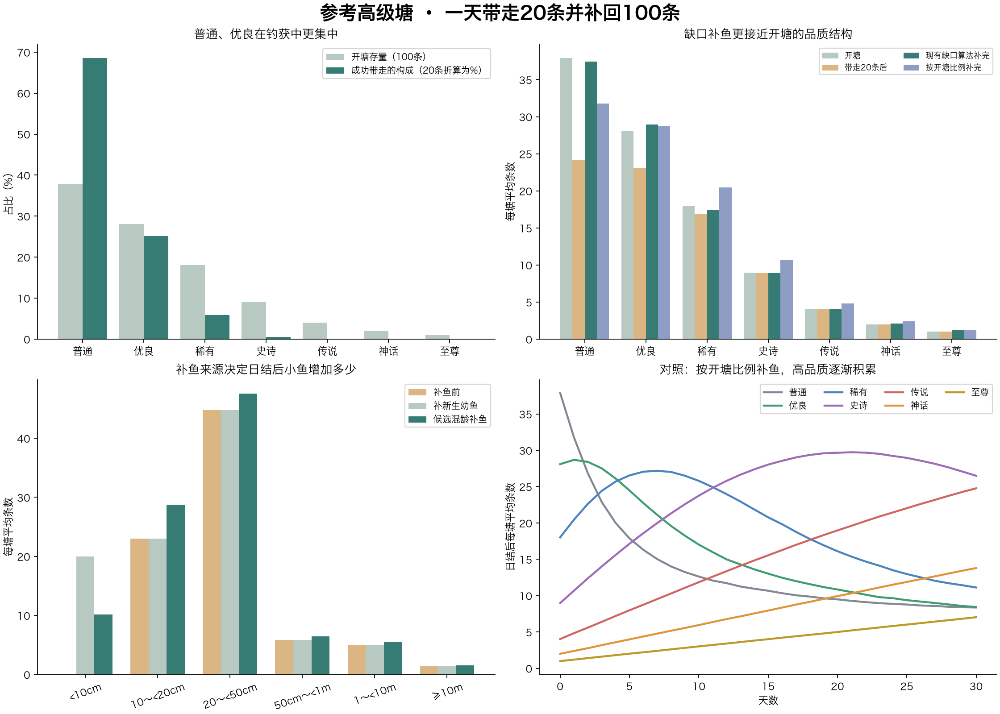

<!-- fishing-rule-status: historical-analysis; reviewed: 2026-11-04 -->
> **历史方案／实验，非现行要求。** 本文保留当时参数与结论供追溯，不能用于验收当前成长或预测现行鱼获；正文旧复现命令已停用。请先看[现行规则](../../策划/规格/玩法/钓鱼系统现行规则.md)，现行成长T80为1／2／3／5／7／10／14天，以入塘口径和实际共享实现为准。

# 一天捕捞与补鱼后的分布推演

2026-11-03 · 新成长方案与现行概率结构的条件推演，未修改业务代码。

## 计算口径

以七品质齐全的参考高级塘为例：初始100条，品质按38/28/18/9/4/2/1随机生成。采用新成长时间1、2、4、5、7、10、14天；出生4cm，上限围绕品质基准按候选三角分布±15%波动。初始体长均匀铺开，再反推出前14～0天内的出生时间。

按每线100名日参与用户、每人目标8条、40个塘平均分配，给定每塘一天成功带走20条。模拟4000个独立参考塘，固定种子2026110302，表中为平均条数；实际单塘是整数并有较大随机波动。每条鱼真实独立，成功带走后不再参加当天后续抽取。

采用现行的按品质抽鱼权重、品质咬钩基数、尺寸咬钩系数、尺寸脱钩曲线，并使用竹竿的品质适配。基础饵，无打窝、无额外营养。为适配新个体上限，尺寸归一化采用该鱼自己的上限；鱼种适配统一为1。没有模拟20个钓位的局部隔离、收杆占用、睡眠强制脱钩、竿损坏、回鱼、线上配置覆盖或脱钩后的增长。因此这是捕获20条的条件分布，不是现有服务器一天必然产出20条的预测，也不是线上实测。

在同一候选池内，某条鱼成功被带走的相对倾向为：

```
该鱼品质抽取权重 × 品质咬钩基数 × 尺寸咬钩系数 × 鱼竿品质适配 × (1−脱钩率)
```

同一池的公共选鱼分母与公共倍率可在成功条件分布中约去。模拟中的20次成功捕获均匀铺在24小时内，每次重新计算所有存活鱼的体长与相对倾向。

## 原始基础概率下的参考日

另做一次未强制捕获数的参考：半数塘安排2位玩家，半数3位，均在08:00～16:00连续8小时每分钟判定一次，即每塘平均20个玩家小时。按原始品质选择、咬钩与脱钩概率抽取结果，钓点倍率取均值2.5。

该参考日平均带走4.53条/塘，剩95.47条，日结平均补4.53条回到100。如果40个塘都采用同一参考配置，折算全线约181条；实际不同类别塘与装备不适用这个直接倍乘。

| 品质 | 开塘 | 原始概率参考带走 | 补鱼前 | 日结补完 |
| --- | --- | --- | --- | --- |
| 普通 | 37.89 | 3.21 | 34.68 | 37.26 |
| 优良 | 28.09 | 1.05 | 27.04 | 28.65 |
| 稀有 | 18.02 | 0.25 | 17.77 | 17.95 |
| 史诗 | 8.98 | 0.02 | 8.97 | 8.98 |
| 传说 | 4.02 | 0.0013 | 4.02 | 4.04 |
| 神话 | 2.00 | 0.0003 | 2.00 | 2.05 |
| 至尊 | 0.99 | 本次未观察到 | 0.99 | 1.07 |

这仍是“始终处于可判定等待态”的参考：没有扣除收杆占用，也没有钓位隔离、睡眠、耐久和线上覆盖配置。它用于展示基础饵概率与目标的差距，不能当作实服精确产量。下文则明确将成功数给定为20条，查看达到目标以后生态怎么变化。

## 目标情景：首日成功带走20条的品质变化

| 品质 | 开塘 | 一天带走 | 补鱼前 | 沿用缺口算法补完 | 按开塘比例补完 |
| --- | --- | --- | --- | --- | --- |
| 普通 | 37.89 | 13.70 | 24.19 | 37.44 | 31.76 |
| 优良 | 28.09 | 5.02 | 23.08 | 28.93 | 28.69 |
| 稀有 | 18.02 | 1.17 | 16.85 | 17.36 | 20.46 |
| 史诗 | 8.98 | 0.10 | 8.88 | 8.92 | 10.68 |
| 传说 | 4.02 | 0.0063 | 4.02 | 4.05 | 4.84 |
| 神话 | 2.00 | 0.0008 | 1.99 | 2.10 | 2.39 |
| 至尊 | 0.99 | 本次未观察到 | 0.99 | 1.19 | 1.19 |

数量关系是：补完后的该品质条数＝开塘条数−当天带走条数＋当日补入条数。主比较沿用现有缺口补鱼算法，逐条重算品质权重：普通、优良有缺口时加权，蓝色相对充足时压低，紫色及以上仍有存量时乘0.02。它偏向恢复低品质，不是精确凑齐每种品质的开塘条数。另列“完全按开塘品质比例抽补鱼”作为对照；这不是现有补鱼算法。两者都采用你最新的日结补足100条规则。

当前权重使普通、优良在成功捕获中占比明显高于它们的存量占比。现有缺口算法会优先把它们补回来，因此比按开塘比例随机补更能维持品质结构。若改成只按开塘比例补鱼，被带走少的高品质会逐渐积累；开塘品质概率不会自动成为每日结算后的固定存量比例。

首日4000塘合计80000条成功捕获样本中，神话观察到3条，至尊未观察到。未观察到或表格四舍五入显示0.00都不代表数学概率为零，极稀有品质的频率仍需要更大样本和完整会话模型验证。

## 首日体长变化

| 体长 | 一天带走 | 补鱼前存量 | 全新幼鱼补完 | 混龄方案补完 |
| --- | --- | --- | --- | --- |
| <10cm | 0.86 | 0.00 | 20.00 | 10.13 |
| 10～<20cm | 13.18 | 22.99 | 22.99 | 28.74 |
| 20～<50cm | 5.85 | 44.75 | 44.75 | 47.56 |
| 50cm～<1m | 0.10 | 5.88 | 5.88 | 6.44 |
| 1～<10m | 0.01 | 4.93 | 4.93 | 5.57 |
| ≥10m | 0.00 | 1.46 | 1.46 | 1.56 |

“全新幼鱼补完”将补入的20条全部设为4cm、鱼龄0天。“混龄方案补完”采用尚未确认的70%幼鱼、25%成长鱼、5%较成熟鱼，鱼龄分别为该品质T80的0～20%、20～80%、80～150%；迁入时间都是当日结算时刻，出生时间根据鱼龄确定，不编造此前经历。

本场景每天仅带走20条，补鱼前剩80条，全天不触发“≤40补到80”的低水位规则；日结补20条回到100。补鱼后的幼鱼增加属于新个体加入，原有存活鱼没有缩小。不同补鱼来源会改变体长分布；首日补入鱼的品质分布一致。

## 连续多日的品质变化

下表只演示对照方案：每日固定成功捕获20条、按开塘比例补鱼、全部补新生幼鱼。它不使用现有缺口补鱼权重，不能当作沿用现有算法的长期预测：

| 品质 | 开塘 | 第1天补完 | 第7天补完 | 第14天补完 | 第30天补完 |
| --- | --- | --- | --- | --- | --- |
| 普通 | 37.89 | 31.76 | 15.02 | 10.95 | 8.37 |
| 优良 | 28.09 | 28.69 | 21.11 | 13.62 | 8.43 |
| 稀有 | 18.02 | 20.46 | 27.18 | 21.85 | 11.12 |
| 史诗 | 8.98 | 10.68 | 19.99 | 27.38 | 26.49 |
| 传说 | 4.02 | 4.84 | 9.52 | 14.84 | 24.77 |
| 神话 | 2.00 | 2.39 | 4.77 | 7.55 | 13.79 |
| 至尊 | 0.99 | 1.19 | 2.40 | 3.81 | 7.03 |

后面的20条仍是外部给定目标。随着低品质减少，真实未调整概率下凑齐20条所需等待时间可能增加，不能据本表承诺未来每天仍能稳定带走20条。

## 原始概率与每小时1条目标的差距

使用均值钓点倍率2.5、每分钟判定一次，并假设玩家一直处于可判定的等待阶段，开塘时近似成功强度为每人每小时0.194条，8小时约1.55条。该数值仍未扣除收杆占用、空钓位等影响，也未加入付费饵的加成。运行中的配置和装备组合可能明显改变结果。

因此“每人8小时8条、全线800条”在本报告里是要达到的目标情景，原始基础饵概率尚不能据此视为已经达到。鱼群存量分布、成功钓获分布、补鱼分布需要分别看。



原始数据：harvest-results.json。复现：simulate_harvest.py，需要numpy和matplotlib。所有数值均为离线推演；未执行真实捕获、补鱼或数据库写入。
