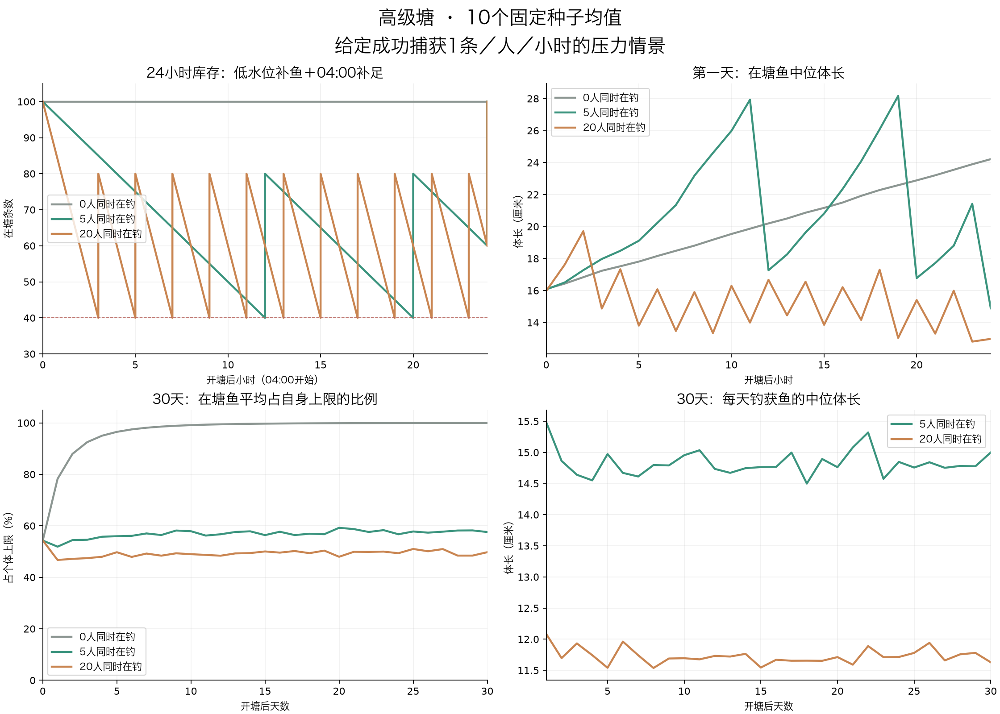

# FISH-ECOLOGY-01：实现后的24小时与30天生态压力模拟

2026-11-04。复用当前共享业务函数，六类正式塘×0／5／20人在钓×10个固定种子，共180次独立模拟、5400塘日。结果用于验证成长与补鱼的变化，未连接数据库。

**在给定每人每小时成功捕获1条的压力下，≤40补80和每日04:00补100能形成可重复的库存波动；混合规格补鱼能持续提供不同长度。长期无人捕捞时，鱼仍会接近各自上限。当前自然成长方案不等于已经实现人均每小时成功1条。**

## 怎样模拟

- 初始100条；原品质权重和合法鱼种池；幼鱼基准3.4～4.6厘米、独立上限±15%、T80=1／2／3／5／7／10／14天。初始体长先抽取，再倒推前14～0天入塘。
- 使用实际共享函数生成50%幼鱼／40%成长鱼／10%较成熟鱼；每小时检查≤40补80，每日上海时间04:00补100，重合仅日结；史诗及以上达到原表库存目标即停止补入。
- 0／5／20是同时在钓人数，全天持续。后两者每天120／480条成功捕获是输入负载；需15／60名用户按8小时轮班。一条100人线路每日最多800条的目标预算下，这些是单塘独立压力情景，不能把40塘都按满员相加。
- 在已发生成功捕获的条件下，按当前品质候选权重、咬钩与脱钩公式分配被捕获个体。采用全塘充分混合近似，位置系数1、竹竿、基础免费饵、个体咬脱偏置均为1。
- 未模拟实际咬钩时间、收杆占用、钓位局部密度与迁徙、摄食营养、打窝、回鱼、断竿、禁止塘驱离、死亡或迁出。巨物塘作为其配置的压力测试，不改变正式锁闭状态。
- 表内统计是10个种子的均值；“钓获中位体长”是各次模拟中位数的均值，并非混合全部样本后的中位数。小数条数是跨模拟均值。

## 第一天：高级塘

从04:00开塘开始计时，表内“日末”在次日04:00补足100之后。

| 同时在钓 | 成功捕获 | 补入 | 最低库存 | 小时补鱼次数 | 日结补鱼次数 | 钓获中位体长 | 日末在塘中位 | 日末≥80%上限 |
| --- | --- | --- | --- | --- | --- | --- | --- | --- |
| 0 | 0 | 0 | 100 | 0 | 0 | — | 24.2cm | 60.1% |
| 5 | 120 | 120 | 40 | 2 | 1 | 15.5cm | 14.9cm | 10.3% |
| 20 | 480 | 480 | 40 | 11 | 1 | 12.1cm | 13.0cm | 6.9% |

20人满负载时，库存从100降到80、60、40，首次在第3小时补至80；随后通常每2小时触发一次低水位补鱼，日结恢复100。5人情景第12、20小时触发低水位补鱼。因为捕获量固定、始终有鱼可捕，这些数量轨迹不受随机品质和尺寸影响；真实随机捕获会让触发时间前后移动。

## 不同品质被钓走与补入后的分布

高级塘单格为“当天捕获数 / 次日04:00补足后的在塘数”。高品质自动补入受库存上限限制；开塘随机超额个体允许继续存在，不能为了凑配额删除。

| 情景 | 普通 | 优良 | 稀有 | 史诗 | 传说 | 神话 | 至尊 |
| --- | --- | --- | --- | --- | --- | --- | --- |
| 5人·第1天 | 73.0 / 40.0 | 35.9 / 30.7 | 9.8 / 11.3 | 1.1 / 9.8 | 0.2 / 4.5 | 0.0 / 2.4 | 0.0 / 1.3 |
| 5人·第30天 | 73.5 / 40.4 | 37.9 / 31.3 | 7.1 / 11.8 | 1.5 / 9.0 | 0.0 / 4.0 | 0.0 / 2.2 | 0.0 / 1.3 |
| 20人·第1天 | 290.1 / 39.7 | 155.3 / 31.3 | 29.2 / 11.6 | 5.0 / 9.3 | 0.4 / 4.4 | 0.0 / 2.4 | 0.0 / 1.3 |
| 20人·第30天 | 294.8 / 40.8 | 151.7 / 31.1 | 27.5 / 11.8 | 5.3 / 8.9 | 0.6 / 4.0 | 0.1 / 2.1 | 0.0 / 1.3 |

## 30天后：六类塘对照

所有情景30天末均补足100条；捕获与补入严格守恒。钓获中位体长取最后7天的日统计均值。

| 鱼塘类别 | 在钓人数 | 30天捕获 | 30天补入 | 末7天钓获中位 | 第30天在塘中位 | ≥80%上限 | 初始鱼仍在塘 |
| --- | --- | --- | --- | --- | --- | --- | --- |
| 高级塘 | 0 | 0 | 0 | — | 32.5cm | 100.0% | 100.0 |
| 高级塘 | 5 | 3600 | 3600 | 14.8cm | 14.9cm | 20.8% | 4.6 |
| 高级塘 | 20 | 14400 | 14400 | 11.8cm | 13.1cm | 11.7% | 2.8 |
| 老手塘 | 0 | 0 | 0 | — | 41.3cm | 100.0% | 100.0 |
| 老手塘 | 5 | 3600 | 3600 | 14.4cm | 17.3cm | 25.5% | 7.8 |
| 老手塘 | 20 | 14400 | 14400 | 11.8cm | 15.3cm | 15.9% | 4.2 |
| 野外塘 | 0 | 0 | 0 | — | 34.1cm | 100.0% | 100.0 |
| 野外塘 | 5 | 3600 | 3600 | 13.1cm | 15.7cm | 32.0% | 13.2 |
| 野外塘 | 20 | 14400 | 14400 | 10.5cm | 14.6cm | 22.6% | 7.5 |
| 水库塘 | 0 | 0 | 0 | — | 33.6cm | 100.0% | 100.0 |
| 水库塘 | 5 | 3600 | 3600 | 13.0cm | 15.7cm | 32.0% | 12.8 |
| 水库塘 | 20 | 14400 | 14400 | 10.5cm | 14.5cm | 21.7% | 7.0 |
| 禁止塘 | 0 | 0 | 0 | — | 62.0cm | 100.0% | 100.0 |
| 禁止塘 | 5 | 3600 | 3600 | 16.7cm | 25.6cm | 22.4% | 6.9 |
| 禁止塘 | 20 | 14400 | 14400 | 14.0cm | 22.1cm | 14.0% | 3.0 |
| 巨物塘 | 0 | 0 | 0 | — | 34.1cm | 100.0% | 100.0 |
| 巨物塘 | 5 | 3600 | 3600 | 14.6cm | 15.4cm | 22.8% | 4.6 |
| 巨物塘 | 20 | 14400 | 14400 | 11.7cm | 13.6cm | 13.6% | 2.8 |

## 稳定态与周期性

数量上存在由固定捕获负载、低水位补鱼和04:00日结共同产生的周期；它不是鱼自然繁殖形成的生态平衡。以下高级塘每周“每日04:00补鱼后平均体长”的均值，可以观察尺寸是否仍在缓慢漂移。

| 在钓人数 | 第1周均长 | 第2周均长 | 第3周均长 | 第4周均长 | 第4周相对第3周 |
| --- | --- | --- | --- | --- | --- |
| 0 | 82.7cm | 1.02m | 1.08m | 1.11m | 持续趋近上限 |
| 5 | 80.3cm | 1.02m | 1.10m | 1.11m | 1.4% |
| 20 | 78.4cm | 94.6cm | 1.03m | 1.07m | 3.2% |

繁忙塘的大多数低品质鱼在捕获和补入间更替，尺寸分布可进入有波动的重复区间；较少被捕获的高品质鱼会继续长大，因此总平均体长可能在低品质已稳定后仍上升。30天和10个种子只能支持这一条件下的趋势，不能证明严格平稳分布或全部玩家行为下都稳定。无人塘没有捕获与自然更替，会逐渐堆积接近个体上限的鱼；±15%仅保留个体尺寸差异，不会自动更新鱼群。

## 与当前捕获概率的边界

下表仅把当前共享概率在全塘充分混合、位置系数1、竹竿＋免费饵、每小时60次独立判定的条件下，折算为“单人每小时理论成功机会”。尚未扣除收杆占用、空钓位、断竿等实际损失，也未加入收费饵与打窝帮助；不是实际用户产量模拟。

| 库存来自的压力情景 | 开塘时 | 第1天补鱼后 | 第30天补鱼后 |
| --- | --- | --- | --- |
| 0 | 0.058 | 0.075 | 0.084 |
| 5 | 0.058 | 0.055 | 0.055 |
| 20 | 0.058 | 0.052 | 0.052 |

这说明“补鱼能够承受1条／人／小时”与“当前咬钩算法能产出1条／人／小时”需要分别验收。后者仍需结合真实装备、饵料、局部钓位和在线过程校准。

## 校验与复现

- 1,098,000条生成记录：初始历史入塘范围、实际补入时刻和上限合法。
- 80,136,000次尺寸检查：从实际入塘长度连续增长、不超过个体上限；本次营养与离塘时间均为0。
- 2,289,600次库存守恒检查：当前库存＝100＋累计补入−累计捕获＋回鱼（本次0）。
- 54,116次高品质新增检查：每条新增前真实计数严格低于原浮点理想数，批次内实时更新。
- 所有日结后库存100、无空塘负载失败、无超100补入。这里未替代服务端事务、重启幂等或并发测试。

脚本：scripts/simulate-fish-entry-ecology.ts。数据：[implementation-simulation.json](implementation-simulation.json)。图表由同目录绘图脚本使用标准Matplotlib从该JSON生成。固定种子20261104～20261113；运行前构建shared，使用tsx运行模拟。
