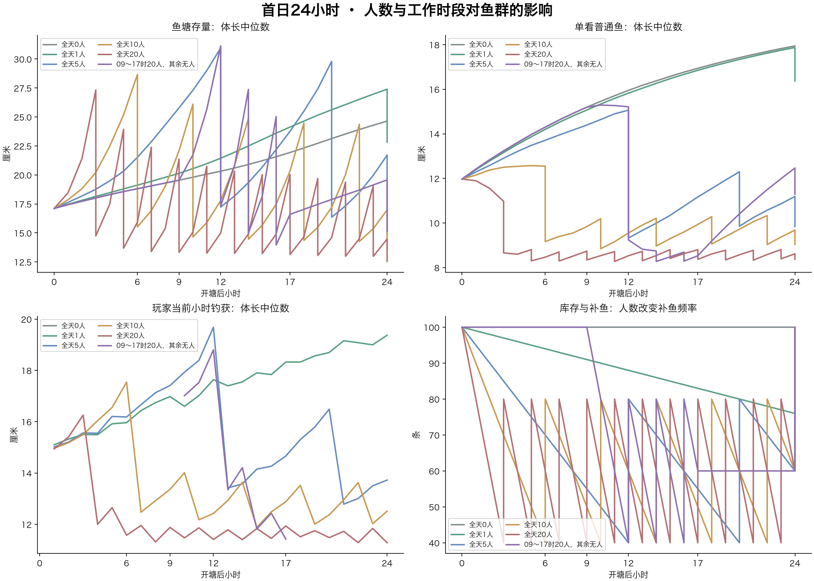
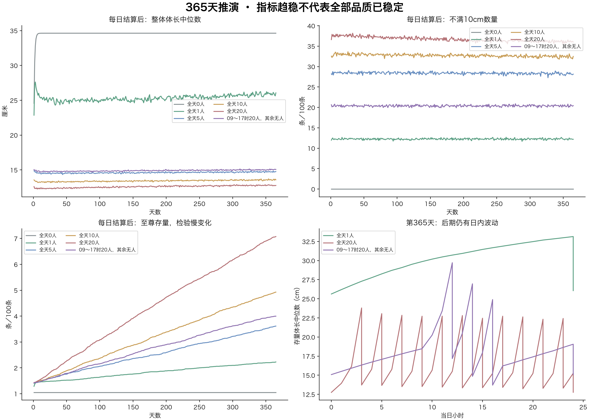

# 人数与时间变化：日内体长曲线、稳定态与周期波动

2026-11-03 · 50%幼鱼／40%成长鱼／10%较成熟鱼 · 仅离线分析，未修改业务算法。

## 模拟口径

同一参考高级塘，开塘100条、初始品质38/28/18/9/4/2/1、新成长速度及个体上限波动沿用前次。每人每小时成功带走1条是外部给定目标，不是代码默认概率的实测产量。比较0、1、5、10、20人全天钓鱼，以及09:00～17:00有20人、其余无人；全天20人可由不同玩家轮班，不假设同一玩家在线24小时。

每小时末检查≤40补至80，日结优先补到100，品质仍按原有缺口权重逐条选择；每条补入鱼以50/40/10独立抽取年龄阶段，按T80的0～20%／20～80%／80～150%赋龄并算体长。出生基准4cm与个体上限±15%仍是对照模型设定，不是当前程序补鱼参数；出生时间与入塘时间分开。无衰老死亡、繁殖、捕食、营养或脱钩额外成长，不模拟钓位隔离、耐久和收杆。

首日使用1024个独立塘，逐条捕获前更新成长。365天使用256个独立塘，为降低计算量，将本小时捕获倾向冻结在小时中点，用无放回加权抽样移除当小时捕获数，小时末按真实时间计算体长。首日20人场景，近似法与逐条法的日结中位体长差0.01cm，不满10cm数量差0.10条；这是合并随机波动的敏感性参照，不能保证所有场景和长期误差都同样小。

以下体长均为所有模拟塘中存活鱼的合并中位数，非少量巨物拉高的算术平均数；小时结果为该小时补鱼后，24小时结果为日结后。玩家钓获另画曲线，不与存量混用。

## 首日：人数改变捕捞与补鱼频率

| 场景 | 每天钓走 | 0小时 | 6小时 | 12小时 | 18小时 | 24小时补完 |
| --- | --- | --- | --- | --- | --- | --- |
| 全天0人 | 0 | 17.1cm | 18.8cm | 20.3cm | 22.3cm | 24.6cm |
| 全天1人 | 24 | 17.1cm | 19.1cm | 21.4cm | 24.6cm | 22.8cm |
| 全天5人 | 120 | 17.1cm | 21.5cm | 17.2cm | 25.5cm | 14.9cm |
| 全天10人 | 240 | 17.1cm | 15.5cm | 17.8cm | 14.4cm | 13.6cm |
| 全天20人 | 480 | 17.1cm | 15.9cm | 15.0cm | 14.7cm | 12.5cm |
| 09～17时20人，其余无人 | 160 | 17.1cm | 18.8cm | 17.3cm | 17.0cm | 15.2cm |

无人时只有原鱼自然成长，没有缺口就不补鱼；人少时原有鱼有更多时间长大，日结补鱼形成一次扰动；人多时普通、优良被反复带走，补鱼更频繁，存量与钓获体长会受到不同影响。某段存量体长上升，可能是小鱼被钓走或大鱼留下，并不意味着玩家更容易钓到大鱼；可对照普通鱼和实际钓获曲线。

## 多日变化：用同一时刻比较，避免把日内波动当趋势

| 场景 | 第1天 | 第7天 | 第30天 | 第90天 | 第180天 | 第365天 |
| --- | --- | --- | --- | --- | --- | --- |
| 全天0人 | 24.6cm | 34.5cm | 34.6cm | 34.6cm | 34.6cm | 34.6cm |
| 全天1人 | 22.9cm | 25.7cm | 25.3cm | 24.7cm | 25.1cm | 26.1cm |
| 全天5人 | 14.9cm | 14.6cm | 14.5cm | 14.6cm | 14.6cm | 14.8cm |
| 全天10人 | 13.6cm | 13.2cm | 13.3cm | 13.4cm | 13.3cm | 13.6cm |
| 全天20人 | 12.6cm | 12.4cm | 12.3cm | 12.5cm | 12.6cm | 12.8cm |
| 09～17时20人，其余无人 | 15.0cm | 14.9cm | 14.8cm | 14.7cm | 14.9cm | 15.1cm |

## 稳定态如何判断

库存总数可被规则稳定在一个范围内，但体长、鱼龄、品质不因此自动稳定。最后两个相邻30天窗口为第306～335天与第336～365天，比较每天同一结算时刻：

| 场景 | 前30天中位体长均值 | 末30天中位体长均值 | 品质分布变化量 | 至尊数量变化 |
| --- | --- | --- | --- | --- |
| 全天0人 | 34.63cm | 34.63cm | 0.00条 | +0.00条 |
| 全天1人 | 25.76cm | 25.89cm | 0.21条 | +0.06条 |
| 全天5人 | 14.71cm | 14.72cm | 0.29条 | +0.18条 |
| 全天10人 | 13.54cm | 13.57cm | 0.27条 | +0.27条 |
| 全天20人 | 12.77cm | 12.79cm | 0.45条 | +0.45条 |
| 09～17时20人，其余无人 | 15.01cm | 15.03cm | 0.31条 | +0.19条 |

20人全天场景，第7天与第365天的日结中位体长分别为12.4cm和12.8cm，常见体长很快进入一个波动区间；但至尊从开塘平均1.1条增加到第365天的7.1条，最后两个30天窗口仍增加约0.45条。这支持“常见体长趋稳、极稀有存量仍在慢变”，不能认定完整生态已经稳定。该场景第365天算术平均体长为3.54米，而中位数只有12.8厘米，说明少量巨物会严重影响平均值。

品质分布变化量为两窗口各品质平均条数差的绝对值总和的一半，用于观察整体结构移动；不是统计显著性或严格收敛判据。256塘的一年推演只能提供有限期证据，不能用某个指标接近平坦证明完整生态已稳定。特别要看不易钓获的至尊是否仍积累。

在固定非零捕捞压力、补鱼来源、品质权重和时刻安排下，可能逐渐形成重复的统计分布：同一日内时刻的体长结构相近，但单条鱼和单塘仍随机变化。高品质捕获倾向极低、仍有非零补入机会、又没有衰老死亡，使这部分库存可能在远长于普通鱼周转的时间尺度上继续变化。整体中位数先稳定，不代表稀有鱼群、鱼龄尾部也稳定。无人塘的鱼龄持续增加，体长则渐近各自上限，不能称为具有持续个体更替的生态平衡。

## 能否形成周期性波动

可以形成由规则和客流驱动的波动：阈值补鱼使库存下降后突然回升；新补入鱼通常较年轻，体长分布在补鱼时跳变，随后随生长和选择性捕捞变化；每天固定结算与重复的工作日程带来24小时相位。20人恒定捕捞时，开塘首日第3小时起每两小时补40条，日结把库存拉回100，下一天重走相同数量节奏。

1人全天每天只钓24条，不触发低水位，主要体现日结一次补鱼；5人会在第12小时首次触发，之后第20小时再触发；10人在第6小时首次触发，此后每4小时一次；20人首次第3小时，此后每2小时一次。09～17时20人的场景，工作时段反复捕捞补鱼，夜间停止移除让原有鱼继续长，构成更明显的客流日周期。具体体长跳变方向和幅度取决于当时存量与补入年龄，不能把库存锯齿直接当作同幅度的体长锯齿。

这些主要是人为补鱼、日结和客流带来的外部周期，不是模型已经产生繁殖、衰老或捕食的自主生态循环；客流随机时，周期会被扰动。若希望玩家感到有涨有落，现有规则已经能制造变化；若希望长期品质与鱼龄都可控，仍需要监测难钓鱼积累和老鱼去向，不能只监测鱼数或体长中位数。

原始数据occupancy-cycles-results.json，脚本analyze_occupancy_cycles.py，固定种子2026110304。逐日校验数量守恒、逐品质守恒、每天结算100条。曲线与结论均针对这个简化设计模型。
