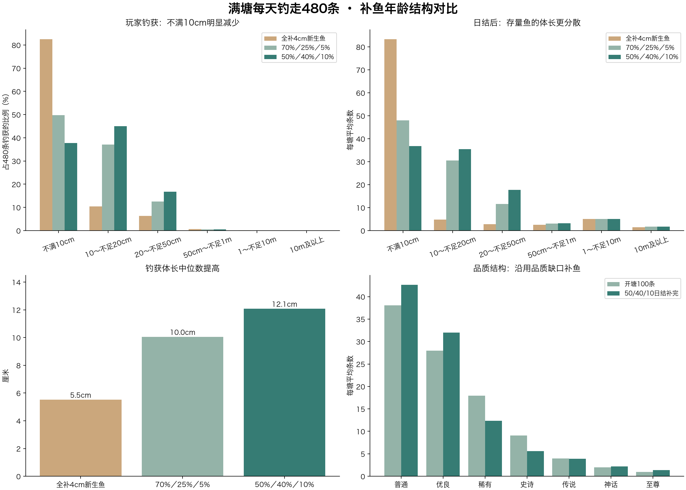

# 补鱼50%幼鱼、40%成长鱼、10%较成熟鱼：满塘全天推演

2026-11-03 · 4000个独立参考塘，仍按每小时已经成功带走20条、一天480条计算。只更新离线报告和预览，未修改游戏算法。

## 本次只调整补入鱼的年龄结构

开塘100条、七品质高级塘原始比例、品质上限基准与候选个体波动、自然成长速度、相对钓获概率、品质缺口补鱼权重，都与上一轮相同。每小时检查≤40补到80，日结补到100；途中11次各补40，日结再补40，全天补入480条。

本次每条补入鱼先按原有品质缺口规则确定品质，再独立以50%／40%／10%选择年龄阶段，不按阶段改变品质。每批40条平均20条幼鱼、16条成长鱼、4条较成熟鱼；单批随机结果可以波动，并非强制配额。

阶段定义沿用此前方案：幼鱼年龄为本品质T80的0～20%，成长鱼20%～80%，较成熟鱼80%～150%，区间内均匀抽取；T80指自然长到该鱼自身上限80%所需时间。阶段是年龄区间，不是体长百分比，较成熟鱼也不保证已经达到80%体长。

| 品质 | 达到80%的时间 | 幼鱼的入塘鱼龄 | 成长鱼的入塘鱼龄 | 较成熟鱼的入塘鱼龄 |
| --- | --- | --- | --- | --- |
| 普通 | 1天 | 0～0.2天 | 0.2～0.8天 | 0.8～1.5天 |
| 优良 | 2天 | 0～0.4天 | 0.4～1.6天 | 1.6～3天 |
| 稀有 | 4天 | 0～0.8天 | 0.8～3.2天 | 3.2～6天 |
| 史诗 | 5天 | 0～1天 | 1～4天 | 4～7.5天 |
| 传说 | 7天 | 0～1.4天 | 1.4～5.6天 | 5.6～10.5天 |
| 神话 | 10天 | 0～2天 | 2～8天 | 8～15天 |
| 至尊 | 14天 | 0～2.8天 | 2.8～11.2天 | 11.2～21天 |

参考模型中每条鱼都从出生4cm按成长公式算到补入鱼龄，再在鱼塘内继续长；4cm只是模型的出生基准，混龄鱼并非以4cm补入。出生日期按鱼龄倒推，入塘日期另记，不编造在本鱼塘吃饵、脱钩等经历。当前程序的“按个体上限12%～28%生成幼鱼”不是本次模拟的初始化规则，因此以下是设计方案比较，不是当前程序实测。

## 三种补鱼方案对比

| 指标 | 全补4cm新生鱼 | 70%／25%／5% | 50%／40%／10% |
| --- | --- | --- | --- |
| 钓获体长中位数（cm） | 5.5 | 10.0 | 12.1 |
| 钓获体长P90（cm） | 16.2 | 23.1 | 25.3 |
| 钓获中不满10cm占比 | 82.5% | 49.7% | 37.7% |
| 钓获中已达到自身上限80%的占比 | 4.7% | 8.0% | 11.3% |
| 日结后不满10cm数量 | 83.3 | 48.0 | 36.9 |
| 日结后体长中位数（cm） | 4.9 | 10.4 | 12.6 |
| 日结后留下的开塘鱼 | 11.1 | 12.1 | 12.4 |
| 被钓走补入鱼的入塘时长中位数（小时） | 1.37 | 1.32 | 1.32 |

P90表示约90%的钓获不超过该体长。三种方案从完全一致的开塘鱼群开始，并在同样的24小时内完成480次成功捕获；各自全天所有补鱼均使用对应年龄结构，并非只替换最后一批。

## 50%／40%／10%的品质变化

| 品质 | 开塘100条 | 全天钓走480条 | 日结前60条 | 日结补完100条 |
| --- | --- | --- | --- | --- |
| 普通 | 38.06 | 294.57 | 18.54 | 42.62 |
| 优良 | 27.94 | 151.74 | 20.23 | 31.97 |
| 稀有 | 17.97 | 29.31 | 8.41 | 12.33 |
| 史诗 | 9.05 | 4.07 | 5.39 | 5.58 |
| 传说 | 3.98 | 0.28 | 3.86 | 3.91 |
| 神话 | 2.01 | 0.02 | 2.20 | 2.22 |
| 至尊 | 0.99 | 0.0013 | 1.37 | 1.37 |

## 50%／40%／10%的体长变化

| 体长 | 全天钓走480条 | 钓获占比 | 日结前60条 | 日结补完100条 |
| --- | --- | --- | --- | --- |
| 不满10cm | 181.06 | 37.72% | 17.31 | 36.86 |
| 10～不足20cm | 215.76 | 44.95% | 20.58 | 35.49 |
| 20～不足50cm | 80.34 | 16.74% | 12.24 | 17.67 |
| 50cm～不足1m | 2.59 | 0.54% | 3.12 | 3.18 |
| 1～不足10m | 0.24 | 0.05% | 5.03 | 5.07 |
| 10m及以上 | 0.01 | 0.00% | 1.72 | 1.73 |

钓获体长P10／中位数／P90为6.5／12.1／25.3厘米。日结后中位体长为12.6厘米。稀有品质或大体长段的平均条数可小于1，单塘仍是整数，小数不是保证每塘都能钓到。

## 鱼的来源与成长经历

全天480条中约87.6条来自开塘鱼，约392.4条来自当天补入；开塘100条最后留下约12.4条。被钓走的补入鱼，在本塘停留时长P10／中位数／P90为0.27／1.32／3.97小时，96.2%在6小时内被带走。

这些鱼会带着补入前的真实鱼龄和体长进入，但在本塘的经历仍然只有几小时。提高混龄比例能改善玩家钓获体长，不能把入塘前的成长算作玩家在本塘见证的成长。两种时间应分别展示。

## 模型边界

这仍是“每小时成功20条已经实现”的条件推演，未验证现行基础饵概率能达到该速度；没有将等待时间、收杆占用、20钓位隔离、迁徙、竿损坏、睡眠或营养与脱钩加速成长接入完整服务器模型。其余参数沿用前次：出生4cm、个体上限候选三角波动±15%、个体上限归一化尺寸。只能比较同一模型下年龄结构改变的效果，不是线上产量承诺。

原始结果restock-50-40-10-results.json；复现脚本compare_restock_50_40_10.py与simulate_full_pond.py；固定种子2026110303，4000塘。逐品质校验初始＋补入−捕获＝日结，校验480条钓获、480条补入、最终100条，以及开塘鱼去留守恒。
