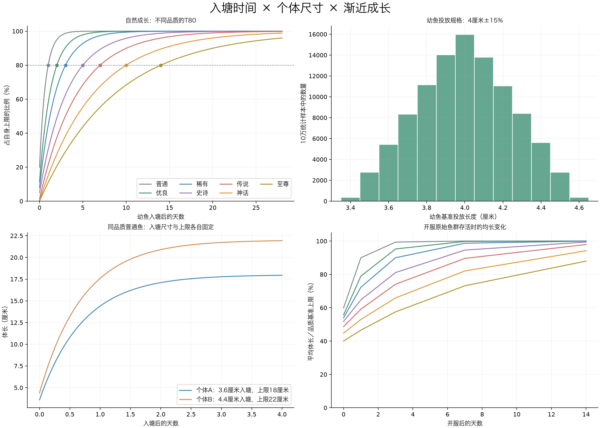

# 入塘口径修订与自然成长验证

2026-11-03 · 离线模型，未修改业务代码或数据库。

**4厘米改为投放幼鱼规格，每条固定3.4～4.6厘米；履历记录入塘时间和在塘生存时间，不再推算真实出生日期。** 开服前14～0天改为历史入塘批次，开服当天已呈现不同体长。规格和上限分别独立采用中心多、两端少的三角分布。

## 参考单鱼：从4厘米入塘

以下上限取各品质基准，仅自然成长，不含营养。正式鱼的投放规格和上限均有±15%固定差异。

| 品质 | 自然T80 | 入塘 | 1天 | 3天 | 7天 | 14天 |
| --- | --- | --- | --- | --- | --- | --- |
| 普通 | 1天 | 4.0厘米 | 16.0厘米 | 19.8厘米 | 20.0厘米 | 20.0厘米 |
| 优良 | 2天 | 4.0厘米 | 20.3厘米 | 31.7厘米 | 34.8厘米 | 35.0厘米 |
| 稀有 | 3天 | 4.0厘米 | 22.3厘米 | 40.0厘米 | 48.7厘米 | 50.0厘米 |
| 史诗 | 5天 | 4.0厘米 | 24.3厘米 | 50.2厘米 | 71.4厘米 | 79.0厘米 |
| 传说 | 7天 | 4.0厘米 | 64.3厘米 | 1.51米 | 2.40米 | 2.88米 |
| 神话 | 10天 | 4.0厘米 | 2.26米 | 5.76米 | 10.1米 | 13.4米 |
| 至尊 | 14天 | 4.0厘米 | 4.38米 | 11.7米 | 22.1米 | 32.0米 |

## 开服初始分布与后续存活

每品质抽取100,000条统计样本，固定种子20261103；并非向实际鱼塘投放70万条鱼。S与C先生成并按0.001米保存，再在S至L14之间均匀抽长度，反解历史入塘时间。各塘初始品质仍用原权重，表中为同品质跨大量鱼塘的统计，不保证每塘都有所有品质。

| 品质 | 开服P10 | 开服P50 | 开服P90 | 在塘时长P50 | 存活+1天均长 | +3天 | +7天 | +14天 |
| --- | --- | --- | --- | --- | --- | --- | --- | --- |
| 普通 | 5.6厘米 | 11.9厘米 | 18.4厘米 | 0.50天 | 18.0厘米 | 19.9厘米 | 20.0厘米 | 20.0厘米 |
| 优良 | 7.1厘米 | 19.4厘米 | 31.8厘米 | 0.93天 | 27.6厘米 | 33.3厘米 | 34.9厘米 | 35.0厘米 |
| 稀有 | 8.5厘米 | 26.9厘米 | 45.3厘米 | 1.36天 | 36.2厘米 | 45.0厘米 | 49.4厘米 | 50.0厘米 |
| 史诗 | 11.5厘米 | 41.2厘米 | 71.3厘米 | 2.17天 | 51.8厘米 | 64.9厘米 | 75.7厘米 | 79.5厘米 |
| 传说 | 32.2厘米 | 1.45米 | 2.59米 | 2.86天 | 1.77米 | 2.22米 | 2.69米 | 2.94米 |
| 神话 | 1.36米 | 6.69米 | 12.0米 | 3.68天 | 7.95米 | 9.88米 | 12.3米 | 14.1米 |
| 至尊 | 3.21米 | 15.9米 | 28.7米 | 4.43天 | 18.6米 | 23.0米 | 29.3米 | 35.2米 |

“存活+N天”只追踪原始鱼，没有捕获、补鱼、摄食或脱钩。长期无人捕捞，鱼仍会趋近各自上限；不能用这张图证明补鱼后形成稳定态。此前捕捞推演使用旧参数，仍保留为历史参考，尚未按本次入塘规格重跑。

## 时间与长度怎样解释

- 初始鱼：实际记录的历史入塘时长为0～14天；所有初始鱼当时都以各自3.4～4.6厘米规格入塘。
- 后续补入鱼：已明确确认50%幼鱼、40%成长鱼、10%较成熟鱼的混合规格，幼鱼以3.4～4.6厘米为基准、各阶段按曲线生成实际入塘长度；所有新补入鱼从实际投放时刻累计在本塘时长，不得假称早已在本塘生活。
- 摄食：另存额外成长分钟，能提前变大；不会让“在塘2天”变成“在塘3天”。
- 钓获：冻结入塘时间、在塘时长、入塘长度和本次尺寸等履历快照。入塘后长大量＝钓获长度−实际入塘长度。

## 校验范围

七品质合计700,000样本校验了幼鱼范围、自然T80、初始化反解0～14天、单调渐近、成长规格接入连续性与营养时间分离。通过的仅为离线数学模型，不代表现有服务器已经切换。每日04:00、补鱼事务、滚动营养额度、玩家历史保留与实际捕获产量需在开发阶段验证。

数据：[stocking-results.json](stocking-results.json)；脚本：[verify_stocking_model.py](verify_stocking_model.py)。
