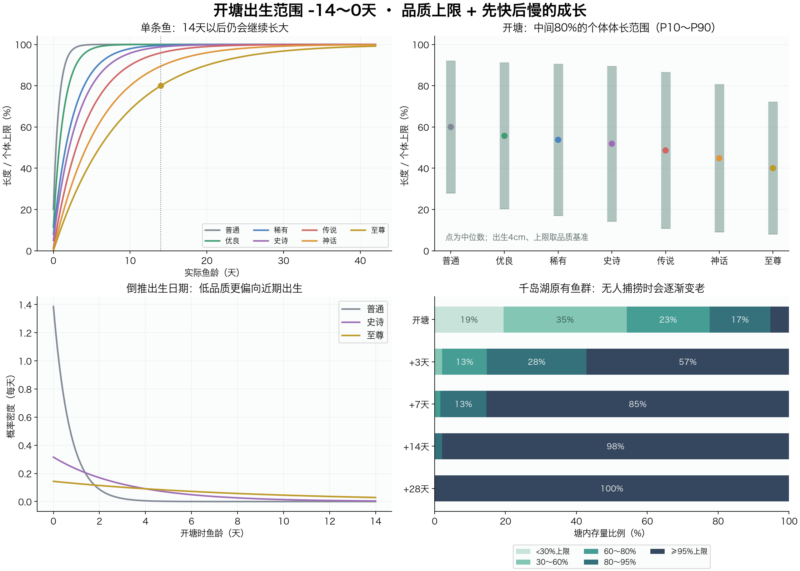
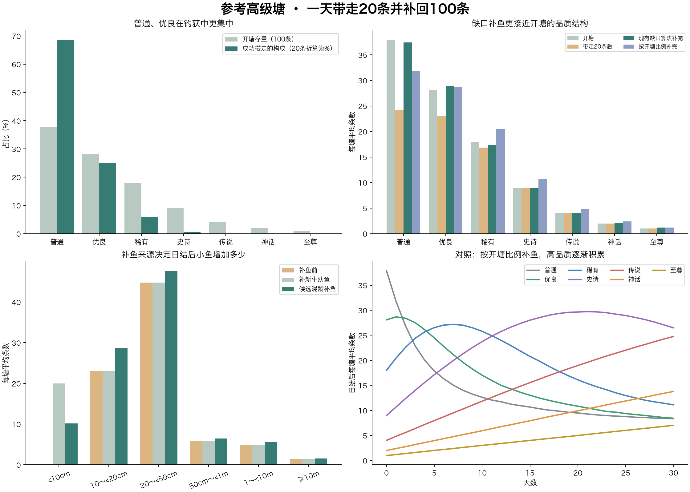
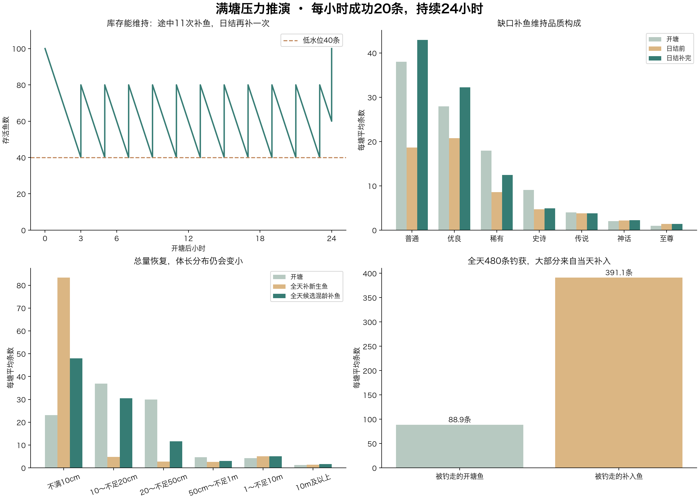
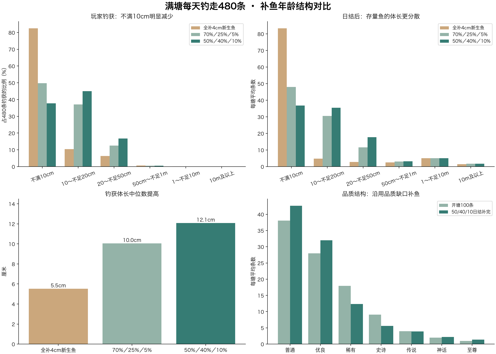
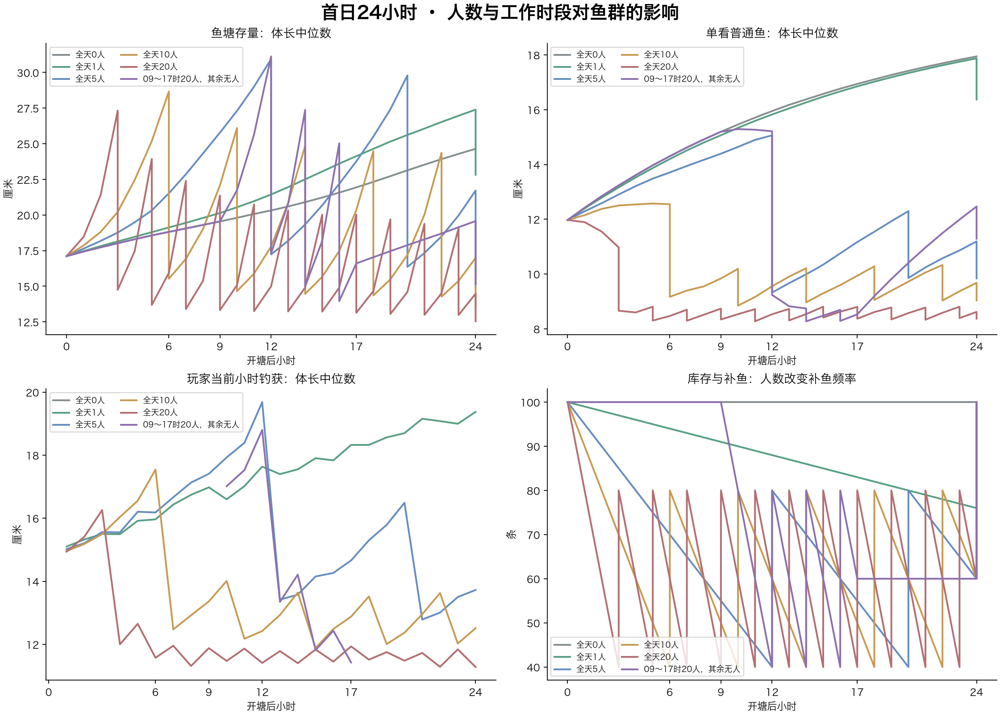
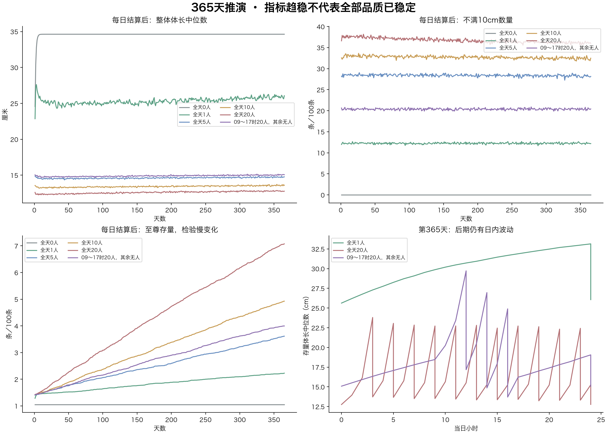

<!-- fishing-rule-status: historical-analysis; reviewed: 2026-11-04 -->
> **历史方案／实验，非现行要求。** 本文保留当时参数与结论供追溯，不能用于验收当前成长或预测现行鱼获；正文旧复现命令已停用。请先看[现行规则](../../策划/规格/玩法/钓鱼系统现行规则.md)，现行成长T80为1／2／3／5／7／10／14天，以入塘口径和实际共享实现为准。

# 开塘鱼群体长与成长变化报告

2026-11-03更新 · 方案参数与离线推演，尚未替换业务算法。

## 结论

保留每个鱼塘原有品质概率和鱼种池；每条鱼的出生时间限制在开塘前14～0天。先铺开每条鱼的初始体长，再反推出生日期。至尊鱼自然成长14天，达到自身上限的80%；之后继续变大，越接近上限越慢。

“前14天”是初始化鱼龄范围，不是鱼的寿命或停止成长时间。

## 本轮确认的补鱼与成长调整

- 普通鱼自然达到个体上限80%的时间改为1天；优良鱼改为2天。
- 低库存每小时检查一次：剩余≤40条时补到80条；41条及以上不触发本轮低水位补鱼。
- 每日固定结算仍补足100条。日结与低水位检查在同一时刻发生时，直接按日结目标补足100条，合并处理，避免重复补鱼。
- 补鱼按实际缺口计算。例如低水位检查时剩40条补40条；日结时剩40条补60条，剩80条补20条。
- 自然成长按真实鱼龄计算，未额外加速的普通鱼出生满24小时达到80%。每天同一时刻补入的普通幼鱼，到次日同一时刻均达到80%或以上；日间临时补鱼需按实际鱼龄判断，跨过零点不代表已经过了24小时。
- 此处的低库存规则已经更新，前半部分图表只模拟自然成长；后续捕捞章节是固定成功次数的条件推演，尚非完整会话验证。70%幼鱼、25%成长鱼、5%较成熟鱼，以及每日营养增益上限6小时，仍作为待评估建议，尚未作为已确认参数实施。

## 1. 哪些已明确，哪些是本次参考参数

- 已明确：原品质分布；品质上限基准20cm、35cm、50cm、80cm、3m、15m、40m；每条鱼有固定的个体上限波动；出生于前14～0天；普通1天、优良2天、至尊14天达到80%；成长先快后慢。
- 当前对比采用各品质80%时间1、2、4、5、7、10、14天。普通、优良已按本轮要求更新，至尊14天沿用既定约束，其他天数保留前次参考参数。这里的80%指“实际长度/该鱼个体上限”，不是完成剩余生长空间的80%。
- 为量化个体波动，鱼塘样本暂用上限基准×三角分布(0.85,1.00,1.15)，以基准附近最常见。±15%并非此前已定案的最终范围。
- 本报告所有样本统一出生4cm，隔离鱼种出生体长对结果的影响；它不表示正式设计中所有鱼种都从4cm出生。单品质对比表上限取品质基准；鱼塘统计表才叠加候选的个体上限波动。接入鱼种出生体长时，必须确保出生体长低于个体上限80%，建议最多为个体上限25%，再重新生成统计表。
- 本轮各品质使用固定的80%时间，鱼种影响出生体长，个体上限影响实际每小时增长多少。额外的鱼种速度系数与随机速度未叠加进本次推演；若保留，需重新校准，保证最慢至尊个体也在14天内到80%。
- 前半部分采用纯自然成长情景：跟踪同一批存活鱼，不包含捕捞、补鱼、自然死亡、回鱼、打窝或脱钩加成。附加的“一天捕捞与补鱼后分布”章节另列条件捕获模型与假设。

## 2. 原有品质分布

| 鱼塘类别 | 普通 | 优良 | 稀有 | 史诗 | 传说 | 神话 | 至尊 |
| --- | --- | --- | --- | --- | --- | --- | --- |
| 高级 | 38.00% | 28.00% | 18.00% | 9.00% | 4.00% | 2.00% | 1.00% |
| 老手 | 30.00% | 20.00% | 20.00% | 15.00% | 10.00% | 3.00% | 2.00% |
| 野外 | 45.00% | 10.00% | 10.00% | 10.00% | 15.00% | 5.00% | 5.00% |
| 水库 | 45.00% | 10.00% | 10.00% | 10.00% | 15.00% | 5.00% | 5.00% |
| 禁止 | 15.00% | 15.00% | 20.00% | 30.00% | 10.00% | 7.00% | 3.00% |
| 巨物 | 36.97% | 26.89% | 17.65% | 10.08% | 5.04% | 2.52% | 0.84% |
| 新手 | 57.58% | 42.42% | 0.00% | 0.00% | 0.00% | 0.00% | 0.00% |

以上是原设计配置权重归一化后的抽取概率，不是每塘固定配额，也不是成功钓获比例。巨物塘原权重之和119，按119归一化。普通鱼塘初始100条；新手塘仍为原配置1条，不扩充为100条。

核对代码时还发现：千岛湖、太湖、洪泽湖、万绿湖、北江的现有鱼种池只覆盖到第6品质，至尊权重抽中后会触发回退。本报告按你要求保留原设计品质概率，不把该回退结果当作目标分布；正式落实新塘初始化前，需要处理这个既有配置冲突。

## 3. 成长曲线

令C为个体上限、B为出生体长、t为实际鱼龄（天）、T为该品质80%时间：

```
k = ln((C-B)/(0.2×C)) / T
L(t) = C - (C-B) × exp(-k×t)
```

因此L(0)=B，L(T)=0.8C。增长速度k(C-B)exp(-kt)一直下降；14天后仍增长。数学上渐近上限，存储或显示四舍五入后仍可能显示成上限。

| 品质 | 80%上限时间 | 95%上限时间 | 99%上限时间 |
| --- | --- | --- | --- |
| 普通 | 1.0天 | 2.0天 | 3.2天 |
| 优良 | 2.0天 | 3.9天 | 6.0天 |
| 稀有 | 4.0天 | 7.6天 | 11.9天 |
| 史诗 | 5.0天 | 9.4天 | 14.6天 |
| 传说 | 7.0天 | 13.1天 | 20.1天 |
| 神话 | 10.0天 | 18.6天 | 28.6天 |
| 至尊 | 14.0天 | 26.1天 | 40.1天 |

参考单条鱼的实际鱼龄变化（均从4.0cm出生）：

| 品质 | 上限基准 | 80%时间 | 1天 | 3天 | 7天 | 14天 | 28天 | 42天 |
| --- | --- | --- | --- | --- | --- | --- | --- | --- |
| 普通 | 20.0cm | 1天 | 16.0cm | 19.8cm | 20.0cm | 20.0cm | 20.0cm | 20.0cm |
| 优良 | 35.0cm | 2天 | 20.3cm | 31.7cm | 34.8cm | 35.0cm | 35.0cm | 35.0cm |
| 稀有 | 50.0cm | 4天 | 18.6cm | 35.4cm | 46.8cm | 49.8cm | 50.0cm | 50.0cm |
| 史诗 | 80.0cm | 5天 | 24.3cm | 50.2cm | 71.4cm | 79.0cm | 80.0cm | 80.0cm |
| 传说 | 3.00m | 7天 | 64.3cm | 1.51m | 2.40m | 2.88m | 3.00m | 3.00m |
| 神话 | 15.0m | 10天 | 2.26m | 5.76m | 10.1m | 13.4m | 14.8m | 15.0m |
| 至尊 | 40.0m | 14天 | 4.38m | 11.7m | 22.1m | 32.0m | 38.4m | 39.7m |

同品质不同个体的差异示例：

| 个体上限 | 1天 | 3天 | 7天 | 14天 |
| --- | --- | --- | --- | --- |
| 19.2cm | 15.4cm | 19.0cm | 19.2cm | 19.2cm |
| 22.6cm | 18.1cm | 22.3cm | 22.6cm | 22.6cm |

这两条普通鱼都在1天达到各自上限的80%，但长度不同；它们初始出生日期也可不同，因此同一时刻的长度差异还会进一步变化。

## 4. 出生日期如何分布

对每条鱼先计算它14天时的长度L14，再抽取U∈[0,1]：

```
开塘长度 = B + U × (L14-B)
开塘鱼龄 = -ln((C-开塘长度)/(C-B)) / k
出生时间 = 开塘时间 - 开塘鱼龄
```

这样每条鱼的初始体长在B～L14之间均匀分布，出生日期自动落在前14～0天。可用分层抽样让同品质的多个个体均匀覆盖体长区间，区间内部保留随机；稀有品质只有一条时照常随机，不保证它是大鱼。

倒推后的鱼龄服从0～14天内的截断指数分布：f(t)=k×exp(-kt)/(1-exp(-14k))。它不是额外抽一次年龄，而是同一个体长分布的另一种表达。

这么选的原因：若普通鱼出生日期在14天内均匀分布，已有85.7%超过自身上限的95%；改成先铺体长再倒推，降至6.2%。普通鱼不会开塘就大面积挤在极限附近。至尊最多14天鱼龄，因此开塘不会自然出现超过个体上限80%的至尊鱼。

每个品质的初始化分布如下（4cm出生、基准上限）：

| 品质 | 初始可取范围 | P10 | 中位体长 | P90 | 鱼龄中位数 |
| --- | --- | --- | --- | --- | --- |
| 普通 | 4.0cm～20.0cm | 5.6cm | 12.0cm | 18.4cm | 0.50天 |
| 优良 | 4.0cm～35.0cm | 7.1cm | 19.5cm | 31.9cm | 0.93天 |
| 稀有 | 4.0cm～49.8cm | 8.6cm | 26.9cm | 45.2cm | 1.80天 |
| 史诗 | 4.0cm～79.0cm | 11.5cm | 41.5cm | 71.5cm | 2.18天 |
| 传说 | 4.0cm～2.88m | 32.4cm | 1.46m | 2.60m | 2.86天 |
| 神话 | 4.0cm～13.4m | 1.38m | 6.73m | 12.1m | 3.69天 |
| 至尊 | 4.0cm～32.0m | 3.24m | 16.0m | 28.8m | 4.44天 |

P10～P90是跨大量初始化个体的中间80%范围，不是一个只有1条至尊鱼的鱼塘内实际分布。均匀长度抽样使中位体长也等于平均体长。

## 5. 初始鱼塘会是什么样

以下按各类鱼塘原设计品质概率，每类别抽100,000个统计样本，固定种子20261102。统一出生4cm，并应用上述候选上限波动。同类鱼塘使用同一组估计值，方便比较；未将鱼种出生体长差异混入这次成长曲线对比。

表中为折算到原配置初始条数的“期望条数”，不是新增10万条鱼，也不是每塘强制配额。实际100条样本可能没有至尊鱼，也可能有多条；小数仅用于显示期望，逐格取整可能不等于总条数。

| 鱼塘 | 初始条数 | <20cm | 20～<50cm | 50cm～<1m | 1～<10m | ≥10m |
| --- | --- | --- | --- | --- | --- | --- |
| 千岛湖 | 100 | 59.9 | 29.9 | 4.7 | 4.2 | 1.2 |
| 太湖 | 100 | 59.9 | 29.9 | 4.7 | 4.2 | 1.2 |
| 洪泽湖 | 100 | 59.9 | 29.9 | 4.7 | 4.2 | 1.2 |
| 鄱阳湖 | 100 | 59.9 | 29.9 | 4.7 | 4.2 | 1.2 |
| 洞庭湖 | 100 | 59.9 | 29.9 | 4.7 | 4.2 | 1.2 |
| 滇池 | 100 | 50.4 | 30.2 | 8.2 | 9.1 | 2.1 |
| 洱海 | 100 | 50.4 | 30.2 | 8.2 | 9.1 | 2.1 |
| 镜泊湖 | 100 | 50.4 | 30.2 | 8.2 | 9.1 | 2.1 |
| 查干湖 | 100 | 50.4 | 30.2 | 8.2 | 9.1 | 2.1 |
| 万绿湖 | 100 | 55.4 | 18.0 | 7.1 | 14.8 | 4.8 |
| 北江 | 100 | 55.4 | 18.0 | 7.1 | 14.8 | 4.8 |
| 丹江口水库 | 100 | 55.4 | 18.0 | 7.1 | 14.8 | 4.8 |
| 清江 | 100 | 55.4 | 18.0 | 7.1 | 14.8 | 4.8 |
| 舟山近海 | 100 | 55.6 | 18.1 | 6.9 | 14.7 | 4.7 |
| 厦门湾 | 100 | 55.6 | 18.1 | 6.9 | 14.7 | 4.7 |
| 南澳近海 | 100 | 55.6 | 18.1 | 6.9 | 14.7 | 4.7 |
| 长江故道野塘 | 100 | 36.5 | 33.7 | 13.9 | 11.9 | 3.9 |
| 青岛近海 | 100 | 36.5 | 33.7 | 13.9 | 11.9 | 3.9 |
| 涠洲近海 | 100 | 36.5 | 33.7 | 13.9 | 11.9 | 3.9 |
| 兴凯湖 | 100 | 58.6 | 29.7 | 5.3 | 5.3 | 1.2 |
| 城郊练杆塘 | 1 | 0.8 | 0.2 | 0.0 | 0.0 | 0.0 |

## 6. 开塘以后，原来的鱼会怎么变

以下只跟踪原有存活鱼：以开塘鱼龄为起点继续成长，不能在开塘时把鱼龄清零。平均体长如下（4cm出生、基准上限）：

| 品质 | 开塘 | 开塘后3天 | 7天 | 14天 | 28天 |
| --- | --- | --- | --- | --- | --- |
| 普通 | 12.0cm | 19.9cm | 20.0cm | 20.0cm | 20.0cm |
| 优良 | 19.5cm | 33.3cm | 34.9cm | 35.0cm | 35.0cm |
| 稀有 | 26.9cm | 42.6cm | 48.4cm | 49.9cm | 50.0cm |
| 史诗 | 41.5cm | 64.9cm | 75.7cm | 79.5cm | 80.0cm |
| 传说 | 1.46m | 2.22m | 2.69m | 2.94m | 3.00m |
| 神话 | 6.73m | 9.89m | 12.3m | 14.1m | 14.9m |
| 至尊 | 16.0m | 23.0m | 29.3m | 35.2m | 39.0m |

“开塘后14天”和“鱼龄14天”不同：原始鱼在开塘后14天的实际鱼龄是14～28天，所以至尊鱼群此时平均长度已经超过32m。



## 7. 这套设计能解决什么，还剩什么

开塘时的低品质鱼不再因年龄均匀而大部分接近上限；品质、个体上限、出生体长、出生日期共同决定玩家钓上来的长度。自然成长不再14天停止。

但同一批鱼若长期无人捕捞、也无自然更新，最终仍会接近各自上限；个体上限差异只会让它们显示不同长度。反过来，20人持续捕捞、只补新生鱼，仍可能以幼鱼为主。本报告明确不把初始分布当作长期生态已经稳定的证明。

现行脱钩按当前体长增加2%的机制、打窝的额外长度、回鱼增长，都可能改变这里的自然成长轨迹。落实时须把它们一起接入、限制不超过个体上限，并分别记录自然鱼龄与额外增长。本次没有将这些加成伪造成出生更早；初始化也不编造吃饵、咬钩或脱钩历史。

## 数据与复现

- 品质与上限：shared/generated/game-data/fish_quality_stats.json。
- 鱼塘品质权重：shared/generated/game-data/pond_category_quality_weights.json。
- 初始数量、鱼种池：ponds.json、pond_fish_pool.json、fish_species.json。
- 原选种规则：shared/gameData.client.ts 的 pickSpawnFish / pickPondSpeciesForQuality。
- 本报告只新增离线分析文件、图表和预览入口，没有修改成长、补鱼或捕捞业务配置。
- 原始汇总：results.json；复现脚本：analyze.py（numpy、matplotlib）。校验了出生鱼龄范围、公式反解、14天80%标定、体长单调性、上限约束及分布总和。


## 一天捕捞与补鱼后的分布推演

2026-11-03 · 新成长方案与现行概率结构的条件推演，未修改业务代码。

### 计算口径

以七品质齐全的参考高级塘为例：初始100条，品质按38/28/18/9/4/2/1随机生成。采用新成长时间1、2、4、5、7、10、14天；出生4cm，上限围绕品质基准按候选三角分布±15%波动。初始体长均匀铺开，再反推出前14～0天内的出生时间。

按每线100名日参与用户、每人目标8条、40个塘平均分配，给定每塘一天成功带走20条。模拟4000个独立参考塘，固定种子2026110302，表中为平均条数；实际单塘是整数并有较大随机波动。每条鱼真实独立，成功带走后不再参加当天后续抽取。

采用现行的按品质抽鱼权重、品质咬钩基数、尺寸咬钩系数、尺寸脱钩曲线，并使用竹竿的品质适配。基础饵，无打窝、无额外营养。为适配新个体上限，尺寸归一化采用该鱼自己的上限；鱼种适配统一为1。没有模拟20个钓位的局部隔离、收杆占用、睡眠强制脱钩、竿损坏、回鱼、线上配置覆盖或脱钩后的增长。因此这是捕获20条的条件分布，不是现有服务器一天必然产出20条的预测，也不是线上实测。

在同一候选池内，某条鱼成功被带走的相对倾向为：

```
该鱼品质抽取权重 × 品质咬钩基数 × 尺寸咬钩系数 × 鱼竿品质适配 × (1−脱钩率)
```

同一池的公共选鱼分母与公共倍率可在成功条件分布中约去。模拟中的20次成功捕获均匀铺在24小时内，每次重新计算所有存活鱼的体长与相对倾向。

### 原始基础概率下的参考日

另做一次未强制捕获数的参考：半数塘安排2位玩家，半数3位，均在08:00～16:00连续8小时每分钟判定一次，即每塘平均20个玩家小时。按原始品质选择、咬钩与脱钩概率抽取结果，钓点倍率取均值2.5。

该参考日平均带走4.53条/塘，剩95.47条，日结平均补4.53条回到100。如果40个塘都采用同一参考配置，折算全线约181条；实际不同类别塘与装备不适用这个直接倍乘。

| 品质 | 开塘 | 原始概率参考带走 | 补鱼前 | 日结补完 |
| --- | --- | --- | --- | --- |
| 普通 | 37.89 | 3.21 | 34.68 | 37.26 |
| 优良 | 28.09 | 1.05 | 27.04 | 28.65 |
| 稀有 | 18.02 | 0.25 | 17.77 | 17.95 |
| 史诗 | 8.98 | 0.02 | 8.97 | 8.98 |
| 传说 | 4.02 | 0.0013 | 4.02 | 4.04 |
| 神话 | 2.00 | 0.0003 | 2.00 | 2.05 |
| 至尊 | 0.99 | 本次未观察到 | 0.99 | 1.07 |

这仍是“始终处于可判定等待态”的参考：没有扣除收杆占用，也没有钓位隔离、睡眠、耐久和线上覆盖配置。它用于展示基础饵概率与目标的差距，不能当作实服精确产量。下文则明确将成功数给定为20条，查看达到目标以后生态怎么变化。

### 目标情景：首日成功带走20条的品质变化

| 品质 | 开塘 | 一天带走 | 补鱼前 | 沿用缺口算法补完 | 按开塘比例补完 |
| --- | --- | --- | --- | --- | --- |
| 普通 | 37.89 | 13.70 | 24.19 | 37.44 | 31.76 |
| 优良 | 28.09 | 5.02 | 23.08 | 28.93 | 28.69 |
| 稀有 | 18.02 | 1.17 | 16.85 | 17.36 | 20.46 |
| 史诗 | 8.98 | 0.10 | 8.88 | 8.92 | 10.68 |
| 传说 | 4.02 | 0.0063 | 4.02 | 4.05 | 4.84 |
| 神话 | 2.00 | 0.0008 | 1.99 | 2.10 | 2.39 |
| 至尊 | 0.99 | 本次未观察到 | 0.99 | 1.19 | 1.19 |

数量关系是：补完后的该品质条数＝开塘条数−当天带走条数＋当日补入条数。主比较沿用现有缺口补鱼算法，逐条重算品质权重：普通、优良有缺口时加权，蓝色相对充足时压低，紫色及以上仍有存量时乘0.02。它偏向恢复低品质，不是精确凑齐每种品质的开塘条数。另列“完全按开塘品质比例抽补鱼”作为对照；这不是现有补鱼算法。两者都采用你最新的日结补足100条规则。

当前权重使普通、优良在成功捕获中占比明显高于它们的存量占比。现有缺口算法会优先把它们补回来，因此比按开塘比例随机补更能维持品质结构。若改成只按开塘比例补鱼，被带走少的高品质会逐渐积累；开塘品质概率不会自动成为每日结算后的固定存量比例。

首日4000塘合计80000条成功捕获样本中，神话观察到3条，至尊未观察到。未观察到或表格四舍五入显示0.00都不代表数学概率为零，极稀有品质的频率仍需要更大样本和完整会话模型验证。

### 首日体长变化

| 体长 | 一天带走 | 补鱼前存量 | 全新幼鱼补完 | 混龄方案补完 |
| --- | --- | --- | --- | --- |
| <10cm | 0.86 | 0.00 | 20.00 | 10.13 |
| 10～<20cm | 13.18 | 22.99 | 22.99 | 28.74 |
| 20～<50cm | 5.85 | 44.75 | 44.75 | 47.56 |
| 50cm～<1m | 0.10 | 5.88 | 5.88 | 6.44 |
| 1～<10m | 0.01 | 4.93 | 4.93 | 5.57 |
| ≥10m | 0.00 | 1.46 | 1.46 | 1.56 |

“全新幼鱼补完”将补入的20条全部设为4cm、鱼龄0天。“混龄方案补完”采用尚未确认的70%幼鱼、25%成长鱼、5%较成熟鱼，鱼龄分别为该品质T80的0～20%、20～80%、80～150%；迁入时间都是当日结算时刻，出生时间根据鱼龄确定，不编造此前经历。

本场景每天仅带走20条，补鱼前剩80条，全天不触发“≤40补到80”的低水位规则；日结补20条回到100。补鱼后的幼鱼增加属于新个体加入，原有存活鱼没有缩小。不同补鱼来源会改变体长分布；首日补入鱼的品质分布一致。

### 连续多日的品质变化

下表只演示对照方案：每日固定成功捕获20条、按开塘比例补鱼、全部补新生幼鱼。它不使用现有缺口补鱼权重，不能当作沿用现有算法的长期预测：

| 品质 | 开塘 | 第1天补完 | 第7天补完 | 第14天补完 | 第30天补完 |
| --- | --- | --- | --- | --- | --- |
| 普通 | 37.89 | 31.76 | 15.02 | 10.95 | 8.37 |
| 优良 | 28.09 | 28.69 | 21.11 | 13.62 | 8.43 |
| 稀有 | 18.02 | 20.46 | 27.18 | 21.85 | 11.12 |
| 史诗 | 8.98 | 10.68 | 19.99 | 27.38 | 26.49 |
| 传说 | 4.02 | 4.84 | 9.52 | 14.84 | 24.77 |
| 神话 | 2.00 | 2.39 | 4.77 | 7.55 | 13.79 |
| 至尊 | 0.99 | 1.19 | 2.40 | 3.81 | 7.03 |

后面的20条仍是外部给定目标。随着低品质减少，真实未调整概率下凑齐20条所需等待时间可能增加，不能据本表承诺未来每天仍能稳定带走20条。

### 原始概率与每小时1条目标的差距

使用均值钓点倍率2.5、每分钟判定一次，并假设玩家一直处于可判定的等待阶段，开塘时近似成功强度为每人每小时0.194条，8小时约1.55条。该数值仍未扣除收杆占用、空钓位等影响，也未加入付费饵的加成。运行中的配置和装备组合可能明显改变结果。

因此“每人8小时8条、全线800条”在本报告里是要达到的目标情景，原始基础饵概率尚不能据此视为已经达到。鱼群存量分布、成功钓获分布、补鱼分布需要分别看。



原始数据：harvest-results.json。复现：simulate_harvest.py，需要numpy和matplotlib。所有数值均为离线推演；未执行真实捕获、补鱼或数据库写入。


## 满塘全天捕捞：每小时20条，一天480条

2026-11-03 · 4000个独立参考塘的离线条件推演，未修改业务算法。

### 场景与口径

接受每小时已经成功带走20条这一前提，共480条，保持上一报告的相对捕获倾向，不据基础概率判断是否能达到该产量。采用七品质参考高级塘，开塘100条；成长、个体上限波动和开塘初始化沿用上一报告。默认补入鱼都是出生4cm的新生鱼；这是对照假设，补鱼鱼龄尚未最终确定。另列此前候选70%幼鱼、25%成长鱼、5%较成熟鱼的混龄方案。

捕获对象按“品质抽取权重×品质咬钩基数×尺寸咬钩系数×竹竿品质适配×成功不脱钩概率”选择；每次捕获后重新计算存量。按新方案以个体上限归一化尺寸，不含鱼种适配差异。没有模拟钓位隔离、收杆占用、迁徙、睡眠、耐久、吃饵打窝及脱钩的额外生长。结果是这个简化模型的平均值，不能直接当作线上预测或其他类别塘的结果。

### 数量与补鱼节奏

第1小时100→80，第2小时80→60，第3小时60→40，触发补40条到80。以后每两小时重复80→60→40→80。第3、5、7、9、11、13、15、17、19、21、23小时各补40条，共11次、440条。第24小时80→60，日结再补40条回到100。

全天总计：开塘100＋途中补440＋日结补40−捕获480＝日结100条。沿用现有按品质缺口补鱼，理想品质数按容量100计算，逐条重算权重；低水位只决定补到80，不把品质理想数另改成80。

### 品质变化

| 品质 | 开塘100条 | 全天钓走480条 | 日结前60条 | 日结补完100条 |
| --- | --- | --- | --- | --- |
| 普通 | 38.06 | 297.56 | 18.66 | 42.96 |
| 优良 | 27.94 | 147.68 | 20.76 | 32.28 |
| 稀有 | 17.97 | 29.52 | 8.56 | 12.43 |
| 史诗 | 9.05 | 4.84 | 4.69 | 4.91 |
| 传说 | 3.98 | 0.37 | 3.77 | 3.82 |
| 神话 | 2.01 | 0.03 | 2.19 | 2.22 |
| 至尊 | 0.99 | 0.00 | 1.37 | 1.38 |

补鱼优先恢复缺少的普通、优良，因而能维持总量并大致拉回品质结构，但这不等于恢复鱼龄结构。表格小数是多塘平均；极小值经四舍五入可显示0，不代表绝无可能。

### 体长变化

| 体长 | 全天钓走480条 | 日结前60条 | 补幼鱼后100条 | 候选混龄补完100条 |
| --- | --- | --- | --- | --- |
| 不满10cm | 395.97 | 43.33 | 83.33 | 48.03 |
| 10～不足20cm | 50.20 | 4.85 | 4.85 | 30.55 |
| 20～不足50cm | 30.53 | 2.74 | 2.74 | 11.65 |
| 50cm～不足1m | 2.97 | 2.55 | 2.55 | 3.03 |
| 1～不足10m | 0.32 | 5.11 | 5.11 | 5.08 |
| 10m及以上 | 0.01 | 1.42 | 1.42 | 1.66 |

上表前三个结果来自“全补新生鱼”；最后一列来自独立运行的候选混龄方案，全天过程都会受混龄补入影响，并非只在最后一刻换40条鱼。

新生补鱼场景，全天钓获体长P10／中位数／P90为4.3／5.5／16.2厘米；日结后中位体长为4.9厘米。

### 原有鱼与新鱼去了哪里

初始100条中，约88.9条首日被钓走，约11.1条留到日结；留下的原有鱼偏向不易钓获的品质。480条钓获中约391.1条来自当天补入，占81.5%。

被钓走的补入鱼，入塘到钓走的时长P10／中位数／P90为0.27／1.37／4.08小时，其中95.8%不到6小时就被带走。新生补鱼时，这也是真实鱼龄；混龄方案的入塘时长不能等同真实鱼龄。

日结后100条中，约81.5条真实鱼龄不足6小时，约88.9条不足1天。即使普通1天可自然长到上限80%，也不代表它能在满负荷捕捞下活够1天。数量补足与年龄平衡是两件事。

### 设计含义

该规则能防止总量持续下降，但全天480条的持续捕捞会使低品质鱼快速周转，出现“新生鱼反复补入、几小时内被钓走，较难钓的鱼长期留下”的分层。仅加快普通鱼到80%的速度不能消除这一问题；如果希望满塘仍能钓到有成长经历的鱼，后续需要确定补鱼来源和入塘鱼龄，或调整成功捕获对象的相对选择方式。本报告不替你改动这些规则。



原始数据full-pond-results.json；复现脚本simulate_full_pond.py，固定随机种子2026110303，numpy与matplotlib。校验总库存、分品质守恒、每日480条捕获和480条补入，以及开塘100条的去留守恒。


## 补鱼50%幼鱼、40%成长鱼、10%较成熟鱼：满塘全天推演

2026-11-03 · 4000个独立参考塘，仍按每小时已经成功带走20条、一天480条计算。只更新离线报告和预览，未修改游戏算法。

### 本次只调整补入鱼的年龄结构

开塘100条、七品质高级塘原始比例、品质上限基准与候选个体波动、自然成长速度、相对钓获概率、品质缺口补鱼权重，都与上一轮相同。每小时检查≤40补到80，日结补到100；途中11次各补40，日结再补40，全天补入480条。

本次每条补入鱼先按原有品质缺口规则确定品质，再独立以50%／40%／10%选择年龄阶段，不按阶段改变品质。每批40条平均20条幼鱼、16条成长鱼、4条较成熟鱼；单批随机结果可以波动，并非强制配额。

阶段定义沿用此前方案：幼鱼年龄为本品质T80的0～20%，成长鱼20%～80%，较成熟鱼80%～150%，区间内均匀抽取；T80指自然长到该鱼自身上限80%所需时间。阶段是年龄区间，不是体长百分比，较成熟鱼也不保证已经达到80%体长。

| 品质 | 达到80%的时间 | 幼鱼的入塘鱼龄 | 成长鱼的入塘鱼龄 | 较成熟鱼的入塘鱼龄 |
| --- | --- | --- | --- | --- |
| 普通 | 1天 | 0～0.2天 | 0.2～0.8天 | 0.8～1.5天 |
| 优良 | 2天 | 0～0.4天 | 0.4～1.6天 | 1.6～3天 |
| 稀有 | 4天 | 0～0.8天 | 0.8～3.2天 | 3.2～6天 |
| 史诗 | 5天 | 0～1天 | 1～4天 | 4～7.5天 |
| 传说 | 7天 | 0～1.4天 | 1.4～5.6天 | 5.6～10.5天 |
| 神话 | 10天 | 0～2天 | 2～8天 | 8～15天 |
| 至尊 | 14天 | 0～2.8天 | 2.8～11.2天 | 11.2～21天 |

参考模型中每条鱼都从出生4cm按成长公式算到补入鱼龄，再在鱼塘内继续长；4cm只是模型的出生基准，混龄鱼并非以4cm补入。出生日期按鱼龄倒推，入塘日期另记，不编造在本鱼塘吃饵、脱钩等经历。当前程序的“按个体上限12%～28%生成幼鱼”不是本次模拟的初始化规则，因此以下是设计方案比较，不是当前程序实测。

### 三种补鱼方案对比

| 指标 | 全补4cm新生鱼 | 70%／25%／5% | 50%／40%／10% |
| --- | --- | --- | --- |
| 钓获体长中位数（cm） | 5.5 | 10.0 | 12.1 |
| 钓获体长P90（cm） | 16.2 | 23.1 | 25.3 |
| 钓获中不满10cm占比 | 82.5% | 49.7% | 37.7% |
| 钓获中已达到自身上限80%的占比 | 4.7% | 8.0% | 11.3% |
| 日结后不满10cm数量 | 83.3 | 48.0 | 36.9 |
| 日结后体长中位数（cm） | 4.9 | 10.4 | 12.6 |
| 日结后留下的开塘鱼 | 11.1 | 12.1 | 12.4 |
| 被钓走补入鱼的入塘时长中位数（小时） | 1.37 | 1.32 | 1.32 |

P90表示约90%的钓获不超过该体长。三种方案从完全一致的开塘鱼群开始，并在同样的24小时内完成480次成功捕获；各自全天所有补鱼均使用对应年龄结构，并非只替换最后一批。

### 50%／40%／10%的品质变化

| 品质 | 开塘100条 | 全天钓走480条 | 日结前60条 | 日结补完100条 |
| --- | --- | --- | --- | --- |
| 普通 | 38.06 | 294.57 | 18.54 | 42.62 |
| 优良 | 27.94 | 151.74 | 20.23 | 31.97 |
| 稀有 | 17.97 | 29.31 | 8.41 | 12.33 |
| 史诗 | 9.05 | 4.07 | 5.39 | 5.58 |
| 传说 | 3.98 | 0.28 | 3.86 | 3.91 |
| 神话 | 2.01 | 0.02 | 2.20 | 2.22 |
| 至尊 | 0.99 | 0.0013 | 1.37 | 1.37 |

### 50%／40%／10%的体长变化

| 体长 | 全天钓走480条 | 钓获占比 | 日结前60条 | 日结补完100条 |
| --- | --- | --- | --- | --- |
| 不满10cm | 181.06 | 37.72% | 17.31 | 36.86 |
| 10～不足20cm | 215.76 | 44.95% | 20.58 | 35.49 |
| 20～不足50cm | 80.34 | 16.74% | 12.24 | 17.67 |
| 50cm～不足1m | 2.59 | 0.54% | 3.12 | 3.18 |
| 1～不足10m | 0.24 | 0.05% | 5.03 | 5.07 |
| 10m及以上 | 0.01 | 0.00% | 1.72 | 1.73 |

钓获体长P10／中位数／P90为6.5／12.1／25.3厘米。日结后中位体长为12.6厘米。稀有品质或大体长段的平均条数可小于1，单塘仍是整数，小数不是保证每塘都能钓到。

### 鱼的来源与成长经历

全天480条中约87.6条来自开塘鱼，约392.4条来自当天补入；开塘100条最后留下约12.4条。被钓走的补入鱼，在本塘停留时长P10／中位数／P90为0.27／1.32／3.97小时，96.2%在6小时内被带走。

这些鱼会带着补入前的真实鱼龄和体长进入，但在本塘的经历仍然只有几小时。提高混龄比例能改善玩家钓获体长，不能把入塘前的成长算作玩家在本塘见证的成长。两种时间应分别展示。

### 模型边界

这仍是“每小时成功20条已经实现”的条件推演，未验证现行基础饵概率能达到该速度；没有将等待时间、收杆占用、20钓位隔离、迁徙、竿损坏、睡眠或营养与脱钩加速成长接入完整服务器模型。其余参数沿用前次：出生4cm、个体上限候选三角波动±15%、个体上限归一化尺寸。只能比较同一模型下年龄结构改变的效果，不是线上产量承诺。



原始结果restock-50-40-10-results.json；复现脚本compare_restock_50_40_10.py与simulate_full_pond.py；固定种子2026110303，4000塘。逐品质校验初始＋补入−捕获＝日结，校验480条钓获、480条补入、最终100条，以及开塘鱼去留守恒。


## 人数与时间变化：日内体长曲线、稳定态与周期波动

2026-11-03 · 50%幼鱼／40%成长鱼／10%较成熟鱼 · 仅离线分析，未修改业务算法。

### 模拟口径

同一参考高级塘，开塘100条、初始品质38/28/18/9/4/2/1、新成长速度及个体上限波动沿用前次。每人每小时成功带走1条是外部给定目标，不是代码默认概率的实测产量。比较0、1、5、10、20人全天钓鱼，以及09:00～17:00有20人、其余无人；全天20人可由不同玩家轮班，不假设同一玩家在线24小时。

每小时末检查≤40补至80，日结优先补到100，品质仍按原有缺口权重逐条选择；每条补入鱼以50/40/10独立抽取年龄阶段，按T80的0～20%／20～80%／80～150%赋龄并算体长。出生基准4cm与个体上限±15%仍是对照模型设定，不是当前程序补鱼参数；出生时间与入塘时间分开。无衰老死亡、繁殖、捕食、营养或脱钩额外成长，不模拟钓位隔离、耐久和收杆。

首日使用1024个独立塘，逐条捕获前更新成长。365天使用256个独立塘，为降低计算量，将本小时捕获倾向冻结在小时中点，用无放回加权抽样移除当小时捕获数，小时末按真实时间计算体长。首日20人场景，近似法与逐条法的日结中位体长差0.01cm，不满10cm数量差0.10条；这是合并随机波动的敏感性参照，不能保证所有场景和长期误差都同样小。

以下体长均为所有模拟塘中存活鱼的合并中位数，非少量巨物拉高的算术平均数；小时结果为该小时补鱼后，24小时结果为日结后。玩家钓获另画曲线，不与存量混用。

### 首日：人数改变捕捞与补鱼频率

| 场景 | 每天钓走 | 0小时 | 6小时 | 12小时 | 18小时 | 24小时补完 |
| --- | --- | --- | --- | --- | --- | --- |
| 全天0人 | 0 | 17.1cm | 18.8cm | 20.3cm | 22.3cm | 24.6cm |
| 全天1人 | 24 | 17.1cm | 19.1cm | 21.4cm | 24.6cm | 22.8cm |
| 全天5人 | 120 | 17.1cm | 21.5cm | 17.2cm | 25.5cm | 14.9cm |
| 全天10人 | 240 | 17.1cm | 15.5cm | 17.8cm | 14.4cm | 13.6cm |
| 全天20人 | 480 | 17.1cm | 15.9cm | 15.0cm | 14.7cm | 12.5cm |
| 09～17时20人，其余无人 | 160 | 17.1cm | 18.8cm | 17.3cm | 17.0cm | 15.2cm |



无人时只有原鱼自然成长，没有缺口就不补鱼；人少时原有鱼有更多时间长大，日结补鱼形成一次扰动；人多时普通、优良被反复带走，补鱼更频繁，存量与钓获体长会受到不同影响。某段存量体长上升，可能是小鱼被钓走或大鱼留下，并不意味着玩家更容易钓到大鱼；可对照普通鱼和实际钓获曲线。

### 多日变化：用同一时刻比较，避免把日内波动当趋势

| 场景 | 第1天 | 第7天 | 第30天 | 第90天 | 第180天 | 第365天 |
| --- | --- | --- | --- | --- | --- | --- |
| 全天0人 | 24.6cm | 34.5cm | 34.6cm | 34.6cm | 34.6cm | 34.6cm |
| 全天1人 | 22.9cm | 25.7cm | 25.3cm | 24.7cm | 25.1cm | 26.1cm |
| 全天5人 | 14.9cm | 14.6cm | 14.5cm | 14.6cm | 14.6cm | 14.8cm |
| 全天10人 | 13.6cm | 13.2cm | 13.3cm | 13.4cm | 13.3cm | 13.6cm |
| 全天20人 | 12.6cm | 12.4cm | 12.3cm | 12.5cm | 12.6cm | 12.8cm |
| 09～17时20人，其余无人 | 15.0cm | 14.9cm | 14.8cm | 14.7cm | 14.9cm | 15.1cm |



### 稳定态如何判断

库存总数可被规则稳定在一个范围内，但体长、鱼龄、品质不因此自动稳定。最后两个相邻30天窗口为第306～335天与第336～365天，比较每天同一结算时刻：

| 场景 | 前30天中位体长均值 | 末30天中位体长均值 | 品质分布变化量 | 至尊数量变化 |
| --- | --- | --- | --- | --- |
| 全天0人 | 34.63cm | 34.63cm | 0.00条 | +0.00条 |
| 全天1人 | 25.76cm | 25.89cm | 0.21条 | +0.06条 |
| 全天5人 | 14.71cm | 14.72cm | 0.29条 | +0.18条 |
| 全天10人 | 13.54cm | 13.57cm | 0.27条 | +0.27条 |
| 全天20人 | 12.77cm | 12.79cm | 0.45条 | +0.45条 |
| 09～17时20人，其余无人 | 15.01cm | 15.03cm | 0.31条 | +0.19条 |

20人全天场景，第7天与第365天的日结中位体长分别为12.4cm和12.8cm，常见体长很快进入一个波动区间；但至尊从开塘平均1.1条增加到第365天的7.1条，最后两个30天窗口仍增加约0.45条。这支持“常见体长趋稳、极稀有存量仍在慢变”，不能认定完整生态已经稳定。该场景第365天算术平均体长为3.54米，而中位数只有12.8厘米，说明少量巨物会严重影响平均值。

品质分布变化量为两窗口各品质平均条数差的绝对值总和的一半，用于观察整体结构移动；不是统计显著性或严格收敛判据。256塘的一年推演只能提供有限期证据，不能用某个指标接近平坦证明完整生态已稳定。特别要看不易钓获的至尊是否仍积累。

在固定非零捕捞压力、补鱼来源、品质权重和时刻安排下，可能逐渐形成重复的统计分布：同一日内时刻的体长结构相近，但单条鱼和单塘仍随机变化。高品质捕获倾向极低、仍有非零补入机会、又没有衰老死亡，使这部分库存可能在远长于普通鱼周转的时间尺度上继续变化。整体中位数先稳定，不代表稀有鱼群、鱼龄尾部也稳定。无人塘的鱼龄持续增加，体长则渐近各自上限，不能称为具有持续个体更替的生态平衡。

### 能否形成周期性波动

可以形成由规则和客流驱动的波动：阈值补鱼使库存下降后突然回升；新补入鱼通常较年轻，体长分布在补鱼时跳变，随后随生长和选择性捕捞变化；每天固定结算与重复的工作日程带来24小时相位。20人恒定捕捞时，开塘首日第3小时起每两小时补40条，日结把库存拉回100，下一天重走相同数量节奏。

1人全天每天只钓24条，不触发低水位，主要体现日结一次补鱼；5人会在第12小时首次触发，之后第20小时再触发；10人在第6小时首次触发，此后每4小时一次；20人首次第3小时，此后每2小时一次。09～17时20人的场景，工作时段反复捕捞补鱼，夜间停止移除让原有鱼继续长，构成更明显的客流日周期。具体体长跳变方向和幅度取决于当时存量与补入年龄，不能把库存锯齿直接当作同幅度的体长锯齿。

这些主要是人为补鱼、日结和客流带来的外部周期，不是模型已经产生繁殖、衰老或捕食的自主生态循环；客流随机时，周期会被扰动。若希望玩家感到有涨有落，现有规则已经能制造变化；若希望长期品质与鱼龄都可控，仍需要监测难钓鱼积累和老鱼去向，不能只监测鱼数或体长中位数。

原始数据occupancy-cycles-results.json，脚本analyze_occupancy_cycles.py，固定种子2026110304。逐日校验数量守恒、逐品质守恒、每天结算100条。曲线与结论均针对这个简化设计模型。


## 鱼群成长、补鱼与个体履历：完整修改清单

日期：2026-11-03。本文是根据本轮讨论和现有代码整理的开发范围清单，不代表功能已经实现；本次不修改游戏逻辑、业务配置或数据库。

### 1. 范围与确定程度

本轮核心目标：玩家自动挂机等待，钓获时能感受到不同鱼的尺寸和独立经历；繁忙鱼塘能持续补鱼，较空闲鱼塘的原鱼有机会成长；不因补鱼让高品质库存长期失控。

| 项目 | 当前确定程度 | 本轮口径 |
| --- | --- | --- |
| 成长上限 | 已明确方向 | 回到品质基准上限，在基准附近赋予每条鱼固定的上限差异 |
| 品质基准 | 沿用原表 | 普通0.2m、优良0.35m、稀有0.5m、史诗0.8m、传说3m、神话15m、至尊40m |
| 达到自身上限80%的自然时间 | 已确认 | 普通、优良、稀有、史诗、传说、神话、至尊分别1、2、3、5、7、10、14天 |
| 上限波动 | 范围已确认 | 基准±15%；建议继续用0.85／1／1.15三角分布，中间多、极值少；形状是设计建议 |
| 出生体长 | 已确认 | 所有新鱼统一4cm，混龄补入时再按真实鱼龄算入塘体长 |
| 开塘鱼龄 | 已明确范围 | 开塘前14天至开塘时刻；分布规律交由设计 |
| 开塘体长分布 | 当前建议 | 先铺开体长，再倒推0～14天鱼龄，避免低品质大量触顶 |
| 补鱼年龄结构 | 最新推演方案 | 50%幼鱼、40%成长鱼、10%较成熟鱼，作为本清单的实现方案 |
| 补鱼年龄分段 | 沿用分析定义 | 各品质T80的0～20%、20%～80%、80%～150%，区间内均匀抽龄 |
| 途中补鱼 | 已确认 | 每小时检查，存量≤40补到80 |
| 每日补鱼 | 已确认 | 每日凌晨04:00结算补到100，与小时任务重合时仅执行日结目标；沿用Asia/Shanghai时区 |
| 高品质库存限制 | 按当前分布方式 | 沿用现有史诗及以上分类、各塘品质权重及容量100计算理想数，达到理想数停止自动补入；小数边界解释见新增选项文档 |
| 摄食与打窝成长 | 已选方案B | 钩饵每次+15分钟；每次打窝120鱼分钟，12份各10分钟，每鱼每次最多2份，仅附近实际摄食；未吃完到期失效；每鱼滚动24小时总上限360分钟 |
| 脱钩成长 | 已选E0 | 仅记录脱钩经历，不额外加长；保留咬钩时已获得的摄食成长，移除原脱钩2%加长 |
| 旧鱼处理 | 已选L1测试环境重建 | 完整备份所有历史数据，当前库保留玩家与历史记录；仅归档并重建在塘鱼群，按新开塘规则重新铺鱼 |
| 自然迁出、寿命 | 明确后续再做 | 现在保留必要时间、身份和离塘原因扩展位置 |
| 鱼塘与数据规模 | 此前规划，需实际扩充 | 每线40个正式塘、每塘100条，共4000条在塘鱼；每塘20个钓位 |
| 100人小服务器 | 此前规划 | 先按逻辑线路组织，物理多机部署是后续工作 |
| 每人每小时成功1条 | 体验目标，尚未校准 | 不能把模拟给定捕获量当成现有概率已达到的保证 |

上述已确认参数更新于本轮。出生4cm、上限±15%、成长时间、阶段边界和各品质停止补鱼阈值都应独立配置；本次仍只设计与整理文档，不修改正式游戏。历史曲线采用稀有T80=4天、尚未实施高品质硬限制，需在参数落实后重跑，不能直接作为新方案结果。

### 2. 成长公式与个体上限（核心改动）

- [ ] 将当前“鱼种典型上限×品质倍率×个体系数”的上限逻辑，改为“品质上限基准×个体固定波动”。鱼种可继续影响外观、食性等；是否影响出生体长或成长速度另行确定，不沿用旧倍率造成隐含差异。
- [ ] 为每条新鱼固定个体上限，入塘后、换钓位后、重启后都不重新抽取；保存生成版本，避免未来改参数导致老鱼上限漂移。
- [ ] 将自然成长口径从当前的daysTo90改为T80，精确表达“鱼龄达到T80时体长为自身上限的80%”，不是剩余空间生长80%。
- [ ] 采用初期快、后期慢、渐近个体上限的曲线，取消14天生长终点；最高品质第14天达到80%后继续缓慢成长。
- [ ] 出生体长必须大于0且小于自身上限80%，否则不能使用本次T80标定公式；非法配置在生成阶段拒绝或明确纠正。
- [ ] 上限、成长、咬钩尺寸归一化、回鱼条件、定价、重量、图鉴展示共用一致的尺寸口径，清除“新成长调用旧鱼种上限”的混用。
- [ ] 体长计算保持足够精度；入库按0.001m量化，展示单位另行处理，不将显示后的字符串或粗略米数写回成长。

参考公式：C为个体上限，B为出生体长，T为达到80%的自然天数，a为自然鱼龄：

```
k = ln((C-B)/(0.2*C)) / T
L(a) = C - (C-B)*exp(-k*a)
```

本轮已确定所有新鱼B=0.04m；旧在塘鱼本轮备份归档后退出活跃鱼群，不为旧历史伪造出生资料。

### 3. 开塘初始化

- [ ] 保留不同鱼塘原来的品质权重和可出鱼种池，不把高级塘38/28/18/9/4/2/1作为所有鱼塘的统一表。
- [ ] 正式塘新建时生成100条；新手塘的特殊规则单列，不因批量扩容而覆盖。
- [ ] 每条鱼独立生成ID、鱼种、品质、出生体长、个体上限，再决定开塘体长与鱼龄。
- [ ] 按当前建议，在出生体长至14天可达体长之间铺开体长，反解出生日期，保证开塘时真实鱼龄在0～14天内。
- [ ] 记录入塘时间为开塘时间，出生日期可早于开塘；不把鱼龄写成在本塘停留时间。
- [ ] 初始化不虚构吃饵、打窝、咬钩、脱钩或玩家经历；出生至入塘前的成长来源只作来源说明。
- [ ] 初始化操作可重入但不重复播种；启动服务器、无人后重入、版本更新都不能重新创建已有鱼群。
- [ ] 扩充鱼塘时同步鱼塘目录、鱼种池、地图、解锁与客户端数据，不能只把总鱼数常量改成4000。

### 4. 补鱼数量与调度（替换当前分批补鱼）

- [ ] 每小时检查实际在塘数量，只有≤40时补足80；取消当前“缺口50%、单次最多12条”的补鱼量限制。
- [ ] 该小时检查不再随活跃人数延长为1.5～2.5小时；人数通过真实捕获量影响库存，避免同时隐含改变检查节奏。
- [ ] 按Asia/Shanghai每日04:00结算补足100，生态日为04:00至次日04:00；库存已足够时不补，也不删鱼凑数。不要因此改变玩家钓鱼时长、奖励等其他日重置规则。
- [ ] 小时任务与日结重合时以100为目标，仅执行一次；以结算日期和塘ID记录执行标识，防止重启、重试重复补入。
- [ ] 捕获、待领取、正在上钩、回鱼和补鱼对鱼的占用与库存统计使用一致状态；不能一条鱼既计入存量又被当作缺口补回。
- [ ] 同塘补鱼和捕获使用事务或串行处理；生成每条新鱼后立即更新本次品质计数，不能整批使用旧计数抽取。
- [ ] 无人塘暂停无意义的轮询，重新进入时按经过的日结和实际库存补算；无人期间没有捕获，不凭空补鱼或重放捕获。
- [ ] 重启后恢复上次小时检查、日结状态，限制长时间离线补算工作量，不能从Unix起点重播生态事件。

### 5. 补入鱼的年龄结构

- [ ] 先按缺口和库存限制选品质、再选合法鱼种，再独立抽取50%／40%／10%年龄阶段；年龄阶段不暗中改变品质概率。
- [ ] 各阶段鱼龄使用本品质T80的0～20%、20%～80%、80%～150%，再按该鱼B、C算出入塘体长。
- [ ] 比例按单条随机选择；每补40条，期望20／16／4条，而非强制每批恰好20／16／4。若要批次配额，应另行确认。
- [ ] “较成熟鱼”指年龄分段，不保证全部达到80%体长；在配置与说明中避免误写成80%～150%体长。
- [ ] 出生时间＝入塘时间−抽中鱼龄；保存入塘时体长与来源，以后能区分入塘前长大和本塘内长大。
- [ ] 系统新鱼出生体长统一4cm，替换当前rollJuvenileSize按上限12%～28%生成方式；混龄补入再按4cm起点计算对应年龄的体长。
- [ ] 不编造新补入鱼此前的本塘咬钩、吃饵和脱钩经历；从入塘后才开始累计实际互动。

### 6. 高品质库存足够时停止补入（本轮新增核心约束）

- [ ] 沿用现有“史诗及以上”范围、各塘原品质分布计算目标数；按实际整数存量与原浮点理想数比较，落实为可审查的阈值表。
- [ ] 目标数按正式容量100及该塘有效品质表计算，不随途中补到80而临时降低；支持逐塘覆盖。
- [ ] 生成前检查该品质实际存量：达到或超过目标，权重严格为0；低于目标才参与缺口抽取。
- [ ] 取消受限品质“仍有鱼就乘0.02但依然能补入”的漏洞；保留普通、优良的缺口补偿，蓝色规则是否调整另列参数。
- [ ] 限制覆盖小时补鱼、日结补鱼、离线补算和所有自动兜底路径；选种失败不能调用不受限制的随机生成，改为在合法且允许补入的候选中重选。
- [ ] 该鱼塘不支持的品质始终为0权重，不为凑总量生成池外鱼；按可用低品质补足总数。
- [ ] 所有候选都不合法时记录明确错误并停止该次生成，避免死循环或偷偷绕过限制；正式配置应保证至少有一种可补鱼。
- [ ] 超额老鱼先保留，只停止补入；不会为了满足新目标删除既有鱼。真实回鱼按回鱼处理，也不能伪装成补入的新鱼。
- [ ] 监控目标数、实际数、停止补入次数及拒绝原因。达到目标归零只控制自动补入，不保证随机开塘和真实回鱼永不超目标。

按用户最新要求沿用现有分布方式：史诗及以上按原浮点理想数与实际整数存量比较，例如目标1.7，达到2条停止，等效向上取整。参考高级塘在容量100下原目标为史诗9、传说4、神话2、至尊1；其他塘按各自品质表计算。池内缺少某品质时需同步校验有效表与兜底逻辑。

### 7. 成长结算、吃饵、打窝与脱钩

- [ ] 自然成长由出生时间和查询时刻计算，移除每30秒扫描全塘并写体长的工作；咬钩、捕获、查看履历时读取当前有效尺寸。
- [ ] 每日做成长快照和生态统计，使用一致的时刻；鱼在日内仍持续长大，不能变成跨日才突然增加尺寸。
- [ ] 迁徙保留每小时一次；这是塘内钓位变动，区别于后续才做的自然迁出。当前代码已有1小时间隔，主要核对无人跳过与离线补算行为。
- [ ] 定义真正吃掉的饵如何计量，区分玩家消耗饵、鱼咬钩、鱼真正摄食；不要将所有失败判定都算成鱼吃饵。
- [ ] 明确打窝作用对象和分配规则：当前玩家临时增益不等于整塘所有鱼共同获得营养。
- [ ] 按已选B方案保存额外成长分钟，不修改出生日期；钩饵每次实际摄食+15分钟，打窝12份各10分钟，每鱼每次打窝最多2份，仅附近实际摄食有效，未用预算到期失效；同一事件幂等，最终受个体上限约束。
- [ ] 按E0移除现有脱钩当前体长增加2%的路径，脱钩只记录经历，已发放的实际摄食奖励不撤销、不重发；统一打窝与回鱼和新曲线的衔接，避免长时间停长。
- [ ] 每鱼额外成长共同上限采用滚动24小时360分钟，04:00不清零；脱钩不产生额外奖励。
- [ ] 在统一这些加成后重新模拟不同人数的24小时与多日变化；此前曲线不含这些加速，不能直接作为实现后的验收数值。

### 8. 鱼龄、身份与个体履历

- [ ] 保留并贯通永久fishId、bornAt、birthSizeM；新增或明确individualCap、enteredAt、entrySize、source、规则版本。
- [ ] 对咬钩鱼按原ID累计咬钩、摄食、脱钩次数；脱钩记录时间、鱼塘和钓位，避免只保留玩家会话总数。
- [ ] 个体事件与玩家操作事件区分，明确事件ID，重连或结算重试不会重复累计；打窝影响到多条鱼时要有可追踪的分配依据。
- [ ] 钓获时制作该鱼的履历快照，跟随待领取、背包、相册和需要展示履历的钓获记录；在塘实体被移除后仍能查看。
- [ ] 钓获展示出生体长、当前体长、真实鱼龄、本塘停留时长、长大多少、实际吃饵和脱钩经历；入塘前历史不足时明确未知，不编造玩家经历。
- [ ] 同时保留“从出生长大多少”和“进入本塘后长大多少”，避免混龄补鱼让玩家误认全部成长发生在本塘。
- [ ] 修正现有回鱼可能加长另一条同类鱼或新建ID、重置出生时间的行为；若回的是同一条，必须保留原身份和历史。
- [ ] 重复捕获、回鱼、待领取过期与断线恢复保持唯一状态；本塘同一条鱼不能被两个玩家同时成功带走。
- [ ] 不必给从未交互的每条鱼持续写详细事件，基础身份完整保留；捕获后详细事件的保留与归档按使用需求确定。

### 9. 客户端展示与挂机提醒

- [ ] 现有厘米／米格式已实现，列为回归检查：不足1m精确到0.1cm；1～不足10m显示两位小数；10m及以上显示一位小数。
- [ ] 检查Unity、服务端文案、图鉴、背包、排行榜、相册和调试页，单位和边界进位一致，避免某一入口仍写固定米数。
- [ ] 补入履历卡与脱钩位置列表；没有真实经历时合理显示空状态，不用统计总数代替这条鱼的历史。
- [ ] 钓获前提示、临近收杆提示、钓获音效作为先前提出的独立体验功能安排；去重、音量和静音可控，不新增必须手动操作才能获鱼的流程。
- [ ] 当前睡眠、自动收杆与人工领取规则需单独审查是否符合纯挂机目标；本清单不擅自更改其损失或奖励规则。
- [ ] 如果要让玩家感知鱼塘变化，可增加粗略的鱼群体型趋势／补鱼提示；实时鱼数、精确位置等信息是否公开属于展示范围待定。

### 10. 数据库、恢复与旧数据迁移

- [ ] 关键事实在事件发生时持久化：鱼的增减、真实摄食或脱钩、个体加速、捕获归属及回鱼；不要只存在内存直到日结。
- [ ] 同一次操作的鱼状态、资产与必要事件尽量在事务内完成；可合并的非关键统计允许批量写，不因担心调用频率牺牲一致性。
- [ ] 每日快照支持幂等重算，保存结算日期、配置版本和实际补鱼原因；批量任务拆分，避免阻塞钓鱼请求。
- [ ] 增加必要的塘ID、fishId与事件时间查询索引；数量和品质计数不能靠不受控缓存长期漂移。
- [ ] 采用已选L1：先完整备份数据库并验证可恢复；在当前测试库继续保留账号、资产、背包、历史钓获、图鉴、相册、帖子和已有统计，不能仅把历史留在备份里而从当前库删除。
- [ ] 旧在塘鱼及关联历史按重建批次归档，保留原ID与记录；仅从活跃鱼群移除，不把新鱼覆盖到旧fishId，不靠级联删除清掉相关历史。
- [ ] 仅重建鱼塘运行状态、在塘鱼群及必要缓存；重建前停止新钓鱼结算并妥善处理上钩／待领取状态，防止玩家损失或与新鱼串号。
- [ ] 使用新规则重新生成每正式塘100条，按开塘前14～0天鱼龄铺开体长；“从0开始”指重建活跃鱼群，不要求所有新鱼鱼龄0天或长时间空塘。新手塘保持其特殊规则。
- [ ] 保存一次性重建批次、时间与规则版本，重复执行不得再次清塘；新旧统计保留批次区分，不删除旧统计，也不混作新模型测试结果。若扩充40塘未同步完成，仅对已存在且已审核的正式塘重建。
- [ ] 修复并实际验证现有backup-db.mjs备份调用问题，做一次可恢复演练后再迁移；备份成功必须以可打开和可恢复为准。
- [ ] 原始个体事件与统计归档分开；设置批量归档和保留策略，避免一次将全部过期数据载入内存。
- [ ] 当前先单线部署，保留lineId归属与未来路由扩展位置；跨机资产一致性、分布式归属和多机上线后续独立实施。

### 11. 配置与验证

- [ ] 参数统一进权威数据源并通过现有game-data导出流程生成，不只修改shared/generated下的JSON而被下次导出覆盖；客户端和服务端版本同步。
- [ ] 自然成长验证：出生为B、T80时为0.8C、体长单调不超过C、日内查询与日结一致、重启及重复计算不多长。
- [ ] 出生与补入验证：开塘鱼龄0～14天，混龄比例和分段正确，补入日期与出生日期分开，上限不会重抽。
- [ ] 库存验证：41条不补、40条补到80、日结补到100、重合只执行一次；并发捕获、回鱼和重试不造成重复鱼或超补。
- [ ] 品质限制验证：达目标后高品质自动补入为0；有缺口允许补；不支持的品质始终不生成；兜底、日结、离线补算不能绕过。
- [ ] 身份验证：咬钩、脱钩、捕获、回鱼和再次捕获使用同一身份与履历；客户端重连不重复事件。
- [ ] 模拟验证：0／1／5／10／20人、工作时段与突发客流、不同类别塘，检查24小时和30／90／365天的数量、品质、体长和鱼龄。
- [ ] 重新运行长期积累分析，验证停止高品质补入后不再由自动补鱼持续抬高存量；对老鱼超额、随机开塘和回鱼超额单列解释。
- [ ] 将咬钩、脱钩、装备、饵料、钓位隔离、收杆和营养纳入完整会话模拟后，再校准人均每小时1条目标；概率改动另列，不能直接以固定480次捕获证明通过。
- [ ] 监控鱼塘实存数、各品质目标与实存、体长分段、中位体长、鱼龄、入塘到钓获时长、补鱼频次、履历事件量、结算耗时与异常。
- [ ] 如果修改fishing_metrics事件或字段，按仓库约定同步埋点清单；开发阶段再登记正式版本计划与验收项。

### 12. 推荐实施顺序与暂缓范围

第一步：确定参数表，落地新公式、个体上限与身份时间字段，并准备旧数据迁移和备份。

第二步：实现开塘初始化、50/40/10混龄补鱼、小时与日结调度、高品质停止补入；先跑完整生态模拟和守恒检查。

第三步：统一摄食、打窝、脱钩和回鱼的成长及身份，落地个体履历、客户端展示与挂机提示，再校准真实捕获概率。

第四步：扩充40个正式塘，检查地图、解锁、不同塘品质和性能，完成迁移演练与回归后上线。

自然迁出、寿命与死亡、本塘自然繁殖、捕食、跨鱼塘迁移和物理多机扩容暂缓；保留身份、出生／入塘时间、来源与离塘原因的扩展空间即可。本轮的钓位迁徙仍保留，不属于暂缓的自然迁出。

### 13. 开发前需要落表的参数

| 参数 | 目前状态 | 需要确定的内容 |
| --- | --- | --- |
| 个体上限波动 | 已确认±15% | 三角分布为建议形状，按个体固定一次 |
| 出生体长 | 已确认统一4cm | 混龄补入按该出生基准计算当前长度 |
| 各品质T80 | 已确认1／2／3／5／7／10／14天 | 更新正式配置并重新推演 |
| 高品质停止补入 | 按当前分布方式 | 沿用史诗及以上、各塘权重，校验整数存量与浮点理想数边界 |
| 额外成长 | 已选B＋E0 | 钩饵15分钟、窝料10分钟／份、每次120鱼分钟、每鱼每次最多2份、滚动24小时360分钟；脱钩无额外成长，回鱼奖励另定 |
| 每日结算 | 已确认凌晨04:00 | 使用Asia/Shanghai生态日，幂等补足100条 |
| 旧鱼迁移 | 已选L1，尚未执行 | 完整备份、当前历史保留、旧在塘鱼归档、按新规则重铺；执行时核对目标测试库与任务状态 |
| 提示和声音 | 已提出目标 | 提示时机、可静音范围、与当前睡眠／收杆规则的关系 |

### 代码核对入口

- 成长与体长精度：shared/fishGrowth.ts、shared/fishing.ts、shared/fish.ts。
- 品质缺口、数量常量与鱼实体：shared/pondEcology.ts。
- 播种、补鱼、成长写入、回鱼与离线补算：server/src/pondEcology.ts。
- 咬钩及装备、钓点修正：server/src/fishingSession.ts。
- 打窝、捕获结算与持久化：server/src/groundbait.ts、catchSettlement.ts、inventory.ts、returnFish.ts、db.ts及migrations。
- 协议与Unity：shared/types.ts、fish-social-unity/Assets/Scripts/Desktop/DesktopGameData.cs及相关DTO与钓获界面。
- 数据导出：scripts/game-data/、shared/generated/game-data/及对应权威表。
- 维护：scripts/backup-db.mjs、scripts/archive-metrics.mjs。
- 离线报告：本目录的成长、捕获、50/40/10和人数周期分析；目前均不是完整服务器模拟。


## 已确认参数与额外成长、旧鱼兼容选项

2026-11-03。设计选项，未修改正式代码、配置或数据库。

### 已确认参数

| 参数 | 最新口径 |
| --- | --- |
| 个体上限 | 各品质基准×0.85～1.15，永久固定；继续采用以1为峰值的三角分布是建议形状，用户已确定的是范围 |
| 出生体长 | 所有新鱼统一4cm |
| 自然成长T80 | 普通1天、优良2天、稀有3天、史诗5天、传说7天、神话10天、至尊14天 |
| 开塘与补鱼 | 开塘鱼龄前14～0天；补入50%幼鱼、40%成长鱼、10%较成熟鱼，仍按各品质T80分段 |
| 补鱼调度 | 每小时检查≤40补到80；Asia/Shanghai每日04:00日结补足100，重合只执行日结 |
| 高品质限制 | 按现有史诗及以上分类、各塘品质权重和容量100计算理想存量，达到时权重归零，不按低水位目标80重算 |

“按当前分布方式”沿用现有浮点理想数，不发明另一套品质配比：目标=100×该品质权重／该塘品质总权重。每补1条后更新整数存量，若存量≥目标则不再补；目标1.7条时，1条仍允许补、达到2条即停止，等效向上取整作为停止阈值。高级塘史诗／传说／神话／至尊对应9／4／2／1条。池外品质不生成；没有合法鱼种的品质需从有效表中剔除，归一化规则与原选种逻辑同步校验，不能让兜底绕过限制。

历史模拟稀有T80=4天且尚未加高品质硬限制，本轮改为3天，因此旧图只作历史对照，不能当作最新参数的仿真结果。本次不重跑全部曲线，先确定下述选项。

### 一、统一额外成长的计量

建议用“额外成长分钟”代替直接加几厘米或将当前长度乘1.02。成长公式中的有效年龄=真实鱼龄＋累计额外成长时间，出生日期保持不变；混龄补入的入塘前年龄不消耗本塘奖励额度。

同一份额外时间对早期鱼增量更明显、接近上限时增量变小，自然遵循原曲线。它不会突破个体上限，也不改变品质。界面仍显示真实鱼龄；成长奖励另行展示，不能把有效年龄当真实存活时长。

### 二、摄食与打窝：已选方案B

用户已确认采用B方案，以及每鱼每次打窝最多2份、仅附近实际摄食、未吃完部分到期失效。正式参数为：每次钩饵摄食+15分钟；每次打窝总预算120鱼分钟，12份各10分钟；每鱼滚动24小时共同上限360分钟。下表A、C仅保留为历史对照。所有鱼竿饵料的营养额度先统一。

| 参数 | A 轻量影响（对照） | B 适中影响（已选） | C 强影响（对照） |
| --- | --- | --- | --- |
| 每次实际吃到钩饵 | +5分钟 | +15分钟 | +30分钟 |
| 每次打窝产生的营养总预算 | 60鱼分钟 | 120鱼分钟 | 240鱼分钟 |
| 打窝每份摄食奖励 | +5分钟，最多12份 | +10分钟，最多12份 | +20分钟，最多12份 |
| 同一次打窝，单条鱼最多摄食 | 2份 | 2份 | 2份 |
| 每条鱼滚动24小时额外成长总上限 | 2小时 | 6小时 | 12小时 |
| 体验倾向 | 主要保留经历，成长影响较小 | 有帮助但保留自然等待 | 更快成长，空闲塘容易较早触顶 |

“120鱼分钟”是总预算，例如12条鱼各获得10分钟，不是每条鱼都加120分钟。已确认的限制与实施口径：

- 打窝营养仅分给该次打窝钓位附近实际参与摄食的在塘鱼，不复制给全塘；12份在窝料有效期内分配，鱼迁入后也可摄食剩余额度。
- 每条鱼在每次打窝最多获得2份。同一鱼达到滚动上限时不再获得成长奖励；仍可记录实际摄食，预算记为已消耗，不无限积攒待兑现。
- 无人在该位置、无候选鱼、鱼已被锁定收杆或窝料过期时，不把未消耗预算远程补给其他鱼；未吃完部分到期失效。
- 打窝原有吸引咬钩作用可以保留；替换“临时把鱼长度加0.003～0.12m再判咬钩”的尺寸加成，避免出现临时变大、真实尺寸没变的口径冲突。
- 玩家用掉一份饵不等于某条鱼已吃到；建议在成功咬钩时认定一次钩饵摄食，并在履历标记为该规则的游戏定义。未咬钩的失败抽样不生成摄食经历。
- 钩饵和窝料可分别计数，但同一钩饵不能在咬钩、脱钩、捕获结算时重复发三次营养。先做营养事件，再根据更新后体长计算本次后续状态，结算使用同一快照。
- 成长奖励逐次即时保存，不等04:00才生效；04:00做快照与补鱼。上限用滚动24小时，不在04:00瞬间清零，避免03:59和04:01连续吃满两天额度。
- 自然成长、钩饵、窝料及可选脱钩奖励的来源分别记录，统一受每鱼总上限约束；服务器重启、重连、跨钓位不能重置额度。

### 三、脱钩：已选E0

用户已确认E0：脱钩仅记录次数、时间、钓位等真实经历，不产生额外成长；咬钩实际摄食的B方案奖励保留且只发放一次。实施时移除当前脱钩体长×1.02的奖励路径。E1、E2仅作历史选项保留。

| 选项 | 规则 | 影响 |
| --- | --- | --- |
| E0 只记录脱钩（已选） | 脱钩不额外加长；若咬钩时已吃饵，该次摄食的成长已保留 | 不重复奖励，鱼越长越难钓造成的加速反馈较弱 |
| E1 给少量经历奖励 | 每次脱钩额外+5分钟，计入共同上限 | 脱钩后有轻微成长，需要与咬钩摄食分开记录 |
| E2 保留当前2%加长 | 脱钩后目标长度=min(C,当前长度×1.02)，反解所需额外时间，按剩余额度截断 | 更有戏剧性，但鱼越大越难钓，额外成长更难控；不推荐首版 |

E2不能直接更新长度而不更新额外成长状态，否则下一次自然计算会出现长时间追不上当前长度的停长。达到上限的鱼无奖励；接近上限时逆解时间可能很大，必须截断到剩余额度，不能让数值溢出。迁移兼容的超上限旧鱼不参加这一逆解。

### 四、数字例子与作用边界

普通鱼个体上限20cm、出生4cm、自然T80为1天：真实鱼龄6小时，纯自然约8.7cm；累计额外2小时后约9.9cm；累计额外6小时后约12.0cm。鱼龄仍显示6小时，不显示12小时。

已选B方案中，一次钩饵＋同一次打窝最多2份，合计额外35分钟；不会瞬间用满6小时额度。6小时是滚动24小时上限，不是每次必发奖励。

混龄补鱼是热门塘保证尺寸的主要来源，营养是次要差异和履历。此前满负荷场景补入鱼到被钓走的中位时长约1.32小时，少量摄食不应强行让它们在1小时长完自然1天；否则会再次出现大面积触顶。以上是公式例子，不是加入营养后的完整生态模拟。

### 五、回鱼成长的衔接

不把回鱼加长偷偷算作出生更早，永久身份、真实鱼龄与已有履历保持。现有回鱼系统还包括付费档位与金币奖励，不能因统一成长而直接移除其收益。

建议首版先把同一条鱼真正放回，再将回鱼的额外成长奖励接入共同额度并保留来源；具体奖励额度另列为回鱼经济参数。若先保留旧的固定长度加长，要标记兼容来源且受个体上限限制，后续仍需验证与新曲线衔接。没有原fishId的历史背包鱼按旧鱼方案处理，不随意挪到另一条同种鱼身上。

### 六、旧鱼兼容：已选L1测试环境重建

用户已确认：先备份所有历史数据，当前测试环境的历史数据继续保留，新的活跃鱼群从头铺设。采用L1；L2、L3仅保留作历史选项，本轮不做旧在塘鱼成长锚点兼容。

| 方案 | 怎样处理在塘旧鱼 | 优点 | 代价／限制 |
| --- | --- | --- | --- |
| L1 测试环境重建（已选） | 完整备份并保留当前历史后，仅归档与重建活跃在塘鱼群 | 参数完全一致、最便于验证 | 新鱼使用新身份，旧鱼历史保留，不当作同一条鱼延续 |
| L2 保留旧鱼，新增用新规则（推荐正式环境） | 已有ID、体长、出生记录都保留；为旧鱼建立一次性兼容成长锚点，新补入鱼严格走新规则 | 玩家已见过的鱼不缩水，不丢资产或历史 | 一段时间新旧鱼并存；旧大鱼无寿命机制时可能长期留下 |
| L3 按成熟度统一转换 | 以旧体长／旧上限估算成熟度，再映射新上限 | 在塘鱼较快统一到新体系 | 部分鱼会缩水；估计成熟度不等于真实年龄，不推荐已有正式用户时采用 |

本次仅确认设计和更新清单，没有执行备份、清塘或数据库转换。实际实施只针对已核对的测试库；保留账号、资产、背包、已钓获记录、图鉴、相册、帖子和历史统计，历史不能只留备份而从当前环境删掉。

#### L1实施顺序

1. 暂停新捕获和补鱼任务，处理好上钩、待领取与事务中的任务，再取一致的全库备份并验证可打开、可恢复。
2. 按批次归档旧在塘鱼及其历史关联，保留旧fishId；只重置活跃在塘鱼群和必要鱼塘运行状态、缓存，不级联删除历史或玩家资产。
3. 按新规则生成每正式塘100条新鱼，新fishId、新上限、出生4cm；开塘年龄仍分布在前14～0天，反推初始体长，不是把全部鱼龄设为0天。
4. 记录重建批次、时刻与配置版本，旧数据保留可查，新周期统计与旧周期分开；再次启动不重复清塘。新手塘继续采用其独立规则。
5. 校验历史数量、玩家资产未变，活跃鱼数与品质配置正确，再恢复任务。40塘扩充若尚未完成，不在重建脚本里凭空新增未配置鱼塘。

#### L2的具体兼容规则（历史备选，本轮不采用）

1. 迁移时固定鱼ID、迁移时体长、时间戳和legacy版本；已记录的出生体长与日期保留，不为了“新鱼出生4cm”而覆盖历史。
2. 新上限高于当前体长的旧鱼：把当前体长反解为新曲线的“成长位置”，以此作为迁移后的计算锚点，随后随经过时间和额外成长前进。这个位置不替代真实鱼龄；真实出生资料缺失时显示历史未知。
3. 当前体长已达到或超过新上限的旧鱼：保留当前长度，暂停增长和营养加长，正常参与捕获；不把超限体长永久扩大成全体新鱼上限。
4. 超限旧鱼被钓走后，该在塘名额按新补鱼规则填充；若是真正回放同一条鱼，继续保留legacy身份，不能借回鱼重抽上限。没有寿命或迁出时，不承诺7天或30天一定完全清除旧鱼。
5. 已超高品质目标的旧鱼只停止该品质补入，不删鱼，不挪作品质；统计分别显示legacy与新规则鱼。
6. 如果历史出生时间与记录可靠，按原数据展示；不可靠部分标记未知或迁移估算。体长锚点、真实年龄、入塘年龄各有字段，不用一个假出生日期兼任。

### 推荐组合

B适中营养、E0仅记录脱钩、L1测试环境备份与重建，均已确认。当前测试环境保留所有已有历史和玩家资产，新的活跃鱼群从新规则开塘。

落地前需对新T80表、04:00生态日、高品质硬限制和已选B＋E0参数重新跑24小时及长期模拟；旧图不直接替换标注冒充新结果。L1已确定但尚未执行，目前仅更新设计，尚未写入正式业务。
