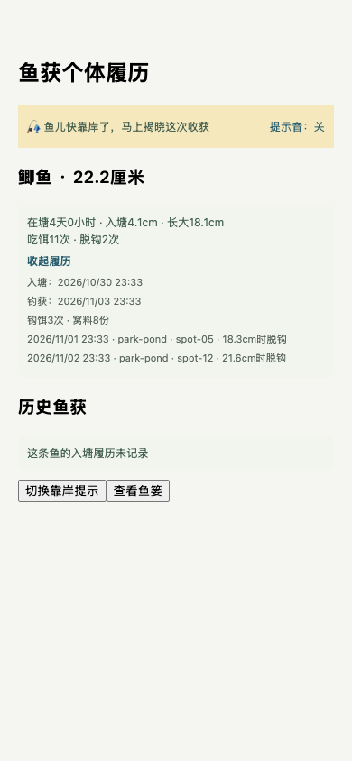
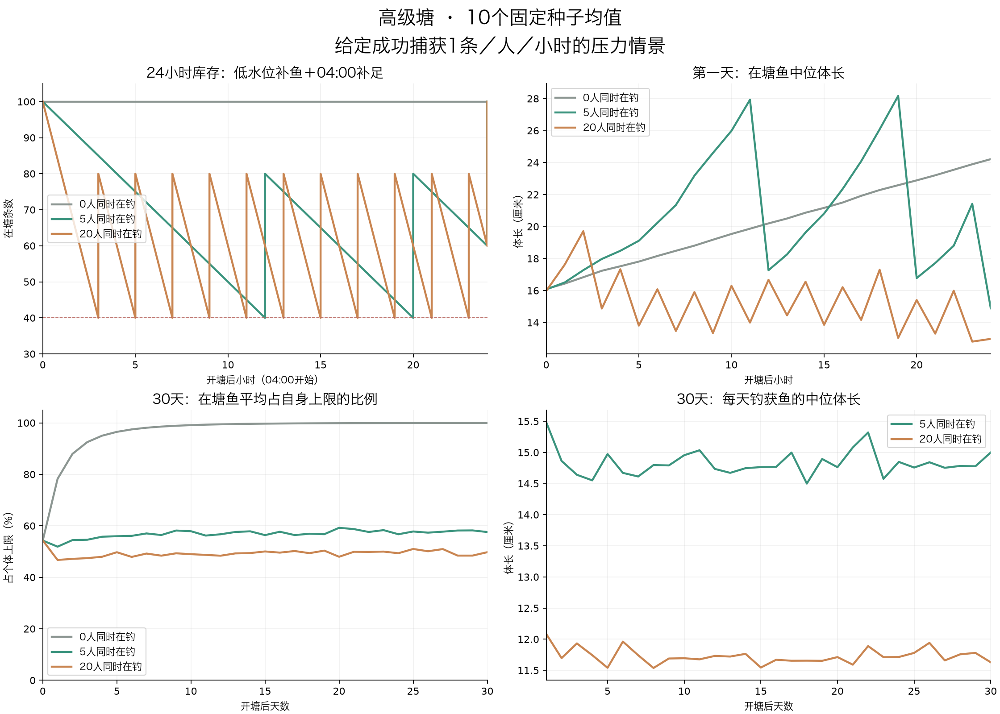

# FISH-ECOLOGY-01 实现与验证报告

2026-11-04。本地代码已实现，真实测试服务器及数据库尚未切换。所有数据库验证使用内存库或隔离临时库；没有操作项目中的实际数据文件。

## 玩家会看到什么

同品质鱼的成长上限不再完全相同。普通鱼上限在17～23厘米间固定抽取，幼鱼基准规格为3.4～4.6厘米；每条鱼的上限与幼鱼规格分别生成，重启和迁徙不会重抽。普通鱼自然成长1天达到自身上限80%，优良2天，其余依次3／5／7／10／14天，之后继续放缓。

钓获后可以展开履历，查看入塘日期、入塘体长、在塘时间、长大量、吃饵次数和脱钩位置。背包与相册保存捕获当时的快照；缺乏记录的旧鱼显示未知。自然成长和吃饵加速不会冒充更早的入塘日期。

上岸前5秒出现提示，保持原有自动流程。Unity提示音遵循静音、勿扰和后台设置；移动Web可开启提示音，原生移动端目前采用可关闭的震动和视觉提示。没有新增需要玩家手动完成的钓鱼动作。

## 本次落地的规则

| 项目 | 实现行为 |
| --- | --- |
| 鱼塘容量 | 40个正式塘，每塘100条、20钓位；另保留新手塘独立引导配置 |
| 初始鱼 | 按原品质权重和鱼种池铺鱼，从开服前14～0天倒推出历史入塘时间；不编造摄食或脱钩 |
| 日常补鱼 | 每小时剩余≤40补80；上海时间04:00补100，同刻优先日结 |
| 新鱼规格 | 50%幼鱼、40%成长鱼、10%较成熟鱼；实际投放时间起算在塘时长 |
| 高品质 | 史诗及以上达到原权重对应库存阈值后停止自动补入；每条新增后重新检查 |
| 钩饵／窝料 | 钩饵摄食15分钟；窝料12份×10分钟，每鱼每窝最多2份，共用滚动24小时360分钟额度 |
| 局部摄食 | 每30秒每窝最多1份，实际同钓位未锁定的鱼获得；无人不补发，过期剩余份数作废 |
| 脱钩 | E0，仅记录经历，额外成长为0；已摄食奖励不重复发放 |
| 回鱼 | 返回同一fishId；同塘扣除背包期间离塘时间，跨塘从实际回鱼时刻开始新塘经历；原经济收益保留 |
| 写库 | 自然长度按查询时间计算，04:00落快照；摄食、脱钩、捕获、回鱼即时持久化 |
| 异常恢复 | 上钩身份和结果可从数据库恢复；扣饵、奖励与鱼锁事务一致，失败回滚 |

新手引导按玩家单独发放首次鱼获，不参与正式塘小时／日结补鱼。新增20塘沿用对应类别的解锁、收费和品质表；巨物塘仍保持锁闭。原部分鱼种池的至尊品质没有合法候选，本次仅将其已有青鱼的品质范围上限扩到至尊，以保留原鱼种池和品质权重。

## 验证结果

- 最终配置联动回归：服务端全量23个测试文件、151项全部通过（含新手塘兼容用例）。
- 覆盖成长T80、毫米精度、单位边界、40塘初始铺设、低水位与日结、高品质限补、离线唤醒、营养额度、局部份数、重复事件、重启恢复、捕获事务失败回滚、履历冻结、原鱼回塘。
- L1临时库7项验证包含全量备份恢复、资产历史保留、失败回滚、批次幂等及在线进程／未结算状态拦截。实际配置在临时库铺设4000条正式塘鱼＋1条新手塘鱼。
- Unity履历、音效、尺寸与地图相关58项通过；移动Web真实组件在390×844屏幕验证履历展开、提示开关与鱼篓滚动，无页面异常。
- shared构建通过；配置、鱼种池、打窝、回鱼与相册smoke通过。服务器全项目类型检查尚有31项既有错误，修改前HEAD为32项，本次无新增错误；移动端另有6项既有RN Web类型错误，未宣称全项目编译通过。

旧状态编码测试漏计原有打窝阶段，已补正为10阶段；相册smoke同步现行个人主页仅返回钉选照片的契约。权威表旧窝料临时尺寸加成已归零，避免与持久营养叠加。没有增加或更改埋点事件。

## 30天模拟说明

六类塘×0／5／20人在钓×10个种子，共180次模拟、5400塘日；库存守恒、尺寸上限和高品质补入阈值校验均通过。详见[压力模拟完整报告](implementation-simulation.md)。

在给定每人每小时成功1条的压力下，高级塘20人情景最后7天钓获中位体长约11.8厘米，5人约14.8厘米。无人塘30天后全部鱼达到自身上限80%以上；没有死亡或自然迁出机制，仍会逐渐接近各自上限。

这些是固定成功捕获量的压力输入，不代表现有概率已能提供这种产量。当前免费饵＋竹竿的简化概率快照明显低于人均每小时1条，需要后续结合实际在线过程单独调参。模拟未覆盖营养、回鱼和钓位局部迁徙，不将结果当作严格稳态证明。

未完成工作已集中记录在[未完成事项与后续交接](../../策划/报告/FISH-ECOLOGY-01-未完成事项与后续交接.md)，包含执行顺序、遗留问题和真实环境验收清单。

## 实际环境还未执行的步骤

本地可以修改服务端源码，不等于已连接运行中的服务器。实际测试库切换需要先核对目标主机、数据库路径和备份位置，再停服处理未结算状态。工具会先全量备份并验证可恢复，再归档旧在塘鱼和重建新鱼群；账号、资产、背包、相册和历史继续保留。

[重建操作说明](../../../scripts/ops/FISH-ECOLOGY-01-重建说明.md)提供dry-run与显式apply命令；未指定目标测试库不会使用默认数据库清塘，管理后台原在线重置入口也已阻断。实际部署、真实库备份及重建均尚未执行。
