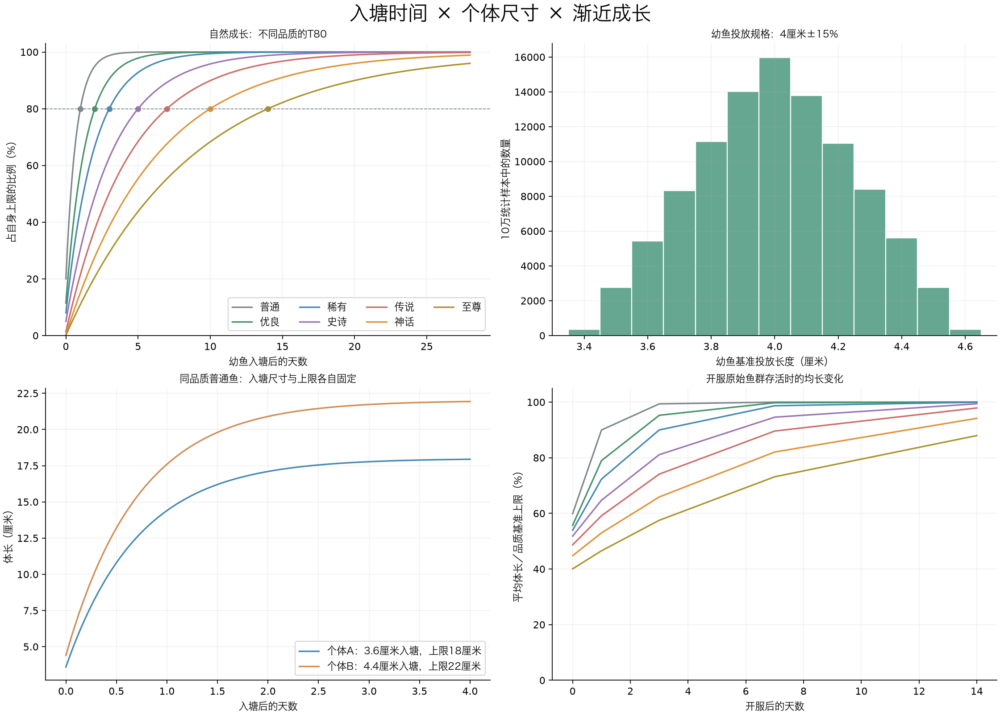

# 入塘口径修订与自然成长验证

2026-11-03 · 离线模型，未修改业务代码或数据库。

**4厘米改为投放幼鱼规格，每条固定3.4～4.6厘米；履历记录入塘时间和在塘生存时间，不再推算真实出生日期。** 开服前14～0天改为历史入塘批次，开服当天已呈现不同体长。规格和上限分别独立采用中心多、两端少的三角分布。

## 参考单鱼：从4厘米入塘

以下上限取各品质基准，仅自然成长，不含营养。正式鱼的投放规格和上限均有±15%固定差异。

| 品质 | 自然T80 | 入塘 | 1天 | 3天 | 7天 | 14天 |
| --- | --- | --- | --- | --- | --- | --- |
| 普通 | 1天 | 4.0厘米 | 16.0厘米 | 19.8厘米 | 20.0厘米 | 20.0厘米 |
| 优良 | 2天 | 4.0厘米 | 20.3厘米 | 31.7厘米 | 34.8厘米 | 35.0厘米 |
| 稀有 | 3天 | 4.0厘米 | 22.3厘米 | 40.0厘米 | 48.7厘米 | 50.0厘米 |
| 史诗 | 5天 | 4.0厘米 | 24.3厘米 | 50.2厘米 | 71.4厘米 | 79.0厘米 |
| 传说 | 7天 | 4.0厘米 | 64.3厘米 | 1.51米 | 2.40米 | 2.88米 |
| 神话 | 10天 | 4.0厘米 | 2.26米 | 5.76米 | 10.1米 | 13.4米 |
| 至尊 | 14天 | 4.0厘米 | 4.38米 | 11.7米 | 22.1米 | 32.0米 |



## 开服初始分布与后续存活

每品质抽取100,000条统计样本，固定种子20261103；并非向实际鱼塘投放70万条鱼。S与C先生成并按0.001米保存，再在S至L14之间均匀抽长度，反解历史入塘时间。各塘初始品质仍用原权重，表中为同品质跨大量鱼塘的统计，不保证每塘都有所有品质。

| 品质 | 开服P10 | 开服P50 | 开服P90 | 在塘时长P50 | 存活+1天均长 | +3天 | +7天 | +14天 |
| --- | --- | --- | --- | --- | --- | --- | --- | --- |
| 普通 | 5.6厘米 | 11.9厘米 | 18.4厘米 | 0.50天 | 18.0厘米 | 19.9厘米 | 20.0厘米 | 20.0厘米 |
| 优良 | 7.1厘米 | 19.4厘米 | 31.8厘米 | 0.93天 | 27.6厘米 | 33.3厘米 | 34.9厘米 | 35.0厘米 |
| 稀有 | 8.5厘米 | 26.9厘米 | 45.3厘米 | 1.36天 | 36.2厘米 | 45.0厘米 | 49.4厘米 | 50.0厘米 |
| 史诗 | 11.5厘米 | 41.2厘米 | 71.3厘米 | 2.17天 | 51.8厘米 | 64.9厘米 | 75.7厘米 | 79.5厘米 |
| 传说 | 32.2厘米 | 1.45米 | 2.59米 | 2.86天 | 1.77米 | 2.22米 | 2.69米 | 2.94米 |
| 神话 | 1.36米 | 6.69米 | 12.0米 | 3.68天 | 7.95米 | 9.88米 | 12.3米 | 14.1米 |
| 至尊 | 3.21米 | 15.9米 | 28.7米 | 4.43天 | 18.6米 | 23.0米 | 29.3米 | 35.2米 |

“存活+N天”只追踪原始鱼，没有捕获、补鱼、摄食或脱钩。长期无人捕捞，鱼仍会趋近各自上限；不能用这张图证明补鱼后形成稳定态。此前捕捞推演使用旧参数，仍保留为历史参考，尚未按本次入塘规格重跑。

## 时间与长度怎样解释

- 初始鱼：实际记录的历史入塘时长为0～14天；所有初始鱼当时都以各自3.4～4.6厘米规格入塘。
- 后续补入鱼：已明确确认50%幼鱼、40%成长鱼、10%较成熟鱼的混合规格，幼鱼以3.4～4.6厘米为基准、各阶段按曲线生成实际入塘长度；所有新补入鱼从实际投放时刻累计在本塘时长，不得假称早已在本塘生活。
- 摄食：另存额外成长分钟，能提前变大；不会让“在塘2天”变成“在塘3天”。
- 钓获：冻结入塘时间、在塘时长、入塘长度和本次尺寸等履历快照。入塘后长大量＝钓获长度−实际入塘长度。

## 校验范围

七品质合计700,000样本校验了幼鱼范围、自然T80、初始化反解0～14天、单调渐近、成长规格接入连续性与营养时间分离。通过的仅为离线数学模型，不代表现有服务器已经切换。每日04:00、补鱼事务、滚动营养额度、玩家历史保留与实际捕获产量需在开发阶段验证。

数据：[stocking-results.json](stocking-results.json)；脚本：[verify_stocking_model.py](verify_stocking_model.py)。


# FISH-ECOLOGY-01 · 鱼塘成长、补鱼与个体履历

| 字段 | 内容 |
| --- | --- |
| 功能名称 | 以入塘时间为起点的鱼群成长、补鱼与个体履历 |
| 编号 | FISH-ECOLOGY-01 |
| 状态 | 已确认 |
| 目标版本 | 后续迭代 |
| 优先级 | P1 |
| 设计时间 | 2026-11-03 |
| 混合补鱼规格确认时间 | 2026-11-04 |
| 完成时间 | |
| 当前交付 | 最终方案修订、参数与离线验证；业务代码和数据库尚未切换 |

## 1. 目标与范围

让玩家挂机等待，偶尔钓到有尺寸差异、有独立经历的鱼；繁忙塘可持续补鱼，空闲塘留下的鱼持续慢长。玩家不必额外操作才能享受收获。

本规格取代此前报告中将4厘米称为出生体长、以出生日期估算真实鱼龄的方案。**4厘米是投放幼鱼的规格；记录入塘时间和在本塘生存时间，不再声称知道生物学出生日期或真实年龄。**

品质决定主要上限与T80。本轮不叠加未确认的鱼种体长倍率、鱼种速度倍率或随机速度；鱼种继续影响外观、食性和原有合法鱼种池。自然死亡、衰老、自然迁出、繁殖和跨鱼塘迁移暂缓。塘内钓位迁徙仍保留。

## 2. 最终参数

### 2.1 幼鱼投放规格

- 基准4.0厘米，个体固定波动±15%，即**3.4～4.6厘米**。
- 采用以4.0厘米为峰值的三角分布，中心较常见、两端较少；范围是用户确认，分布形状是本次设计选定的可配置实现。
- 幼鱼规格与个体上限分别独立生成，按永久fishId保存或稳定派生；换钓位、重启、重新查询不能重抽。
- 初始投放体长不是开服当天体长；开服前已经入塘的鱼需按已在塘时间计算当前长度。
- 保留0.001米的保存精度；展示不足1米用厘米并保留0.1厘米，1～不足10米保留两位小数，10米及以上保留一位小数。内部计算不以展示精度递归累加。

### 2.2 品质上限与自然成长时间

| 品质 | 上限基准 | 个体上限范围，±15% | 自然达到自身上限80%的时间T80 |
| --- | --- | --- | --- |
| 普通 | 20厘米 | 17～23厘米 | 1天 |
| 优良 | 35厘米 | 29.75～40.25厘米 | 2天 |
| 稀有 | 50厘米 | 42.5～57.5厘米 | 3天 |
| 史诗 | 80厘米 | 68～92厘米 | 5天 |
| 传说 | 3米 | 2.55～3.45米 | 7天 |
| 神话 | 15米 | 12.75～17.25米 | 10天 |
| 至尊 | 40米 | 34～46米 | 14天 |

表内边界是数学范围；保存时按0.001米量化。个体上限同样使用0.85／1／1.15三角分布，生成一次后永久固定。范围独立于幼鱼投放规格，不把两种±15%混为一个共用随机数。

自然T80以该鱼的幼鱼投放规格起算，含义是长度达到0.8×个体上限，不是长完剩余空间的80%。加速摄食可使实际到达时间提前，但不会增加在塘生存时间。14天不是寿命，也不是停止成长的期限。

## 3. 成长公式与时间口径

### 3.1 幼鱼从入塘起成长

S为该鱼幼鱼投放规格（0.034～0.046米），C为固定个体上限，T为品质T80，r为本塘生存天数，G为入塘后获得的额外成长天数：

```
k = ln((C-S)/(0.2*C)) / T
r = max(0, (当前时刻-enteredAt)/86400000)
L = C-(C-S)*exp(-k*(r+G))
```

自然无加速时L(0)=S、L(T)=0.8C；始终渐近上限，先快后慢。S须为正且小于0.8C，否则拒绝生成。生成参数在本轮所有品质合法。

### 3.2 生存时间不接受“成长加速”

- `enteredAt`：投放到这个鱼塘的时间。
- `entrySizeM`：投放时的实际长度；幼鱼投放时等于S。
- `residenceDuration`：当前时刻减enteredAt；钓获后使用捕获时间减enteredAt的快照。
- `growthBonusMinutes`：独立记录额外成长分钟。不得靠改早enteredAt来实现加速。
- `growthSinceEntryM`：当前长度减实际入塘长度，展示时称“入塘后长大了”。

不新增或推算真实出生日期；新规则不展示“出生体长”“真实鱼龄”。旧`born_at`、`birth_size_m`只保留历史原义，不直接改列名后把所有老数据冒充入塘记录。L1重建时新鱼使用明确的新字段，历史快照不覆盖。

如投放时已是成长鱼，必须使用真实入塘时刻和实际入塘体长；不得为了让它更大而虚构早已在本塘生活。其成长阶段与在塘时长应分开，具体衔接见补鱼条款。

## 4. 开服初始鱼群

1. 每个正式塘初始100条，沿用原鱼种池和各类别品质权重。新手塘保持其特殊规则。
2. 每条鱼独立固定ID、品质、S、C与规则版本。
3. 计算从S自然成长14天的长度L14，在S至L14之间均匀抽取开服长度L0，再反解在塘时长r0：

```
r0 = -ln((C-L0)/(C-S)) / k
enteredAt = openingAt-r0*86400000
entrySizeM = S
```

4. 因此初始入塘日期位于**开服前14天～开服时刻**，每条鱼各不相同；低品质的分布偏近期投放，以减少开服已大量接近极限的现象。
5. 这是开服鱼塘的铺设背景，标记`source=pre_opening_seed`；配置的铺鱼开始时间为开服前14天。运行系统在开服时创建记录，不改变其设定的历史入塘时间。
6. 开服前默认仅自然成长；不编造玩家、摄食、脱钩、钓位迁徙或捕获记录。开服后只记录实际发生的事件。
7. 服务器重启、休眠唤醒及客户端进入都不能重新初始化已有鱼群；播种批次幂等。

## 5. 日常补鱼与品质库存

### 5.1 保留混合规格补入，分清成长阶段与入塘时间

用户已明确确认日常补鱼采用**50%幼鱼、40%成长鱼、10%较成熟鱼**的混合规格。幼鱼以3.4～4.6厘米为基准，成长鱼、较成熟鱼按成长阶段生成更大的实际入塘规格；所有新补入鱼在本塘的生存时间一律从本次实际投放时刻开始。

每条补入鱼独立抽规格阶段：幼鱼为0～0.2T、成长鱼为0.2～0.8T、较成熟鱼为0.8～1.5T，段内均匀抽取成长位置a，沿本品质曲线计算实际入塘长度E。a只是生成体长的数学阶段参数，不是真实鱼龄，也不计入在本塘生存时间；无需向玩家展示或存成出生日期。

```
S = 固定幼鱼基准规格（3.4～4.6厘米）
E = C-(C-S)*exp(-k*a)
enteredAt = 本次实际投放时刻
entrySizeM = E
L = C-(C-E)*exp(-k*(r+G))
```

50%的“幼鱼”沿用此前0～0.2T阶段，以S为规格基准计算实际入塘长度E，因而E可能大于4.6厘米；成长位置a=0时E=S。3.4～4.6厘米描述幼鱼基准，不是所有补入鱼的实际长度范围。成长鱼与较成熟鱼也从各自实际E延续成长，入塘时在本塘的生存时间均为0。

概率按单条随机选择，补40条期望20／16／4条，不强制整批配额；阶段选择不改变品质概率。新补入鱼在本塘经历从0开始，所有实际摄食和脱钩据实记录。S与C永久固定；E在投放时保存，后续长度不得从S重新起算，避免成长鱼入塘后缩水。

### 5.2 数量与调度

- 每小时检查，存量≤40时补到80，41条时不补；不再按缺口50%、每次最多12条补入。
- Asia/Shanghai每日04:00结算并补到100；与小时检查重合时只执行日结目标。
- 使用同塘事务或串行处理，以真实可用及占用状态定义一致的存量，避免捕获、待领取、回鱼与补鱼重复占名额。
- 无人塘跳过持续轮询，唤醒后按实际库存和结算状态补算；不重放无人期间不存在的捕获，也不反复补同一天。
- 每日结算标识、补鱼批次与事件幂等，长时间离线补算有界。

### 5.3 高品质停止补入

沿用史诗及以上范围、各塘品质权重与正式容量100计算理想数。实际整数存量达到或超过浮点理想数时，该品质自动补入权重严格为0；目标1.7条时达到2条停止，目标9条时达到9条停止。参考高级塘史诗／传说／神话／至尊阈值9／4／2／1，其余按原表逐塘计算，不统一套用。

每补一条立即更新计数；小时、日结、离线补算与兜底均受限。保留现有低品质缺口补偿和蓝色抑制规则，不改变其余品质表。不支持或无合法鱼种的品质不生成；保证合法低品质候选可以补足数量。此限制控制自动补入，不删除随机开塘超额鱼或真实回鱼。

## 6. 摄食B、脱钩E0与钓位迁徙

- 钩饵每次实际摄食+15分钟；建议以成功咬钩为钩饵实际摄食的游戏定义。同一钩饵在咬钩、脱钩、捕获阶段只发一次奖励。
- 每次打窝总预算120鱼分钟，分12份、每份10分钟；**同一鱼同一次打窝最多吃2份，仅该钓位附近实际摄食的鱼获得，剩余到期失效**。
- 每条鱼滚动24小时，钩饵与窝料合计加速上限360分钟；04:00不重置该滚动窗口。记录实际摄食和实际发放成长的差异。
- 达上限不再发成长；打窝预算在实际吃掉后扣除，不累积待兑现。临时长度加成须与持久成长统一，避免虚假尺寸。
- E0：脱钩只记经历，不额外增加长度；移除当前×1.02，保留已经吃到的钩饵成长且不重复发放。
- 塘内迁徙每小时一次，沿用现有钓位规则；无人时不做无意义逐小时写入，唤醒保持既有休眠协议。
- 回鱼须是原fishId，保留已知入塘与成长、营养、履历；不能增加另一条同种鱼尺寸。既有付费与金币收益不在本票擅改，成长奖励另有经济参数时先统一来源和上限。

## 7. 身份、履历与挂机展示

新规则最低字段：`fishId`、`pondId`、`speciesId`、`quality`、`individualCapM`、`juvenileEntrySizeM`（S）、`enteredAt`、`entrySizeM`、`growthBonusMinutes`、`growthRuleVersion`、`source`、生成批次。迁徙为塘内钓位移动，不重置这些字段。

摄食与咬钩、脱钩采用事件ID幂等；记录脱钩时间、鱼塘、钓位和该次体长。钓获制作履历快照，跟随待领取、背包、相册等，离塘实体不在后仍能查看。

玩家示例：**“11月1日入塘｜在塘2天6小时｜入塘4.2厘米 → 钓获18.5厘米｜长大14.3厘米｜吃饵8次｜脱钩3次”**。这是文案示意，不是保证该品质和时间一定长到该长度的模拟结果。钓获后的生存时间停止计时；不得继续随今天日期增长。

鱼将上岸前给出可静音的提示、音效与视觉线索，保留纯挂机自动流程；具体提示时机作为展示子任务。现有睡眠、人工领取与自动收杆规则应审查体验冲突，不能在本次文档修订中直接变更损失和经济规则。

## 8. 数据持久化与测试环境重建L1

- 自然长度按查询时刻、入塘锚点和已保存奖励推导，不再每30秒扫描全塘写尺寸；04:00可落快照。鱼在日内持续成长。
- 捕获归属、鱼增减、真实摄食、营养奖励、脱钩事实与回鱼在事件发生时持久化；资产与鱼状态放在同一事务，不等日结才把全部关键事实写库。
- 完整备份并实际验证可恢复；当前测试环境仍保留账号、资产、背包、钓获历史、图鉴、相册、帖子和已有统计。
- 旧活跃在塘鱼按批次归档，保留原ID与历史；仅重建活跃鱼群和必要运行状态，使用新ID，不覆盖旧历史和旧出生字段。重建前处理上钩、待领取和并发任务。
- 重建后按第4章铺鱼，避免全是当日新投幼鱼；记录重建批次和规则版本，重试不重复清塘。
- 本票交付设计文档，**尚未执行数据库备份、归档、清塘或重新铺鱼**；执行前核对具体测试库并完成恢复演练。

规划容量仍为每逻辑线路40个正式塘、每塘100条、20钓位；先单线，100人是线路规划。40塘扩充需同步鱼塘目录、解锁、地图、鱼种与权重，不能只改总数量。物理多机部署另立实施计划。

## 9. 技术影响与兼容

成长、上限、尺寸归一化、价格、重量、回鱼、图鉴和客户端应使用一致尺寸。权威配置通过现有game-data导出，不只改generated JSON。稀有T80为3天；此前4天图表明确标历史，不作为本版验收结果。

重点入口：`shared/fishGrowth.ts`、`shared/fishing.ts`、`shared/pondEcology.ts`、`server/src/pondEcology.ts`、`fishingSession.ts`、`groundbait.ts`、`returnFish.ts`、`catchSettlement.ts`、`inventory.ts`、`db.ts`与迁移、共享协议及Unity对应DTO和履历界面。

旧规格FISH-ATTR-01中0.05米粗步进已被本轮0.001米保存与自动单位口径取代，开发不得重新引入；体重相关经济与展示另按现行有效规则处理。FISH-SCALE-01原先按40米描述现行上限，本轮品质上限波动可能达到46米，需按其0.02～50米映射范围做联动回归，不擅自重画鱼。

如变更`fishing_metrics`字段或事件，实施阶段按仓库埋点目录同步；不为省写入而丢关键事实。

## 10. 验收标准

- [ ] 幼鱼规格3.4～4.6厘米、上限±15%，独立且固定；重启不重抽。
- [ ] 七品质自然T80为1／2／3／5／7／10／14天；L(0)=S、L(T80)=0.8C，单调渐近、不越C。
- [ ] 开服前14～0天入塘时间、开服长度与公式相符；初始时间不全相同，经历不伪造。
- [ ] 日常补鱼遵守第5章最终投放策略，入塘日期不能为了尺寸回拨。
- [ ] 41条不补、40条补80、04:00补100；重合及并发重试不重复，品质库存阈值覆盖全部自动路径。
- [ ] B方案局部预算守恒、每鱼每窝最多2份、滚动24小时360分钟；脱钩E0且摄食不重复。
- [ ] 加速只改变成长，不改变enteredAt和在塘生存时间；钓获快照时长停止计时。
- [ ] 身份贯通咬钩、脱钩、捕获、回鱼与再次捕获；未知旧历史不伪造。
- [ ] 保存精度与厘米／米展示边界一致；客户端与服务端同源配置。
- [ ] 备份可恢复，L1仅重建活跃鱼群，当前测试环境的全部历史和资产保留；未授权的真实清塘不可由文档生成器触发。
- [ ] 不同人数、分类鱼塘和工作时段的24小时及长期模拟单独验证；本轮自然成长图不当作已实现的人均每小时1条捕获保证。

## 11. 实施顺序与变更记录

先做参数、成长与身份时间字段，再做播种、补鱼和调度；随后统一营养、脱钩、回鱼和履历，最后联动客户端提醒、40塘配置与迁移演练。模型模拟和守恒检查通过后再执行测试环境切换。

| 日期 | 变更 |
| --- | --- |
| 2026-11-03 | 品质上限与T80、B／E0／L1整合；4厘米改为入塘幼鱼规格并增加±15%；开服前14～0天改为历史入塘日期，展示在塘时长，旧出生字段保留历史原义。 |
| 2026-11-04 | 用户明确确认保留50／40／10混合规格补鱼；规格阶段只决定实际入塘尺寸，不冒充在塘时长；所有日常补入鱼从实际投放时刻计时。 |
