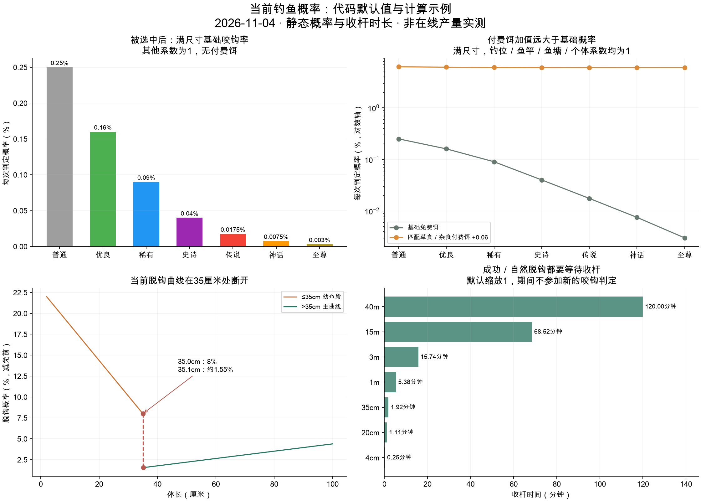

# 当前钓鱼概率完整说明与重设计依据

记录日期：2026-11-04。范围为当前本地代码及随仓库生成的默认配置，包含本轮入塘成长改造；没有读取正在运行的服务配置或真实鱼群。它是一份现状审计与后续设计依据，尚未确定或实施新概率方案。

维护入口：[钓鱼系统现行规则](../../策划/规格/玩法/钓鱼系统现行规则.md)。旧阶段正文和旧模拟不得作为当前数值的验收依据；已确认的成长、当前概率现状与待定新方案在该入口分别说明。

## 1. 先看结论

**当前一条鱼进背包，需要依次经过：有资格判定 → 本钓位有可用鱼 → 按品质权重抽中一条 → 它愿意咬钩 → 等待收杆 → 没有随机脱钩或强制中断 → 自动入包。**

| 环节 | 当前规则 |
| --- | --- |
| 机会频率 | 正常默认每分钟检查一次，只检查在线且处于等待中的玩家 |
| 选鱼范围 | 本钓位已有的未锁定真实鱼；不从全塘直接抽，也不每条鱼都试一次 |
| 先选哪条 | 每条鱼按品质权重抽；普通38、至尊1，再乘实际条数形成品质总机会 |
| 是否咬钩 | 品质、当前长度占个体上限比例、个体性格、钓位、饵、竿、塘、窝料共同决定 |
| 是否脱钩 | 咬钩时先抽好结果，主要看实际体长、个体偏置、竿和塘，不在收杆中反复抽 |
| 等待多久 | 按实际长度计算，20厘米约67秒、3米约16分钟、40米2小时 |
| 自动收获 | 正常成功后自动入背包、自动续钓，无需点领取 |
| 最明显的挂机冲突 | 默认30分钟无关注操作后睡眠；睡眠咬钩强制脱钩，仍然耗饵 |

后续最需要一起处理的是：**免费／付费饵差距、品质多重压制、随机钓位波动、脱钩曲线断层、长收杆占用，以及睡眠强制失败。** 只提高一个“咬钩率”不能完整决定用户一小时能拿到几条鱼。



## 2. 什么时候有一次机会

正常默认间隔为60秒。全服使用共同循环，玩家刚进入等待可能很快碰到下一轮，也可能接近一分钟；不是每个人独立倒计时一分钟。循环延迟后不追赶补发，断线期间也不积累次数。

只有`waiting`且有钓位、身份和在线连接的真人参加。装饵、抛竿、打窝、收杆、结果展示、停钓、断线均不判新的咬钩。已有待领取鱼也会跳过。

准备耗时：装饵0.8秒、首次抛竿0.6秒，成功展示0.8秒、脱钩展示0.6秒；结果后再装饵，默认续钓跳过抛竿。收杆时长远大于这些动画，详见第7节。

运行配置`FISH_BITE_CHECK_MS`可以延长间隔，正常模式不能缩短到60秒以下；启动初始化会把该配置设回代码默认值。本地快速测试模式另述，不可用于判断正常概率。

## 3. 先抽哪一条鱼

只读取当前`pondId + spotId`的实体，排除正在上钩和待领取的鱼。不存在“邻近几个钓位都能钓”的半径搜索。本钓位无鱼时本轮为空，即使其他钓位有鱼也不会直接借用。

```text
选中某条鱼的概率 = 这条鱼的品质权重 ÷ 本钓位所有可用鱼的权重和
```

权重38／28／18／9／4／2／1施加在每条鱼身上。它们不是最终钓获的38%／28%／……／1%。例如10条普通＋1条至尊，至尊被抽到的机会只有1÷381，约0.2625%；抽到后还得咬钩并留住。

为了说明二次加权，假设一个钓位候选恰好按38／28／18／9／4／2／1条分布，得到下面的选鱼比例。**这是公式例子，100条集中同钓位不是典型实际库存；实际每塘100条分散在20个钓位。**

| 品质 | 假设本钓位数量 | 再按品质权重抽鱼后的比例 |
| --- | --- | --- |
| 普通 | 38 | 54.4084% |
| 优良 | 28 | 29.5403% |
| 稀有 | 18 | 12.208% |
| 史诗 | 9 | 3.052% |
| 传说 | 4 | 0.6029% |
| 神话 | 2 | 0.1507% |
| 至尊 | 1 | 0.0377% |


鱼多只改变组成和空位风险，不会将本轮变成多次试钓。若加入的鱼和原有鱼完全同类、同长度，单次咬钩概率基本不变。加入更多低品质鱼，还可能稀释高品质被选中的机会。

## 4. 抽到后是否咬钩

令n为当前长度／该鱼固定个体上限，限制在0～1。

```text
单鱼基础值 B = 品质基数 × 0.05 × (0.35 + 0.65n) × 个体咬钩偏置
点内值 = clamp(钓位系数 × (B + 饵料加值), 0, 1)
p = 点内值 × 塘咬钩倍率 × 竿倍率
有窝料时：p = min(1, p × (1 + 窝料相对加成))
随机数小于p，则咬钩
```

个体咬钩偏置和脱钩偏置分别在0.9～1.1均匀抽取、固定保存。品质上限±15%是另一组独立差异，不能混为同一个随机数。

### 4.1 品质与成长

下表都是**已选中该鱼之后**，个体偏置1、其他系数1、无付费饵的基础概率，已包含全局×0.05：

| 品质 | 每条鱼抽选权重 | 满长基础咬钩率 | 长到上限50%时 | 长到上限80%时 |
| --- | --- | --- | --- | --- |
| 普通 | 38 | 0.25% | 0.1688% | 0.2175% |
| 优良 | 28 | 0.16% | 0.108% | 0.1392% |
| 稀有 | 18 | 0.09% | 0.0608% | 0.0783% |
| 史诗 | 9 | 0.04% | 0.027% | 0.0348% |
| 传说 | 4 | 0.0175% | 0.0118% | 0.0152% |
| 神话 | 2 | 0.0075% | 0.0051% | 0.0065% |
| 至尊 | 1 | 0.003% | 0.002% | 0.0026% |


随成长变大，基础咬钩增加；按个体上限的比例归一化，同为普通鱼，17厘米上限个体与23厘米上限个体到各自80%时基础值相同。品质在这里又压低一次高品质咬钩，再叠加第3节抽鱼权重，形成多层稀缺。

理论n=0时基础值为满长的35%；实际入塘尺寸大于0，不会真的从零长度起算。

### 4.2 钓位

每个钓位约每5分钟刷新一次：`round2(随机数×5)`，范围0～5。系数0使正常咬钩为0；系数5可将进入该乘区的概率放大5倍。它不是钓位鱼数量的换算值，也不是由地形标签直接决定。

同一个系数还参与鱼的投放与迁徙目的地权重：`0.7×系数+0.3`。因此高系数位既更容易咬，又更容易聚鱼；低系数位可能同时鱼少、咬得慢。

### 4.3 边界处理

代码先对点内值限制0～1，再乘塘与竿。有窝料时最后再封顶1；无窝料时最后没有显式封顶，超过1与随机数比较仍等效必咬。重设计应统一这些边界，不能把每个乘区都理解成已经封顶。

### 4.4 整个钓位的概率怎么算

固定这一刻的鱼群、装备和状态后，需把每条候选鱼的结果加权平均：

```text
本轮咬钩概率 = Σ（该鱼被选中概率 × 该鱼实际咬钩概率）
本轮自然捕获概率 = Σ（该鱼被选中概率 × 该鱼实际咬钩概率 × 自然不脱钩概率）
```

其中参与乘法的实际概率限制在0～1。自然捕获概率仍未扣除睡眠、停钓、断线等状态影响，也未折算收杆占用；本位没有候选鱼时，本轮概率为0。不能将所有鱼的咬钩率直接相加，也不能用现场抽到某一条鱼的概率代替整个钓位。

## 5. 饵、鱼竿和窝料

### 5.1 鱼饵是加值，实际流程会自动匹配

| 饵料 | 草食鱼加值 | 杂食鱼加值 | 肉食鱼加值 | 解锁等级 | 每次实际咬钩花费 |
| --- | --- | --- | --- | --- | --- |
| 基础杂饵 | 0% | 0% | 0% | 0 | 0 |
| 谷物饵 | 6% | 1% | 1% | 2 | 15 |
| 腥香饵 | 1% | 6% | 1% | 3 | 20 |
| 荤腥饵 | 1% | 1% | 7% | 4 | 25 |


表中6%表示把B加上0.06后再乘钓位等系数，**不是**将B乘1.06。满长普通基础0.0025加0.06变为0.0625，是25倍；至尊基础0.00003加0.06后变为0.06003，是2001倍。

实际流程先抽目标鱼，再自动选择该鱼食性对应、玩家已解锁且付得起的饵；条件不满足就使用无限免费饵。最终选择不直接以`equippedBait`为准，所以“只改装备的饵”未必改变真实用饵。解锁与余额会使同一玩家的概率发生明显变化。

只有真正咬钩才扣15／20／25金币；未命中不扣。即使随后脱钩或因睡眠失败，这一口也照常收费。扣费失败时锁鱼与摄食奖励一起回滚，本轮失败。

旧库存饵corn／pellet／live仍有兼容字段和装饵阶段消耗规则；它们不等于当前自动选择的`bait-*`付费饵。兼容口径详见附录。

### 5.2 鱼竿不是一个简单“加咬钩率”

```text
竿倍率 = (1 + 竿biteBonus) × 品质适配 × 鱼种钓法组适配
```

同一鱼竿对小鱼、大鱼和不同鱼种可能分别增益或减益。比如竹竿对普通静水鱼乘1.1，对至尊巨物组只乘0.3×0.7＝0.21。

| 鱼竿 | 咬钩基础乘数 | 脱钩绝对减免 | 超过该长度累计损耗 | 超规格着陆次数阈值 |
| --- | --- | --- | --- | --- |
| 竹制手竿 | ×1.00 | 0个百分点 | 0.45米 | 3 |
| 台钓碳素竿 | ×1.03 | 4个百分点 | 0.8米 | 5 |
| 溪流竿 | ×1.04 | 3个百分点 | 0.55米 | 4 |
| 矶钓竿 | ×1.03 | 6个百分点 | 1.2米 | 5 |
| 海竿 | ×1.02 | 7个百分点 | 1.5米 | 6 |
| 路亚竿 | ×1.05 | 5个百分点 | 1米 | 5 |
| 重型路亚竿 | ×1.04 | 10个百分点 | 2.5米 | 8 |
| 巨物竿 | ×1.03 | 12个百分点 | 4米 | 10 |


脱钩“减4个百分点”和咬钩“乘1.03”是不同运算。完整适配矩阵见附录。

超过断竿规格仍可钓获：鱼先入包，再累计超规格成功着陆次数，达到阈值才销毁鱼竿；不是“超规格立即100%脱钩”。断竿后自动换其他拥有的竿，没有可用竿才停下一轮。

### 5.3 打窝是小幅相对乘数

```text
窝料加成 G = maxBonus × (1-exp(-stackK×层数))
咬钩概率再乘 (1+G)
```

| 窝料 | 等级／金币／等待 | 时效／咬钩口数 | 1层相对加成 | 10层 | 50层 |
| --- | --- | --- | --- | --- | --- |
| 基础窝料 | Lv3／30金／3秒 | 20分钟／8口 | 0.6151% | 4.4054% | 7.8535% |
| 混合窝料 | Lv5／50金／5秒 | 25分钟／10口 | 0.8113% | 6.041% | 11.6376% |
| 精品窝料 | Lv7／80金／8秒 | 30分钟／12口 | 1.0482% | 8.1214% | 17.1038% |


例如原概率1%，相对加成8%后为1.08%，不是9%。同种累层，上限50；换种重置为1层，离塘／换位清空，停钓同位保留有效窝效。每次补窝刷新咬钩buff的时限与可用口数；时间或实际咬钩口数先耗尽即失效，脱钩也算用掉一口。

`perStackBiteBonus`仅用于旧线性对照，不是实际逐层加法。配置中1.5倍全局软上限的函数没有被当前正式咬钩路径调用，不能写成现行已生效限制。

打窝另有持久营养：每窝12份×10分钟，每鱼每窝最多2份，仅同钓位实际吃到的未锁定鱼获得；每30秒每窝最多吃1份，过期余量作废；与钩饵15分钟共用滚动24小时360分钟上限。它通过改变尺寸间接影响概率，与玩家咬钩buff的8／10／12口数是两套预算。旧临时增加尺寸已归零。

## 6. 是否脱钩

咬钩成功后，系统先发放本次钩饵成长，再用成长后的体长抽取脱钩结果和收杆时间；两者会持久保存。收杆过程中没有每秒反复脱钩抽签，重新连接也不会重抽。

```text
L≤0.35米：e0 = 0.22 - 0.14 × clamp((L-0.02)/0.33, 0, 1)
L>0.35米：e0 = 0.985 × [1-(1-clamp(L/40,0,1))^1.8]
e = clamp(e0 × 个体脱钩偏置 - 竿减免, 0, 1) × 塘脱钩倍率
```

品质和鱼种没有再直接提供一个独立脱钩率，主要通过尺寸间接影响。野塘最后乘1.1，其他塘乘1；乘塘后没有再次封顶，大于1等效必脱钩。

**当前曲线并不连续：35.0厘米为8%，35.1厘米约1.55%。** 从4厘米长到35厘米会越来越不容易脱钩，越过边界突然更容易留住，此后随尺寸增加重新变难。不能笼统说“鱼越大越容易跑”。

| 体长 | 基础脱钩率 | 巨物竿减免后 | 默认收杆时间 |
| --- | --- | --- | --- |
| 4厘米 | 21.15% | 9.15% | 15.0秒 |
| 10厘米 | 18.61% | 6.61% | 34.4秒 |
| 20厘米 | 14.36% | 2.36% | 66.7秒 |
| 35厘米 | 8% | 0% | 115.0秒 |
| 35.1厘米 | 1.55% | 0% | 115.3秒 |
| 50厘米 | 2.21% | 0% | 2.72分钟 |
| 80厘米 | 3.52% | 0% | 4.32分钟 |
| 1米 | 4.39% | 0% | 5.38分钟 |
| 3米 | 12.9% | 0.9% | 15.74分钟 |
| 10米 | 39.81% | 27.81% | 48.52分钟 |
| 15米 | 56.23% | 44.23% | 68.52分钟 |
| 40米 | 98.5% | 86.5% | 120.00分钟 |
| 46米 | 98.5% | 86.5% | 120.00分钟 |


表内个体偏置1、塘倍率1；巨物竿的减免为12个百分点。它可以把许多小鱼随机脱钩率减到0，但不能避免睡眠或停钓等强制失败。

脱钩E0本身只增加履历，不再增长2%；咬钩时已经吃到的成长和费用照常保留。

## 7. 收杆多久，何时得到鱼

```text
收杆毫秒 = round(2000 + (7200000-2000)
                  × [1-(1-clamp(L/40,0,1))^1.8])
再乘运行时HOOK_DURATION_SCALE，默认1
```

所有品质、鱼种使用同一长度曲线。40米及以上时间封顶2小时，主脱钩曲线也封顶。当前最大潜力46米不再使时间超过2小时。

自然随机脱钩与成功都通常先等待完整收杆，再展示结果；睡眠强制脱钩则立即结束收杆。收杆期间没有新的咬钩机会。成功后自动领取并继续装饵，不要求玩家接近上岸时操作。

因此“每小时60次×平均咬钩率×不脱钩率”最多只是理想机会折算；真实时间里长收杆、装饵、展示都会减少判定次数。

## 8. 塘类别、初始鱼与补鱼

### 8.1 塘的直接修正与初始品质

| 塘类别 | 咬钩倍率 | 脱钩倍率 | 初始品质权重，普通→至尊 | 权重合计 |
| --- | --- | --- | --- | --- |
| 新手 | 1 | 1 | 38／28／0／0／0／0／0 | 66 |
| 高级 | 1 | 1 | 38／28／18／9／4／2／1 | 100 |
| 老手 | 1 | 1 | 30／20／20／15／10／3／2 | 100 |
| 野外 | 0.75 | 1.1 | 45／10／10／10／15／5／5 | 100 |
| 水库 | 0.65 | 1 | 45／10／10／10／15／5／5 | 100 |
| 禁止 | 0.9 | 1 | 15／15／20／30／10／7／3 | 100 |
| 巨物 | 1 | 1 | 44／32／21／12／6／3／1 | 119 |


初始品质概率需将权重除以合计：巨物塘总119、新手塘总66，都不能把每列直接叫百分比。这些是**投放时的品质概率**，不是玩家每次得到该品质的概率。

野塘／水库配置的`qualityWeightSkew=0.85`只用于部分Debug选鱼占比展示，真实抽鱼没有应用；`sizeCapMul`也没有进入本轮新成长计算。`infoRevealMul`和塘经验倍率不直接增加咬钩概率。

### 8.2 鱼种生成存在最高稀有度优先

初始投放先抽品质，再筛选品质范围合法的鱼种；在候选中只保留**物种稀有度最高的一档**，同档内才按塘种池spawnWeight抽。这个“物种稀有度”与普通／至尊的“鱼品质”是两种不同属性。

例如千岛湖普通品质有18种合法鱼，但当前生成会优先保留青鱼、鳜鱼、翘嘴鲌、大口黑鲈、鳗鲡、锦鲤这6种；鲫鱼等common档即使有种池权重，也不会在这一轮同档筛选后留下。所有50种的qualityMin均为1，含更稀有物种的塘也可能让低稀有度物种长期没有生成机会。

这会直接影响玩家见到的鱼种多样性，属于重新规划时需要检查的规则。现存旧鱼仍然是实际候选，不会因新生成筛选而立即消失。[完整逐塘、逐品质可生成鱼种](current-odds.json)已随审计导出。

鱼种当前没有各自独立的基础咬钩／脱钩数值，实际差异来自配置食性、钓法组、品质、尺寸和个体偏置；50种映射见附录。

### 8.3 日常补鱼概率是动态的

正式塘每小时剩余≤40补80，上海04:00补100。补入规格50%幼鱼／40%成长鱼／10%较成熟鱼，不会先按初始品质表直接重复抽所有鱼。

对每种品质：

```text
ideal = 该塘初始品质权重占比 × 100
raw = max(0, ideal-actual) + 0.1×ideal
普通／优良有缺口：raw再×2.25
稀有若actual>0且当前占比≥理想占比×0.6：raw再×0.15
史诗及以上若actual≥ideal：raw=0
屏蔽无合法鱼种的品质，再把raw归一化抽取
```

每补一条立即更新actual，下一条的概率跟着变。浮点ideal达到上方整数后停止自动补高品质，不删除开塘超额或真实回鱼。补完品质后仍走上节的合法鱼种与稀有度筛选。

塘内每小时让未锁鱼以40%概率参与目的地抽选；选到原位可以不移动，因此不是严格40%的鱼实际换位。无人塘不持续迁徙，唤醒时有界补算；也没有离线鱼获。

## 9. 随机之外：哪些情况会让鱼拿不到

| 情况 | 当前实际表现 |
| --- | --- |
| 睡眠 | 默认30分钟无fishing_attention，下一次waiting检查睡眠；之后仍判咬钩，但命中必脱且立即结算，仍收费、吃饵、耗窝次数 |
| 睡眠途中已在收杆 | 不打断这一条，等回到waiting后再处理；明确关注动作才重置计时 |
| 手动停钓／离塘 | 收杆途中可强制变脱钩；成功结果已展示时通常等展示结束再停 |
| 每日8小时额度 | 上海自然日计算，与生态04:00不同；达到额度停止，可能中断正在收杆的鱼 |
| 塘费不足／日扣费上限 | 收费塘按有效钓鱼累计每2小时扣费，默认每天最多4次；门禁不满足停钓 |
| 没有可用竿 | 不开始或不续钓；断竿是在已成功入包后处理，不撤回本条鱼 |
| 付费饵余额不足 | 通常自动退免费饵；实际扣费失败时回滚本次咬钩与奖励，记failed |
| 断线 | 不产生新机会，不累计断线期间时长；会话宽限60秒，重连可续原结果，过期状态按恢复流程处理 |
| 本位无鱼／都被锁 | 本轮empty，不因为全塘有鱼就一定有候选 |
| 已有待领取鱼 | 暂停新判定；正常自动入包，异常待领取锁默认13秒超时 |
| 禁钓塘巡警 | 是独立风险事件，不属于自然脱钩 |

睡眠参数`FISHING_SLEEP_AFTER_MS=0`可禁用；否则配置允许1分钟至24小时。**这是当前默认规则与“上班全程无操作挂机”最直接的冲突**，实际环境可能有热更覆盖，需上线前核对。

旧非基础tackle另有耐久：自然／睡眠脱钩扣1，耗尽切基础tackle；与新鱼竿的超规格着陆销毁是不同机制。手动强制停钓分支的脱钩统计和耐久处理也与自然脱钩分支不同，后续分析不能直接混用。

### 9.1 巡警风险

禁钓塘每秒对活跃真人独立检查：`p秒=1-(1-0.15)^(1/3600)`，表示持续一小时至少遇到一次的默认概率15%，不是每分钟15%。触发后给10秒离塘：及时走免罚但2小时不能重入；不走扣最多800金币、强制离塘并禁入到上海当日结束。它引入主动响应要求，需要与纯挂机定位一起评估。

### 9.2 机器人

机器人使用同一选鱼／咬钩／脱钩核心，也会拿走真实塘鱼，间接影响真人候选。其waiting每轮先有3%停钓；idle每轮28%开钓。当waiting机器人占“真人数＋waiting机器人”比例大于配置0.4时，另有50%概率跳过本轮。该比例是**人数比例**，不是实际鱼获份额40%的硬上限。

机器人免睡眠限制；没有真人连接的塘会跳过持续生态轮询。这些因素会使“只有机器人”和“真人参与”的长期库存与真人产出不能简单按同一人数缩放。

## 10. 一个完整计算例子

设本位只有同一规格的普通鲫鱼候选，体长与个体上限均20厘米；竹竿、钓位系数1、高级塘、无窝料、个体偏置1。鲫鱼在当前配置中属于草食、静水组，所以自动匹配谷物饵，竹竿倍率1.1。满长后不再因这次吃饵增长，便于比较。

| 条件 | 免费基础饵 | 匹配谷物饵 |
| --- | --- | --- |
| 单次咬钩概率 | 0.275% | 6.875% |
| 平均需要的有效判定次数 | 363.64次 | 14.55次 |
| 60次有效判定内至少咬钩一次 | 15.23% | 98.61% |
| 同尺寸自然脱钩概率 | 14.36% | 14.36% |
| 单次有效判定自然捕获概率 | 0.2355% | 5.8875% |
| 60次有效判定对应成功机会期望 | 0.1413 | 3.5325 |


这说明相同鱼和钓位下，付费饵可带来25倍咬钩差异；**表中60次有效判定不是保证现实一小时都发生60次**。概率未命中不收费，付费饵只在咬钩后扣15金币。这里还主动排除了睡眠、库存变化和强制停钓，所以不能当作真实用户一小时入包承诺。

即使把自然成功率调成每次1／60，每小时60次独立判定的成功期望等于1，仍有约36.5%的人这一小时一条也没有。后续需要明确“平均每小时1条”和“每小时至少1条”究竟选哪种体验目标；后者需要另外设计等待上限或保底，而不是单调一个随机概率。

## 11. 当前问题与重设计顺序

| 优先讨论 | 当前问题 | 下一轮需要决定 |
| --- | --- | --- |
| 1. 纯挂机前提 | 睡眠强制脱钩，巡警要求10秒响应 | 哪些状态可以让挂机玩家停止收获；是否保留主动响应机制 |
| 2. 等待与收获节奏 | 无连续空手补偿，没有一小时至少一条保障 | 平均频率、首条等待、最长等待、是否需要保底 |
| 3. 免费与付费 | 饵的加值压倒基础值；自动按目标选饵，余额影响极大 | 免费能否达到基础体验，付费主要提高数量、品质还是减少空手 |
| 4. 品质分布 | 库存、每条选鱼权重、基础咬钩、竿适配、巨物脱钩叠加 | 稀缺主要放在哪个环节，目标每8小时普通／高品质构成 |
| 5. 鱼种和钓位 | 最高物种稀有度优先排掉常见种；钓位随机0～5且会聚鱼 | 保留哪些真实个体与生态差异，允许多大钓位体验落差 |
| 6. 留鱼与时长 | 35厘米脱钩断层；大鱼收杆可达2小时，失败也占满 | 连续脱钩曲线、巨物成功率、长收杆是否替代普通等待 |
| 7. 展示与验证 | Debug选中单鱼的概率被当本位总体概率，部分字段未接实算 | 展示实际加权概率、条件概率与时长，并记录不同失败原因 |

这是待设计的问题清单，不是新数值已确认。成长和补鱼已完成的规则作为输入；重新设计应先确定体验目标，再推导概率与资源消耗，最后按实际时间过程模拟与验收。

## 12. 调试、旧文档和配置差异

- 正常真人结果由服务端权威决定；移动端demo另有每轮14%触发、触发后70%成功的旧演示模型，不能当真实服概率。失败演示再随机50%标empty或escaped。
- 非production且`FISHING_TEST_MODE=instant`时，默认每秒判定、绕过普通咬钩与随机脱钩、收杆1秒×缩放，并尝试给无鱼钓位放测试鱼；整塘已经空时可能先被空塘门禁挡住。睡眠强制脱钩仍生效。
- 玩法Debug指定鱼可绕过正常抽鱼、咬钩和自动饵扣费，不能用于估计真实产出。
- `NOVICE_WAIT_BITE_MS=5000`与`NOVICE_HOOK_MS=5000`当前仅有定义，没有正式调用；不能据此承诺当前新手5秒必咬。新手首次引导赠鱼和新手结果后不续钓是独立流程。
- 旧“多鱼概率相加封顶100%”、30秒／5分钟间隔、品质脱钩表、近满长固定98.4%逃脱、物种旧基础概率、出生0.6%近满长，都不是本轮正式塘的当前概率链。
- shared/fishing.ts旧咬钩速查注释遗漏×0.05，可能高估20倍；幼鱼锚点、曲线示意与constants.ts间隔注释也有过时内容，本报告数值按函数和JSON计算。
- `qualityWeightSkew`只影响Debug的候选share、1.5倍窝料softcap未接调用，均不能按“配置里有”认定已生效。
- Debug当前pBite是现场随机抽到一条鱼的条件概率，不是对全部候选加权后的本位总体概率；Debug没有完整复现自动选饵、装备rod、打窝和塘脱钩修正，不能用其摘要直接验收真人产量。
- 公式表来自生成JSON及共享代码，修改后需构建、重启对应程序；判定间隔、收杆缩放、睡眠和部分开关另走数据库运行配置。未连接实际库，本报告不声称其热更值等于默认值。

## 附录A. 全部鱼竿适配

品质适配乘在鱼竿自身的1+biteBonus之后：

| 鱼竿 | 普通 | 优良 | 稀有 | 史诗 | 传说 | 神话 | 至尊 |
| --- | --- | --- | --- | --- | --- | --- | --- |
| 竹制手竿 | 1.1 | 1.05 | 1 | 0.7 | 0.5 | 0.4 | 0.3 |
| 台钓碳素竿 | 1.05 | 1.05 | 1.05 | 0.9 | 0.7 | 0.55 | 0.4 |
| 溪流竿 | 1.05 | 1.05 | 1 | 0.85 | 0.65 | 0.5 | 0.35 |
| 矶钓竿 | 0.95 | 1 | 1.05 | 1 | 0.85 | 0.7 | 0.55 |
| 海竿 | 0.9 | 1 | 1.05 | 1.05 | 0.9 | 0.75 | 0.6 |
| 路亚竿 | 0.85 | 0.95 | 1.05 | 1.1 | 0.95 | 0.8 | 0.65 |
| 重型路亚竿 | 0.75 | 0.85 | 0.95 | 1.1 | 1.15 | 1.05 | 0.9 |
| 巨物竿 | 0.7 | 0.8 | 0.9 | 1.05 | 1.15 | 1.2 | 1.25 |


再乘鱼种所属钓法组的适配：

| 鱼竿 | 静水饵钓 | 溪流 | 掠食路亚 | 重抛 | 巨物 |
| --- | --- | --- | --- | --- | --- |
| 竹制手竿 | 1 | 0.7 | 0.7 | 0.7 | 0.7 |
| 台钓碳素竿 | 1.15 | 0.75 | 0.75 | 0.75 | 0.7 |
| 溪流竿 | 0.75 | 1.2 | 0.8 | 0.75 | 0.7 |
| 矶钓竿 | 0.75 | 0.8 | 0.85 | 1.1 | 0.75 |
| 海竿 | 0.7 | 0.75 | 0.8 | 1.15 | 0.8 |
| 路亚竿 | 0.7 | 0.8 | 1.2 | 0.9 | 0.75 |
| 重型路亚竿 | 0.7 | 0.75 | 1.1 | 1.1 | 0.9 |
| 巨物竿 | 0.7 | 0.7 | 0.85 | 0.95 | 1.25 |


## 附录B. 当前50种鱼的概率相关分类

以下是游戏配置，供判断饵与竿适配，不代表现实鱼类百科分类。

| 鱼种 | 配置食性 | 钓法组 | 品质范围1～7 | 物种稀有度 |
| --- | --- | --- | --- | --- |
| 鲫鱼 | 草食 | 静水 | 1～5 | common |
| 鲤鱼 | 草食 | 静水 | 1～5 | common |
| 草鱼 | 草食 | 静水 | 1～5 | common |
| 鲢鱼 | 杂食 | 静水 | 1～5 | common |
| 鳙鱼 | 杂食 | 静水 | 1～5 | common |
| 青鱼 | 杂食 | 重抛 | 1～7 | uncommon |
| 罗非鱼 | 草食 | 静水 | 1～5 | common |
| 泥鳅 | 杂食 | 静水 | 1～5 | common |
| 鳊鱼 | 草食 | 静水 | 1～5 | common |
| 团头鲂 | 草食 | 静水 | 1～5 | common |
| 长春鳊 | 草食 | 静水 | 1～5 | common |
| 鳜鱼 | 肉食 | 路亚 | 1～6 | uncommon |
| 翘嘴鲌 | 肉食 | 路亚 | 1～6 | uncommon |
| 大口黑鲈 | 肉食 | 路亚 | 1～6 | uncommon |
| 乌鳢 | 肉食 | 路亚 | 1～6 | uncommon |
| 鲶鱼 | 杂食 | 重抛 | 1～5 | common |
| 黄颡鱼 | 肉食 | 静水 | 1～5 | common |
| 银鲴 | 杂食 | 溪流 | 1～5 | common |
| 红鳍鲌 | 肉食 | 路亚 | 1～6 | uncommon |
| 马口鱼 | 肉食 | 溪流 | 1～5 | common |
| 鳡鱼 | 肉食 | 路亚 | 1～7 | rare |
| 赤眼鳟 | 杂食 | 静水 | 1～6 | uncommon |
| 长吻鮠 | 肉食 | 重抛 | 1～7 | rare |
| 武昌鱼 | 草食 | 静水 | 1～6 | uncommon |
| 光唇鱼 | 杂食 | 溪流 | 1～6 | uncommon |
| 岩原鲤 | 杂食 | 静水 | 1～7 | rare |
| 花鲴 | 杂食 | 溪流 | 1～6 | uncommon |
| 裂腹鱼 | 杂食 | 溪流 | 1～7 | rare |
| 金线鲃 | 杂食 | 溪流 | 1～7 | rare |
| 铜鱼 | 杂食 | 静水 | 1～6 | uncommon |
| 黑鲷 | 杂食 | 重抛 | 1～6 | uncommon |
| 真鲷 | 肉食 | 重抛 | 1～7 | rare |
| 大黄鱼 | 肉食 | 重抛 | 1～6 | uncommon |
| 带鱼 | 肉食 | 重抛 | 1～6 | uncommon |
| 鲐鱼 | 肉食 | 路亚 | 1～5 | common |
| 牙鲆 | 肉食 | 重抛 | 1～6 | uncommon |
| 花鲈 | 肉食 | 路亚 | 1～6 | uncommon |
| 银鲳 | 杂食 | 重抛 | 1～6 | uncommon |
| 石斑鱼 | 肉食 | 巨物 | 1～7 | rare |
| 鲻鱼 | 杂食 | 静水 | 1～5 | common |
| 虹鳟 | 肉食 | 路亚 | 1～6 | uncommon |
| 细鳞鲑 | 肉食 | 路亚 | 1～7 | rare |
| 哲罗鲑 | 肉食 | 巨物 | 1～7 | legendary |
| 雅罗鱼 | 杂食 | 溪流 | 1～6 | uncommon |
| 中华鲟 | 杂食 | 巨物 | 1～7 | legendary |
| 达氏鲟 | 杂食 | 巨物 | 1～7 | legendary |
| 鳗鲡 | 肉食 | 重抛 | 1～6 | uncommon |
| 黄鳝 | 肉食 | 静水 | 1～5 | common |
| 锦鲤 | 杂食 | 静水 | 1～6 | uncommon |
| 巨青 | 杂食 | 巨物 | 1～7 | rare |


## 附录C. 旧兼容参数

旧饵加值按草／杂／肉：玉米corn为0.08／0.04／0.02，颗粒pellet均0.08，活虾live为0.04／0.08／0.18；是兼容API回退，不是当前自动付费饵路线。

旧basic／carbon／pro／master渔具脱钩减免为0／0.10／0.20／0.30；新`rod-*`优先使用新竿表。旧装备耐久与新竿损坏并存，不能把旧30个百分点减免当成新巨物竿12个百分点。

`BITE_LAMBDA`、旧物种概率覆盖和品质逃脱覆盖虽仍可见于部分配置或函数，但未进入当前真人正式路径。当前代码也没有基于白天／夜晚、天气、幸运值、连续未咬钩次数直接调整概率的乘区；现实时间会通过鱼成长、钓位刷新、生态与状态门禁间接影响结果。

## 附录D. 复现、来源与验证边界

本报告只写文档和离线计算，不修改游戏概率或实际数据库。[计算数据](current-odds.json)由[只读复现脚本](derive-current-odds.ts)调用共享纯函数与生成配置导出；[绘图脚本](plot-current-odds.py)据此作图。以当前工作区为准，后续改公式或配置后应重新生成。

主要源码位置：

| 内容 | 来源 |
| --- | --- |
| 真人轮询与有效机会 | `server/src/serverLoops.ts:96`、`server/src/runtimeConfig.ts:31` |
| 正式抽鱼、饵、咬钩与预抽脱钩 | `server/src/fishingSession.ts:169` |
| 单鱼品质／体长咬钩与脱钩／时长公式 | `shared/fishing.ts:215`、`:235`、`:251`、`:273`、`:284`、`:311` |
| 自动选饵与鱼竿适配 | `shared/gearRules.ts:33`、`:90`、`server/src/gear.ts:345` |
| 实际咬钩与扣费事务 | `server/src/fishingStateMachine.ts:931` |
| 睡眠和强制失败 | `server/src/fishingSleep.ts:33`、`server/src/fishingStateMachine.ts:860` |
| 钓位、播种与迁徙 | `server/src/pondEcology.ts:257`、`:281`、`shared/pondEcology.ts:68` |
| 初始品质与鱼种筛选 | `shared/gameData.client.ts:430`、`:459`、`:486` |
| 动态品质补鱼 | `shared/pondEcology.ts:155`、`:218` |
| 打窝曲线、有效期和营养 | `shared/groundbaitRules.ts:9`、`server/src/groundbait.ts:62`、`server/src/fishLifecycle.ts:208` |
| 巡警与机器人 | `shared/riskRules.ts:39`、`server/src/forbiddenPolice.ts:212`、`server/src/bots.ts:389` |
| 鱼种、竿、饵、塘与品质参数 | `shared/generated/game-data/`对应JSON；品质抽鱼权重另在`shared/fish.ts:20` |

已按真实调用区分“候选抽中”“咬钩”“自然留鱼”“最终入包”，并独立复算数值。未运行真实在线用户产量实验，也未读取实际服务开关；新概率方案、完整流程仿真和上线校准是下一阶段工作。
