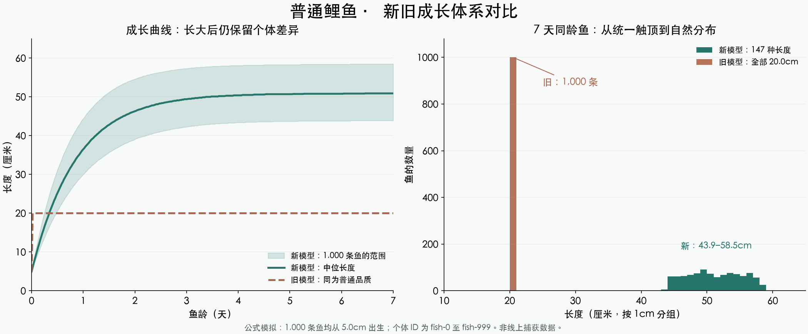

# 鱼体成长与长度显示

日期：2026-11-01。状态：本页为旧设计，代码已实现、尚未部署；设计方向已由[45 米巨物成长方案](45米巨物成长重设计-2026-11-01.md)替代，新方案尚未接入业务。以下为游戏设计数值，不是自然界生长速度的科学结论。

## 目标与选择

按用户选择，以鱼种决定体型，品质增加同种鱼的潜力。同种、同品质、同龄鱼也要有真实且持久的个体差异，避免全部停在 0.2m、0.35m、0.8m。

## 新旧对比

模拟 1,000 条普通鲤鱼，均从 5.0cm 出生。旧默认模型在同龄 7 天时全部为 20.0cm；新模型有 147 种长度，范围 43.9-58.5cm。左图阴影表示个体范围，右图按 1cm 分组统计。此图只对比成长公式，不包含捕捞、补鱼与脱钩；不是玩家线上数据。

总预览入口：根目录 `现行预览.html#fish-growth`。图表数据与复现脚本在 `fish-growth-2026-11-01/`。

## 新成长规则

权威参数在 `shared/fishGrowth.ts`。

| 品质 | 鱼种参考上限倍率 | 剩余生长空间达到 90% 的基准天数 |
| --- | ---: | ---: |
| 普通 | 0.65 | 2 |
| 优良 | 0.80 | 3 |
| 稀有 | 1.00 | 4 |
| 史诗 | 1.15 | 5 |
| 传说 | 1.30 | 7 |
| 神话 | 1.50 | 10 |
| 至尊 | 1.80 | 14 |

- 鱼种品质潜力 = 鱼种 `typicalMaxM` × 品质倍率，最后受 50m 技术硬上限约束。当前种库最高潜力为中华鲟至尊 6.3m，不再把所有至尊鱼推到 40m。
- 每条鱼再获得 75%-100% 的个体潜力系数，以及基准天数 85%-115% 的成长时间系数。两者分别从永久实体 ID 计算，重启、离线补算、生态更新都不会重抽。
- 出生长度随机为个体潜力的 12%-28%，最小 2cm。大鱼种幼鱼与小鱼种幼鱼不再共用 2-10cm 的尺寸桶。
- 长度 `L(t) = L出生 + (L个体上限 - L出生) × [1 - exp(-ln(10) × t / T90)]`。
- 前期较快、后期放缓；达到 90% 后仍缓慢成长，不设置统一的“第 7 天强制满长”。所有长度保存为米，精度 0.001m。
- 已有的回鱼、脱钩成长保留，但受个体上限约束，且正常更新不会让已获得的长度倒退。

示例：普通鲤鱼的鱼种品质潜力为 58.5cm，不同个体的最终潜力约为 43.9-58.5cm。普通泥鳅潜力上界约 16.3cm；普通草鱼为 78.0cm。鱼种自身的品质出生带保持有效，不因为尺寸大自动升品。

## 长度显示

数据仍以米保存，显示由 TypeScript `formatFishSize` 和 Unity `DesktopGameData.FormatFishSize` 统一完成。

| 范围 | 显示精度 | 示例 |
| --- | --- | --- |
| 小于 1m | 0.1cm | 0.123m → 12.3cm；0.999m → 99.9cm |
| 1m 至不足 10m | 0.01m | 1m → 1.00m；1.234m → 1.23m |
| 10m 及以上 | 0.1m | 10m → 10.0m；12.35m → 12.4m |

以显示精度处理进位边界：0.9995m 进位为 1.00m；9.995m 进位为 10.0m。使用整数毫米转换，避免二进制浮点数导致 9.995 显示为 9.99m，或出现 10.00m。桌面端使用固定小数点，不随操作系统区域改变。

已接入：移动/网页端共用长度格式化、管理鱼塘网格、后台事件摘要、服务端钓获/回鱼文案，以及 Unity 钓获提示、背包、排行榜、图鉴、个人展示、相册、社交分享和本次出行结算。

## 存量与兼容

新增幂等迁移 `INDIVIDUAL_FISH_GROWTH_V1`。下次服务启动时，仅对尚在鱼塘的鱼按出生时间、出生尺寸、鱼种和永久 ID 重算自然长度，因此旧塘鱼可能变长或缩短。背包、图鉴、相册、历史排行和已锁定钓获记录不回写。

旧的 `migrateFishingV2` 原本每次启动都按固定尺寸帽自动升品；新迁移完成后禁止此路径，防止新的普通大鱼在下一次重启时被错误升品。

旧 `QUALITY_SIZE_CAP`、JSON 中的 `sizeCapM` 以及无鱼种的 `getQualityMaxSize` 仅保留兼容接口；运行鱼体生长、出生、回鱼、脱钩成长均传鱼种和个体 ID。咬钩尺寸归一化使用鱼种品质潜力，避免小鱼种始终被当作未长大。

本次未改变咬钩基础倍率、鱼饵加成、脱钩曲线、睡眠和断线规则。尺寸变化会间接影响体重、售价、回鱼门槛、鱼竿损坏及收杆时长；需结合后续整体经济/挂机节奏调参，不以本次分布模拟替代线上产量验证。

## 验证

- 新增成长/精度/迁移测试：20 项通过，包含多鱼种潜力、个体稳定性、渐近成长、重复 tick、回溯时间、0.1cm 精度、单位边界、存量迁移幂等及重启后不错误升品。
- 钓鱼展示、钓获身份、睡眠相关定向回归：合计 57 项通过（含新增 20 项）。
- 服务端全量：112 项中 111 项通过；原有 `phaseCodes.test.ts` 仍按 9 阶段断言，当前已有 10 阶段，1 项失败。该文件及阶段定义未被本次修改。
- Unity EditMode：长度格式化与分享界面相关 17 项通过。最新重跑测试报告为 17/17 通过，编辑器进程退出码为 0。
- 补充脚本：`verify-feat-return-01.ts` 通过；旧 `a0-verify.ts` 的新增成长检查通过，但补鱼间隔、空浮漂文件检查、幼鱼脱钩率仍有与现行实现不一致的旧断言，整份脚本未通过。
- TypeScript：shared 构建通过；与修改前 HEAD 对照后，server/mobile/admin-web 未新增诊断。其既有类型/依赖错误不属于本次修复范围。
- 图表页面：已通过 Chrome 检查，总预览 `#fish-growth` 路由、图片加载正常，无页面脚本错误与横向溢出；截图在测试输出目录的 `report-preview.png`。
- 对照样本：1,000 条普通鲤鱼，同为出生 5cm、鱼龄 7 天；新模型出现 147 种长度，范围 43.9-58.5cm，中位 50.9cm，P10/P90 为 45.4/56.7cm。此为公式分布示例，不是玩家捕获样本，也不代表整个鱼塘的品质/年龄结构。

详细测试输出：`/Users/red/Desktop/fish/output/growth-v3-verification/`。
